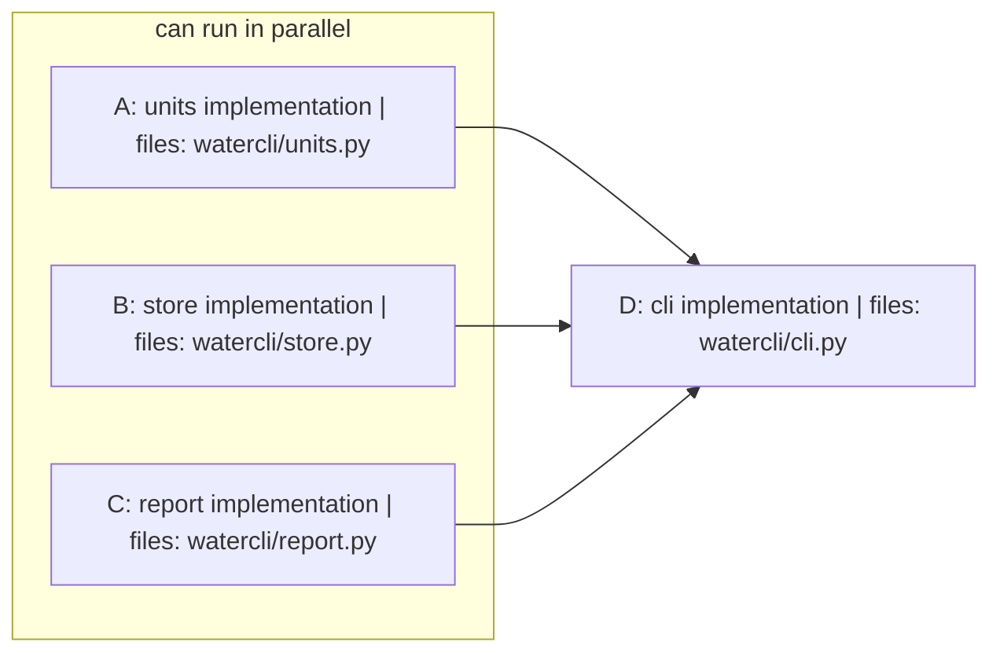

# Water CLI planner dogfood — 2026-10-14

Local planning and publication completed. The final structural quality card is **100/100**, the oracle audit passes, and the integrated oracle passes **18 unittest tests**, including separate real CLI processes. This proves a planning fixture and its tests; no product workers were launched.

**User proxy, not the owner; local only.** Opus wrote the supplied answers as the user proxy. All recorded approvals use `by="opus-user-proxy"` and statements beginning `Opus (user proxy):`. No claim of Oren approval, commit, push, deployment, release, or shipped product.

Assignment: `C:\Users\oren\claude-worktrees\_assignments\dogfood2.md`. Worktree: `C:\Users\oren\claude-worktrees\v3-dogfood2`; branch `codex/claude-v3-dogfood2`. Owner surface: this new fixture, its regression test and this demo. Harness source modules remain unchanged.

## Method and authority

Python 3.12.7, `uv run --frozen --offline`. Onboarding health passed Python/uv/port/workspace checks and warned that repo wiring had not been applied. This assignment explicitly uses the new core `PlanStore`/planner tools in-process; it does not use the legacy prepare-run lifecycle. No wiring repair or provider configuration edits were needed.

The fixture workspace is `fixtures/dogfood-watercli/`. Its ignored `.codex-harness/plan.sqlite3` is the planning authority. `harness_plan_start`, `harness_understanding_card`, and `harness_decision_card` ran through `PlannerServer.call_tool`; `ask`, `answer`, `approve`, `advance`, finding resolution, export and publish used the supported store API. Source contracts were read before authoring. All eight advances are actual store events, with no skipped gate or manual SQL state repair.

The first exact banner/card response was not retained after an author-helper exception. The retrospective entry summaries in `planning-record.json` are labeled accordingly; SQLite events, V1 fields, questions and approvals establish the actual entry and card. The helper was repaired and resumed at requirements in the same store; no history was erased.

## Questions and assignment-supplied answers

Each row was recorded with actual `ask` and `answer` calls before the vision lock. These are the supplied proxy answers, not a newly conducted owner conversation.

| Question | Recorded answer |
| --- | --- |
| Who is it for? | Opus (user proxy): One person, on their own computer. |
| Units? | Opus (user proxy): Milliliters internally. Accept ml or oz; 1 oz = 29.5735 ml, rounded to the nearest ml. |
| Daily goal? | Opus (user proxy): Configurable, default 2000 ml. Show progress as a percentage. |
| Storage? | Opus (user proxy): Local JSON. WATER_CLI_DATA configures its path; default ./water.json. |
| Commands? | Opus (user proxy): add <amount> [unit], today, history [days] (default 7), goal [ml], undo (last entry of today). |
| Time zone and day boundary? | Opus (user proxy): The local calendar day. |
| Which edge cases matter? | Opus (user proxy): Reject zero/negative amounts and unknown units. Missing/corrupt files: clear errors, never crash or silent data loss. Empty undo is graceful. |
| What is out of scope? | Opus (user proxy): GUI, reminders, sync, multiple users. |
| Tech stack preference? | Opus (user proxy): Python 3.11+ standard library only; unittest. |

## Understanding and uplifts

Understanding: one person quickly adds water in ml or oz, sees daily progress toward a configurable goal, and trusts local JSON persistence. The first moment is an explicit one-time seed file (`{"goal_ml":2000,"entries":[]}`), `python -m watercli.cli add 250`, then `today` showing 12.5%. The missing-file rule applies to first use, so the CLI explains a missing file rather than silently creating or resetting it.

| Proposal | Disposition | Reason |
| --- | --- | --- |
| --json output | Deferred | Proposed best-practice uplift. Disposition: deferred by planner pending a proxy answer. Machine-readable output helps scripting, but introduces an output contract the proxy did not request. |
| Streak count | Deferred | Proposed best-practice uplift. Disposition: deferred by planner pending a proxy answer. Motivation can help habits, but adds calendar semantics beyond intake tracking. |
| Data-file backup on write | Deferred | Proposed best-practice uplift. Disposition: deferred by planner pending a proxy answer. Backups help manual recovery, but add retention and disk-use decisions; atomic replacement protects failed writes now. |

No uplift acceptance was supplied. The planner deferred these proposals instead of attributing invented answers to Opus. The vision lock preserves the supplied scope and explicitly leaves unanswered uplifts deferred. Atomic replacement is an implementation detail supporting the accepted no-data-loss requirement; it does not introduce backup retention.

The tech-stack decision records two options with pros/cons: Python 3.11+ stdlib (selected per proxy preference) and Python plus Click (extra dependency, conflicts with preference). Planner-owned detail choices are recorded in D_CONTRACT: half-up ml rounding, current goal for historical progress, sequential command invocation, explicit initial seed and atomic replacement.

## Gate and phase log

Approval gates are revision-bound. Their exact statements follow; the remaining transitions are structural gates, not additional user approvals.

- **align**, `3f252cc3abbc`, by `opus-user-proxy`: Opus (user proxy): The supplied answers confirm this understanding: one person, local water tracking, five commands, configurable goal/path and explicit storage errors. This is proxy confirmation, not Oren's approval.
- **vision-lock**, `16da2416d431`, by `opus-user-proxy`: Opus (user proxy): Lock the supplied water-cli scope: single person, five commands, ml/oz, local JSON/day, configurable 2000 ml goal, clear errors, stdlib Python and unittest; GUI/reminders/sync/multiple users excluded. Unanswered uplifts stay deferred. Approval derives from the delegated assignment, not the owner.

| Transition | Revision | Gate evidence |
| --- | --- | --- |
| align → expand | `3f252cc3abbc` | Confirmed understanding; nine proxy Q/A records. |
| expand → vision-lock | `16da2416d431` | Three proposed uplifts recorded deferred. |
| vision-lock → features | `16da2416d431` | Proxy vision-lock approval matches the locked revision. |
| features → requirements | `d71443b5f6d6` | Four features and four stories recorded. |
| requirements → tech-stack | `b30cd62d22af` | All eleven requirements have planner test ancestry. |
| tech-stack → plan | `92f3ab8fdf94` | Options/trade-offs and four designs recorded. |
| plan → roundtable | `acdd28d6ac7d` | All requirements have bead ancestry; template-bound manifest passes graph loading. |
| roundtable → publish | `a6ea2144ee9c` | Two real cross-provider rounds; every finding addressed; zero open questions. Oracle audit passes. |

There are no approval records attributed to a generic user or the owner. `phaseLog.statement` is null on structural transitions because the actual approval statements live in the separate approvals table. Publication stopped at publish; execute and accept were not entered.

## Quality before and after review

Before roundtable (roundtable phase; publication checks not yet applicable):

```text
Planner quality: 83/100
✅ Did we expand the idea, and ask enough questions to align?
✅ Is the idea mapped correctly into features, stories and requirements?
✅ Is there a clear spine from vision to tasks to proof?
✅ Are beads spread for concurrency and ownership?
❌ Did the cross-subscription roundtable run, and was it helpful?
○ Is the process efficient, or full of guesswork?
✅ Is it repeatable and deterministic?
○ Is the plan published with correct context for each worker?
- Run and record the cross-provider roundtable.
```

After all findings were addressed (still roundtable; publication checks not yet applicable):

```text
Planner quality: 100/100
✅ Did we expand the idea, and ask enough questions to align?
✅ Is the idea mapped correctly into features, stories and requirements?
✅ Is there a clear spine from vision to tasks to proof?
✅ Are beads spread for concurrency and ownership?
✅ Did the cross-subscription roundtable run, and was it helpful?
○ Is the process efficient, or full of guesswork?
✅ Is it repeatable and deterministic?
○ Is the plan published with correct context for each worker?
```

After local publication (all checks applicable):

```text
Planner quality: 100/100
✅ Did we expand the idea, and ask enough questions to align?
✅ Is the idea mapped correctly into features, stories and requirements?
✅ Is there a clear spine from vision to tasks to proof?
✅ Are beads spread for concurrency and ownership?
✅ Did the cross-subscription roundtable run, and was it helpful?
✅ Is the process efficient, or full of guesswork?
✅ Is it repeatable and deterministic?
✅ Is the plan published with correct context for each worker?
```

**Score limit:** 100 is the deterministic structural checklist result. It is not a product-delivery or exact-final-revision reviewer verdict. The latest review examined `423df79173589eb512e030248e1e2c680c1c373c29ebcc2975cd6a9d73adfae9`; the final spine is `a6ea2144ee9cf59d42b0d3d2b738ce981008241474481b6d6ed998a868d326f8`. The second-round precision/window findings were resolved afterward and verified by tests; no third review was run.

## Real roundtable

Both providers ran twice, with no mocks: desktop Codex `gpt-6.1-sol` at medium effort, and Claude `claude-haiku-4-5-20251001`. Both rounds have `crossSubscription: true`; all four processes exited 0 and all four final response arrays parsed with zero invalid findings. The oracle was never in a reviewer packet or a worker template. No worker was launched.

Codex executable: `C:\Users\oren\AppData\Local\OpenAI\Codex\bin\9614f1d9b40d9c4f\codex.exe`. Claude: `C:\Users\oren\.local\bin\claude.exe`. Reviewers received only the canonical rendered plan/JSON packet in empty temporary directories and a read-only assignment. Normal protections were retained, with no bypass flags. The injected real subprocess runner used supported stdin for the large packets; raw process streams remain ignored locally under the fixture `.codex-harness/review-output/`.

### Round 1

Roundtable: plan acdd28d6ac7d
Cross-subscription: true
- codex-reviewer: codex / gpt-6.1-sol; 2 findings, 0 invalid; exit 0
- claude-reviewer: claude / claude-haiku-4-5-20251001; 4 findings, 0 invalid; exit 0

Major:
- plan (6a025dc2928e4b72baf7357bb6bfe555, rejected): The canonical validation arguments end with '-p' without a pattern. This is an incomplete unittest command, so the declared plan-wide validation cannot run as written. Suggestion: Use explicit executable and arguments, such as python -B -m unittest discover -s tests -p "test_*.py", to run all unit and end-to-end tests.
  Resolution: The manifest validation array is an intentional argv prefix. core.dispatch._validate prepends sys.executable and appends proofModule, satisfying -p. All four real bead validations pass against the oracle. D_CONTRACT now explicitly documents this transport contract.
- D (bec70558955e4648968e8d0531552eb3, resolved): D owns R11 but its acceptance runs only test_cli.py. T_E2E names the real separate-process journey, yet has no bead parent or explicit execution owner. All four beads could pass their stated acceptance without proving persistence across real CLI processes. Suggestion: Make D's integration acceptance explicitly require test_end_to_end.py after A, B and C are integrated, and link T_E2E to D. Require the real modules, separate processes and temporary data file specified by R11.
  Resolution: D now owns the final real-module subprocess integration acceptance; T_E2E links to D, while sample.integration independently declares the controller proof. Test suite checks the real producer-to-persistence-to-consumer path.
- V1 (612f1b79de6345aa84ced76a9cd57c5a, rejected): Plan explicitly states 'Oren did not approve this plan' but proceeds with execution. This is a critical risk to project alignment and success. Suggestion: Obtain explicit user approval before proceeding, or document why the plan is proceeding without approval and acknowledge the implementation risk.
  Resolution: The explicit dogfood assignment authorizes user-proxy planning and local publication. No worker execution or owner approval is claimed; V1 now states this boundary. Requiring unavailable owner approval would contradict the assignment.
- R11 (7a7a14144d784229a8f688a4d2d62275, resolved): E2E test scenario only adds entries on the same calendar day. R8 requires history to include 'zero-intake dates across month/year boundaries', but the single-day scenario cannot verify this requirement. Suggestion: Extend R11's integration scenario to span multiple days (add on day 1, skip day 2, add on day 3) and verify history output correctly shows empty days between entries.
  Resolution: Added a separate real-process multi-day history scenario with pre-seeded older intake, empty yesterday and intake today; added a report unit assertion across Dec31/Jan1. R11 now names both checks.
- R9 (dc6a182ef41d41fe81b67406d82e6e7b, resolved): WATER_CLI_DATA override path handling is not explicitly specified. R9 mentions WATER_CLI_DATA overrides ./water.json, but R4's error contract only specifies the default file. Missing/unreadable WATER_CLI_DATA paths must follow the same DataError handling. Suggestion: Clarify in R9 or R4 that WATER_CLI_DATA paths are subject to identical error handling as ./water.json (missing files, unreadable, invalid JSON, corrupt schema all raise DataError).
  Resolution: R9 explicitly applies R4 error handling to WATER_CLI_DATA overrides. The real CLI journey already proves missing/corrupt override paths return2 and preserve data.

Minor:
- R9 (3481c42a475d4efca7b3830c8a6225a0, resolved): R9 lists 'Goal: N ml.' as a possible output but doesn't specify when it's printed. R6 clarifies behavior (goal shows current, goal <ml> sets), but R9's output spec should explicitly state which commands produce which output. Suggestion: In R9's output list, explicitly state 'Goal: N ml.' is printed by both 'goal' (show) and 'goal <ml>' (set) commands, or clarify the actual outputs expected.
  Resolution: R9 now maps every output to its command and explicitly states both goal show and goal set print Goal: N ml.; existing unit and separate-process tests prove it.

Next:
- Recheck planner quality before advancing to publish.

### Round 2

Roundtable: plan 423df7917358
Cross-subscription: true
- codex-reviewer: codex / gpt-6.1-sol; 2 findings, 0 invalid; exit 0
- claude-reviewer: claude / claude-haiku-4-5-20251001; 0 findings, 0 invalid; exit 0

Major:
- R8 (2f54e05fcd18431da00e2af50c127439, resolved): History accepts any positive integer window, but sufficiently large windows extend before Python's minimum calendar date. Date arithmetic can raise OverflowError, which DES_CLI does not handle, violating R10's traceback-free error contract. Suggestion: Define windows extending before date.min as invalid, reject them with ValueError before date arithmetic, and verify that the real CLI returns 2 with empty stdout, one-line stderr and unchanged data.
  Resolution: R8 now requires a pre-arithmetic date.min bound; added unit proofs for minimum-date and huge-integer windows and a real CLI rejection that preserves file bytes.

Minor:
- R1 (2d653ea6a9f147c29a618b935c8b8420, resolved): Exact conversion is required without an amount bound or Decimal precision policy. Decimal multiplication uses context precision, so long finite inputs can lose precision before integer rounding; large exponents can also raise exceptions outside the promised ValueError contract. Suggestion: Specify supported numeric limits or sufficient local Decimal precision for exact conversion. Normalize unsupported numeric inputs to ValueError and add focused rounding and numeric-limit proofs.
  Resolution: R1 now specifies local Decimal precision based on input coefficient length and R2 normalizes Decimal failures. Added long exact half-up rounding and overflow rejection tests; corrected the oracle accordingly.

Next:
- Recheck planner quality before advancing to publish.

Eight findings total: six resolved, two rejected with reasons. Round 1 produced six; round 2 produced two. Claude returned an empty finding array in round 2. No findings remain open. The final requirement, test and oracle repairs retain all accepted proxy scope.

## Test audit and fixture checks

Test audit: PASS
No findings or newly failing proofs.

The audit used a temporary Git tree of the actual failing template (`56167c4ada5d9ccd5345adc320bfb7e31bcb1499`) made with `git init`, `git add`, `git write-tree`. No commit was created and the worktree index was untouched. All four beads were affected because this is an initial plan. The oracle overlay satisfied all four bead proofs; no findings or newly failing proofs remain. This is initial test satisfiability, not a changed-requirements regression audit.

The audit currently omits the integration module. Therefore the planner additionally overlaid the oracle into an isolated template copy and ran all tests: **18 tests, exit 0**. That includes real separate-process CLI use, persistence, invalid inputs, missing/corrupt file preservation, empty undo, multi-day empty-day history, numeric rounding, and calendar window rejection.

Regression command: `uv run --frozen --offline python -m pytest tests/python/devx/test_dogfood_watercli_fixture.py -q`. Result: **9 passed**. It checks failing stubs; each owner-only replacement passing precisely its own proof; the fully integrated oracle; graph loading; protected file binding; generated view equality; hidden oracle; and a wrong oz conversion caught by unit/e2e tests. Ruff checks on the new Python files pass with E501 excluded for long authored requirement strings.

## Published plan and bead DAG

Spine: `a6ea2144ee9cf59d42b0d3d2b738ce981008241474481b6d6ed998a868d326f8`. Content-bound published manifest: `6d3c6981ab55f626fdbadc3bfcb20e589ec331396c3a076f08ca532e67b81f97`. The different identifiers are intentional: the published identity binds protected template documents and tests as well as the spine.

Compilation used `python -m codex_harness.core.spine compile fixtures/dogfood-watercli/spine.json fixtures/dogfood-watercli/sample.json --template fixtures/dogfood-watercli/template` inside `uv run --frozen --offline`. The store publication manifest equals that compiled manifest. Frozen snapshot and generated views are under `fixtures/dogfood-watercli/published/`.

Beads (4): A, B, C, D
Wave 1 (can run in parallel): A, B, C
Wave 2 (single bead): D
Open assumptions: 0



Four disjoint owned production files: A units, B storage, C report, D CLI. Planner owns tests and documents. D depends on A/B/C and owns final integration acceptance; the compiled integration module is `test_end_to_end.py`.

## Harness findings and practical exit checks

The assignment prohibits existing Harness source changes. This demo is the permitted discovery record for this lane; existing ledgers outside its allowed write scope were not edited. These findings are follow-ups, not undisclosed fixture failures.

| ID / likely owner | Evidence | Disposition and exit check |
| --- | --- | --- |
| DF2-H1 / `core.roundtable._run` | Default positional packets measured 34098 and 38547 characters before flags/executable; exceeding the Windows native command-line limit. Injected real runner used supported stdin and preserved normal provider arguments. | No Harness patch per assignment; measured limitation, default failure inferred rather than launching an extra reviewer. Exit: Default run_roundtable transports this exact large packet successfully on Windows with real reviewer process; no bypass flags. |
| DF2-H2 / `core.plan_quality._roundtable` | Final quality100 with latest reviewed spine423df7917358 and final spinea6ea2144ee9c; the query counts latest successful reviewer runs without comparing their plan_revision to current spine. | Reproduced in this final report; score is structural, not exact-revision review certification. Exit: Changing a reviewed requirement makes roundtable quality explicitly stale until matching revision review exists. |
| DF2-H3 / `core.plan_store.status` | At published_revision6d3c6981ab55, status still returns pending_gate=current-revision-published after successful publication. It projects a gate name, not remaining work. | Reproduced; status wording only. Existing operator docs identify this owner boundary. Exit: Satisfied current publication is projected as satisfied with no implied pending publication. |
| DF2-L1 / `core.test_audit.audit_revised_tests` | Oracle loop audits affected bead proof modules only, not manifest.integration.proofModule. | Audit coverage limitation; separately ran all18 tests including real-process e2e. Exit: A failing oracle integration module is either audited or the report explicitly states integration was not checked. |

The incomplete-validation-prefix reviewer conclusion is explicitly superseded: Harness appends the proof module and executable; the real oracle bead runs pass. The owner-approval finding is explicitly rejected because the assignment authorizes proxy planning and local export, and this lane never launches workers.

## Files and next boundary

- `fixtures/dogfood-watercli/spine.json`, `sample.json`, `planning-record.json`, `author_plan.py` (initial authoring and gated review/finish helper).
- `template/`: four implementation stubs, package marker, five planner-owned unittest modules, generated VISION/REQUIREMENTS/PLAN/TRACE views.
- `reference/watercli/`: four correct oracle modules plus package marker, solely for planner test auditing.
- `published/revisions/<publishedRevision>.json` and `published/<publishedRevision>/`: frozen snapshot, manifest and four generated views.
- `tests/python/devx/test_dogfood_watercli_fixture.py` and this demo.

The last proven transition is local publication of an audited plan. The next unproven step is real worker execution and controller-owned integration against this frozen context; it is outside this assignment. No shipping, provider worker completion or live-product proof is claimed.
