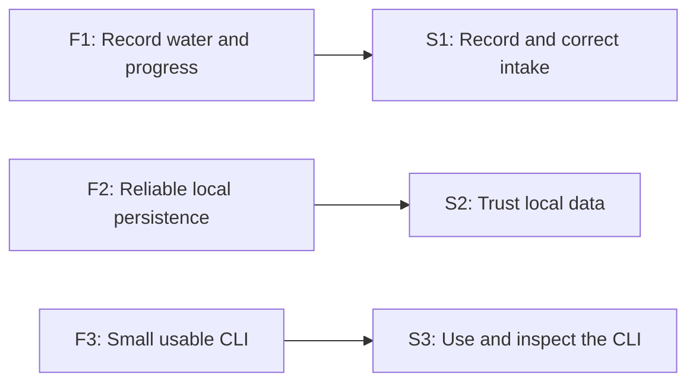
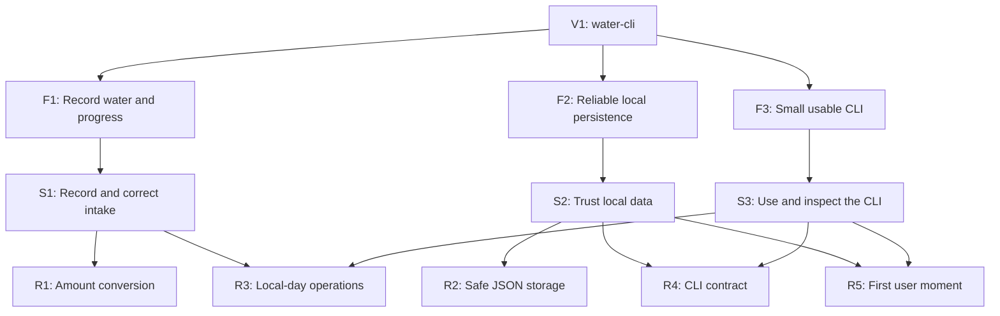
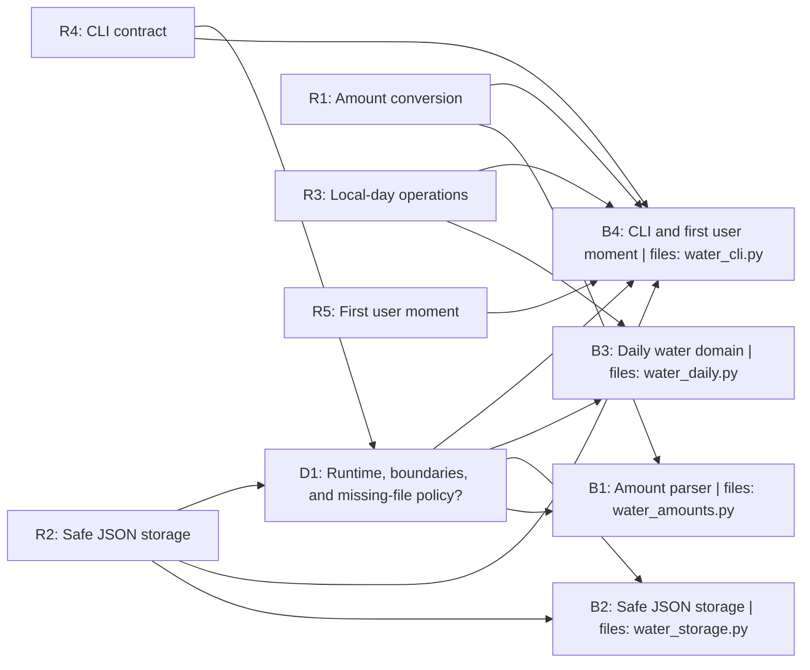
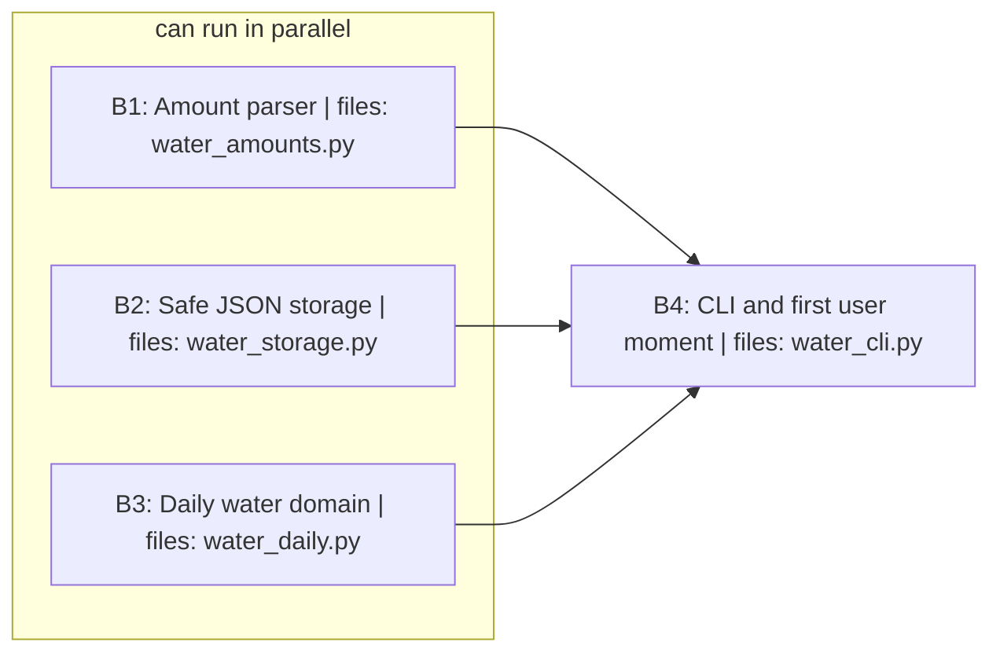
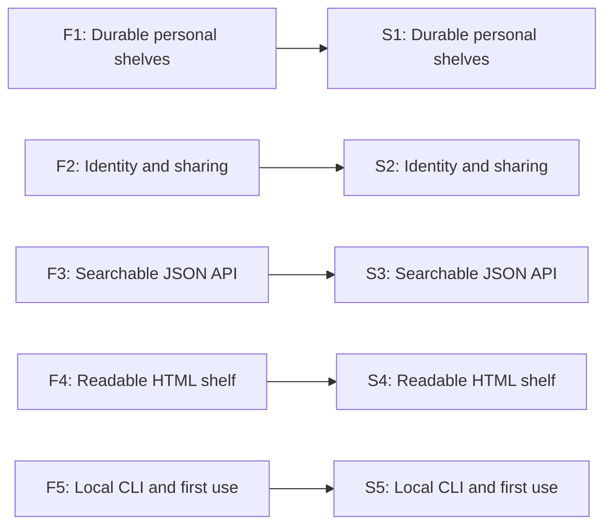
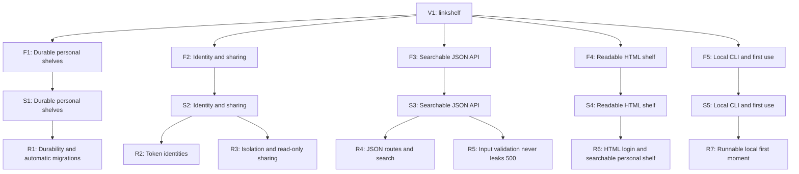
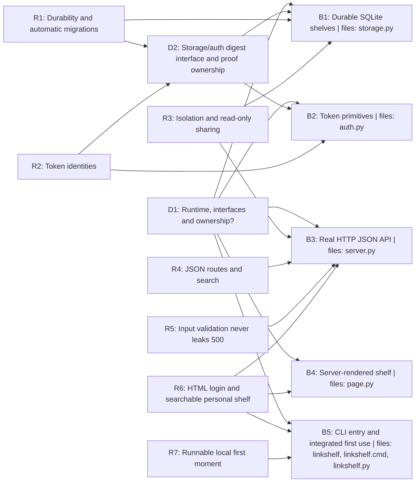
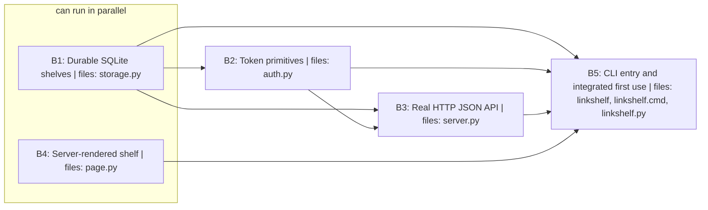

# Planner chat gallery

Captured from real water-cli and LinkShelf planning data. All tools ran against isolated temporary workspace copies. No providers were launched and no original store was opened by PlanStore.

Original sources: `C:\Users\oren\claude-worktrees\_runs\watercli-replay3\project` and `C:\Users\oren\claude-worktrees\_runs\linkshelf\project`. Each `.codex-harness/plan.sqlite3` (plus existing WAL/SHM companions), template and generated plan files was copied before use. Every MCP call starts from its own copy of the same snapshot.

“Before” is the original response text, verbatim, including temporary paths, IDs, existing Markdown and JSON. HTML `<pre>` preserves exact newlines (encoded as `&#10;` in this compact source). Expand each entry to inspect the full response. Machine JSON is separate from the chat projection.

Mutation calls replay stored vision, decision, question or assumption data on copies. Empty confirmation/acceptance statements intentionally show refusal rather than inventing user approval. Acceptance run/review use a missing temporary repository and review has an empty reviewer list, so no code or providers can run. Mail stays in the isolated gallery workspace; missing-mail ack/reply demonstrate refusal. BLOCKED denotes the real tool error response, not a successful operation.

Both snapshots are at phase 11/11 (accept), with historical proxy approval. Their current acceptance projections are invalid (`acceptance-scenarios-required`); this gallery does not certify a product or re-record user acceptance.

## Before: every planner view and MCP text response

### water-cli

Standalone views (real snapshot values; not complete tool responses):

<details><summary>banner</summary><pre>🧭 Harness Plan Mode: water-cli · Phase 11/11: Accept&#10;Next: Review whether the delivered product achieves the locked vision.&#10;To pause, say &#x27;pause plan&#x27;.</pre></details>
<details><summary>status_line</summary><pre>[plan 25245b1ae96f · phase accept · open questions 0 · pending: acceptance:scenarios-review-approval]</pre></details>
<details><summary>phase_tracker</summary><pre>✅ Align · ✅ Expand · ✅ Vision Lock · ✅ Features · ✅ Requirements · ✅ Tech Stack · ✅ Plan · ✅ Roundtable · ✅ Publish · ✅ Execute · ⏳ Accept</pre></details>
<details><summary>understanding_card</summary><pre>Here&#x27;s what I understood&#10;Vision: A tiny CLI that tracks daily water intake reliably on one computer.&#10;Users: One person on their own computer.&#10;First user moment: From a clean install, today shows 0 ml (0%); add 250 ml creates the data file and today shows 250 ml (12.5%).&#10;Scope in: add ml or oz: 29.5735 ml per oz, rounded to nearest ml; today total and goal percentage; history default 7 local calendar days, configurable positive days; goal default 2000 ml, configurable positive integer ml; undo last entry of today, graceful when none; local JSON via WATER_CLI_DATA, default ./water.json; safe first use: absent file in an existing directory is empty; prior deletion is indistinguishable without separate metadata; clear errors for nonpositive amounts, unknown units, corrupt data or missing parent directory; no crashes or silent data loss&#10;Scope out: GUI, reminders, sync, multiple users, detection of previously deleted JSON without separate metadata&#10;Assumptions:&#10;- The proxy delegates the indistinguishable-file choice. No hidden sentinel: missing file in existing directory means empty state; no creation on read, only add or goal set. Missing parent is always an error.&#10;Confirm, or tell me what&#x27;s wrong.</pre></details>
<details><summary>decision_card</summary><pre>Decision D1: Runtime, boundaries, and missing-file policy?&#10;Linked to: R2, R4, V1&#10;- Python stdlib, four modules, no hidden sentinel&#10;  Pros: Matches proxy preference; three independently testable modules plus CLI; effortless first use with explicit deletion-detection limitation&#10;  Cons: Requires Python 3.11+; absent JSON cannot distinguish later deletion&#10;Recommendation: Python stdlib, four modules, no hidden sentinel&#10;Reply with an option name (Python stdlib, four modules, no hidden sentinel), or explain the change you want.&#10;Chosen: Python stdlib, four modules, no hidden sentinel&#10;Rationale: Python 3.11+ stdlib and unittest match the proxy preference; the explicit absent-file decision preserves first use without hidden state; four modules allow three parallel owners and one integration owner.</pre></details>
<details><summary>change_digest</summary><pre>What changed&#10;Changed nodes: none&#10;Affected nodes: none&#10;Affected beads: none&#10;Untouched beads: B1, B2, B3, B4&#10;Affected tests: none&#10;Stale docs: none</pre></details>
<details><summary>publish_summary</summary><pre>Beads (4): B1, B2, B3, B4&#10;Wave 1 (can run in parallel): B1, B2, B3&#10;Wave 2 (single bead): B4&#10;Open assumptions: 0</pre></details>

All 27 MCP tools:

<details><summary>harness_show_node — returned</summary><pre>[plan 25245b1ae96f · phase accept · open questions 0 · pending: acceptance:scenarios-review-approval]&#10;✅ Align · ✅ Expand · ✅ Vision Lock · ✅ Features · ✅ Requirements · ✅ Tech Stack · ✅ Plan · ✅ Roundtable · ✅ Publish · ✅ Execute · ⏳ Accept&#10;V1 · vision · water-cli&#10;Detail: A tiny CLI that tracks daily water intake reliably on one computer.&#10;Fields: {&quot;assumptions&quot;: [&quot;The proxy delegates the indistinguishable-file choice. No hidden sentinel: missing file in existing directory means empty state; no creation on read, only add or goal set. Missing parent is always an error.&quot;], &quot;first_user_moment&quot;: &quot;From a clean install, today shows 0 ml (0%); add 250 ml creates the data file and today shows 250 ml (12.5%).&quot;, &quot;requirementFiles&quot;: [&quot;tests_cli&quot;], &quot;scope_in&quot;: [&quot;add ml or oz: 29.5735 ml per oz, rounded to nearest ml&quot;, &quot;today total and goal percentage&quot;, &quot;history default 7 local calendar days, configurable positive days&quot;, &quot;goal default 2000 ml, configurable positive integer ml&quot;, &quot;undo last entry of today, graceful when none&quot;, &quot;local JSON via WATER_CLI_DATA, default ./water.json&quot;, &quot;safe first use: absent file in an existing directory is empty; prior deletion is indistinguishable without separate metadata&quot;, &quot;clear errors for nonpositive amounts, unknown units, corrupt data or missing parent directory; no crashes or silent data loss&quot;], &quot;scope_out&quot;: &quot;GUI, reminders, sync, multiple users, detection of previously deleted JSON without separate metadata&quot;, &quot;users&quot;: &quot;One person on their own computer.&quot;, &quot;validation&quot;: [&quot;-m&quot;, &quot;unittest&quot;, &quot;discover&quot;, &quot;-s&quot;, &quot;tests_cli&quot;, &quot;-p&quot;], &quot;vision&quot;: &quot;A tiny CLI that tracks daily water intake reliably on one computer.&quot;}&#10;Parents: &#10;Children: D1, F1, F2, F3&#10;Next: harness_plan_status</pre></details>
<details><summary>harness_nodes — returned</summary><pre>[plan 25245b1ae96f · phase accept · open questions 0 · pending: acceptance:scenarios-review-approval]&#10;✅ Align · ✅ Expand · ✅ Vision Lock · ✅ Features · ✅ Requirements · ✅ Tech Stack · ✅ Plan · ✅ Roundtable · ✅ Publish · ✅ Execute · ⏳ Accept&#10;F1 · feature · Record water and progress&#10;F2 · feature · Reliable local persistence&#10;F3 · feature · Small usable CLI&#10;Next: harness_plan_status</pre></details>
<details><summary>harness_resolve_finding — returned</summary><pre>[plan 25245b1ae96f · phase accept · open questions 0 · pending: acceptance:scenarios-review-approval]&#10;✅ Align · ✅ Expand · ✅ Vision Lock · ✅ Features · ✅ Requirements · ✅ Tech Stack · ✅ Plan · ✅ Roundtable · ✅ Publish · ✅ Execute · ⏳ Accept&#10;Finding AF-4158a88ac606427c9a7b34832df70c96: resolved</pre></details>
<details><summary>harness_accept_scenarios — returned</summary><pre>[plan 25245b1ae96f · phase accept · open questions 0 · pending: acceptance:scenarios-review-approval]&#10;✅ Align · ✅ Expand · ✅ Vision Lock · ✅ Features · ✅ Requirements · ✅ Tech Stack · ✅ Plan · ✅ Roundtable · ✅ Publish · ✅ Execute · ⏳ Accept&#10;{&#10;  &quot;scenarios&quot;: [&#10;    {&#10;      &quot;expect&quot;: {&#10;        &quot;exit&quot;: 0,&#10;        &quot;stdout&quot;: &quot;Windows failed atomic replacement preserved bytes and cleaned temporary files&quot;&#10;      },&#10;      &quot;given&quot;: &quot;Empty cwd and fresh HOME/data. Install integrated CLI read-only; all data setup is executed inside the scenario.&quot;,&#10;      &quot;id&quot;: &quot;failed-atomic-replacement&quot;,&#10;      &quot;steps&quot;: [&#10;        {&#10;          &quot;command&quot;: &quot;\&quot;{python}\&quot; -c \&quot;import shutil; shutil.copytree(r&#x27;{repo}&#x27;, &#x27;installed&#x27;); print(&#x27;Installed four-module CLI&#x27;)\&quot;&quot;,&#10;          &quot;expect&quot;: {&#10;            &quot;exit&quot;: 0,&#10;            &quot;stdout&quot;: &quot;Installed four-module CLI&quot;&#10;          }&#10;        },&#10;        {&#10;          &quot;command&quot;: &quot;\&quot;{python}\&quot; -c \&quot;import base64;exec(base64.b64decode(&#x27;aW1wb3J0IG9zLHBhdGhsaWIsc3RhdCxzdWJwcm9jZXNzLHN5cwphc3NlcnQgb3MubmFtZT09J250JywnVGhpcyBzY2VuYXJpbyBkZW1vbnN0cmF0ZXMgdGhlIFdpbmRvd3MgcmVhZC1vbmx5IHJlcGxhY2VtZW50IGZhaWx1cmUnCnA9cGF0aGxpYi5QYXRoKG9zLmVudmlyb24uZ2V0KCdXQVRFUl9DTElfREFUQScsJ3dhdGVyLmpzb24nKSkKYXNzZXJ0IG5vdCBwLmV4aXN0cygpLCdzY2VuYXJpbyBtdXN0IHN0YXJ0IGNsZWFuJwpjbGk9W3N5cy5leGVjdXRhYmxlLCdpbnN0YWxsZWQvd2F0ZXJfY2xpLnB5J10Kcj1zdWJwcm9jZXNzLnJ1bihjbGkrWydhZGQnLCcyNTAnXSxjYXB0dXJlX291dHB1dD1UcnVlLHRleHQ9VHJ1ZSkKYXNzZXJ0IHIucmV0dXJuY29kZT09MCwoci5yZXR1cm5jb2RlLHIuc3Rkb3V0LHIuc3RkZXJyKQpvcmlnaW5hbD1wLnJlYWRfYnl0ZXMoKQpvcmlnaW5hbF9maWxlcz1zZXQocC5wYXJlbnQuaXRlcmRpcigpKQpwLmNobW9kKHN0YXQuU19JUkVBRCkKdHJ5OgogICAgYXNzZXJ0IG5vdCBwLnN0YXQoKS5zdF9tb2RlICYgc3RhdC5TX0lXUklURSwncmVhZC1vbmx5IGF0dHJpYnV0ZSBub3QgZXN0YWJsaXNoZWQnCiAgICBmb3IgYXJncyBpbiBbWydhZGQnLCcxMDAnXSxbJ2dvYWwnLCcxMDAwJ10sWyd1bmRvJ11dOgogICAgICAgIHI9c3VicHJvY2Vzcy5ydW4oY2xpK2FyZ3MsY2FwdHVyZV9vdXRwdXQ9VHJ1ZSx0ZXh0PVRydWUpCiAgICAgICAgcHJpbnQoJ1JlYWQtb25seSByZXBsYWNlbWVudCBDTEknLGFyZ3MsJ2V4aXQnLHIucmV0dXJuY29kZSwnc3RkZXJyJyxyLnN0ZGVyci5zdHJpcCgpKQogICAgICAgIGFzc2VydCByLnJldHVybmNvZGU9PTIsKGFyZ3Msci5yZXR1cm5jb2RlLHIuc3Rkb3V0LHIuc3RkZXJyKQogICAgICAgIGFzc2VydCAnRXJyb3I6JyBpbiByLnN0ZGVyciBhbmQgJ1RyYWNlYmFjaycgbm90IGluIHIuc3RkZXJyIGFuZCAnVHJhY2ViYWNrJyBub3QgaW4gci5zdGRvdXQsKGFyZ3Msci5zdGRvdXQsci5zdGRlcnIpCiAgICAgICAgYXNzZXJ0IHAucmVhZF9ieXRlcygpPT1vcmlnaW5hbCwoYXJncywnb3JpZ2luYWwgYnl0ZXMgY2hhbmdlZCcpCiAgICAgICAgYXNzZXJ0IHNldChwLnBhcmVudC5pdGVyZGlyKCkpPT1vcmlnaW5hbF9maWxlcywoYXJncywndGVtcG9yYXJ5IGZpbGUgcmVzaWR1ZScsbGlzdChwLnBhcmVudC5pdGVyZGlyKCkpKQpmaW5hbGx5OgogICAgcC5jaG1vZChzdGF0LlNfSVJFQUR8c3RhdC5TX0lXUklURSkKcHJpbnQoJ1dpbmRvd3MgZmFpbGVkIGF0b21pYyByZXBsYWNlbWVudCBwcmVzZXJ2ZWQgYnl0ZXMgYW5kIGNsZWFuZWQgdGVtcG9yYXJ5IGZpbGVzJyk=&#x27;))\&quot;&quot;,&#10;          &quot;expect&quot;: {&#10;            &quot;exit&quot;: 0,&#10;            &quot;stdout&quot;: &quot;Windows failed atomic replacement preserved bytes and cleaned temporary files&quot;&#10;          }&#10;        }&#10;      ],&#10;      &quot;title&quot;: &quot;Windows read-only file rejects replacement safely&quot;,&#10;      &quot;status&quot;: &quot;stale&quot;&#10;    },&#10;    {&#10;      &quot;expect&quot;: {&#10;        &quot;exit&quot;: 0,&#10;        &quot;stdout&quot;: &quot;250 ml (12.5%)&quot;&#10;      },&#10;      &quot;given&quot;: &quot;Clean install in empty cwd with fresh HOME and data; Python 3.11+ available, no seeded fixture.&quot;,&#10;      &quot;id&quot;: &quot;first-moment&quot;,&#10;      &quot;steps&quot;: [&#10;        {&#10;          &quot;command&quot;: &quot;\&quot;{python}\&quot; -c \&quot;import shutil; shutil.copytree(r&#x27;{repo}&#x27;, &#x27;installed&#x27;); print(&#x27;Installed four-module CLI&#x27;)\&quot;&quot;,&#10;          &quot;expect&quot;: {&#10;            &quot;exit&quot;: 0,&#10;            &quot;stdout&quot;: &quot;Installed four-module CLI&quot;&#10;          }&#10;        },&#10;        {&#10;          &quot;command&quot;: &quot;\&quot;{python}\&quot; installed/water_cli.py today&quot;,&#10;          &quot;expect&quot;: {&#10;            &quot;stdout&quot;: &quot;0 ml (0%)&quot;&#10;          }&#10;        },&#10;        {&#10;          &quot;command&quot;: &quot;\&quot;{python}\&quot; installed/water_cli.py add 250 ml&quot;,&#10;          &quot;expect&quot;: {&#10;            &quot;stdout&quot;: &quot;Added 250 ml&quot;&#10;          }&#10;        },&#10;        {&#10;          &quot;command&quot;: &quot;\&quot;{python}\&quot; -c \&quot;import json,pathlib,os; p=pathlib.Path(os.environ.get(&#x27;WATER_CLI_DATA&#x27;,&#x27;water.json&#x27;)); assert p.exists(); assert json.loads(p.read_text())[&#x27;entries&#x27;][-1][&#x27;ml&#x27;]==250; print(&#x27;JSON created&#x27;)\&quot;&quot;,&#10;          &quot;expect&quot;: {&#10;            &quot;stdout&quot;: &quot;JSON created&quot;&#10;          }&#10;        },&#10;        {&#10;          &quot;command&quot;: &quot;\&quot;{python}\&quot; installed/water_cli.py today&quot;,&#10;          &quot;expect&quot;: {&#10;            &quot;stdout&quot;: &quot;250 ml (12.5%)&quot;&#10;          }&#10;        }&#10;      ],&#10;      &quot;title&quot;: &quot;Zero, first drink and persisted progress&quot;,&#10;      &quot;status&quot;: &quot;stale&quot;&#10;    },&#10;    {&#10;      &quot;expect&quot;: {&#10;        &quot;exit&quot;: 0,&#10;        &quot;stdout&quot;: &quot;Prior-day retention, today isolation, history and undo protection passed&quot;&#10;      },&#10;      &quot;given&quot;: &quot;Empty cwd and fresh HOME/data. Install integrated CLI read-only; all data setup is executed inside the scenario.&quot;,&#10;      &quot;id&quot;: &quot;prior-day-data&quot;,&#10;      &quot;steps&quot;: [&#10;        {&#10;          &quot;command&quot;: &quot;\&quot;{python}\&quot; -c \&quot;import shutil; shutil.copytree(r&#x27;{repo}&#x27;, &#x27;installed&#x27;); print(&#x27;Installed four-module CLI&#x27;)\&quot;&quot;,&#10;          &quot;expect&quot;: {&#10;            &quot;exit&quot;: 0,&#10;            &quot;stdout&quot;: &quot;Installed four-module CLI&quot;&#10;          }&#10;        },&#10;        {&#10;          &quot;command&quot;: &quot;\&quot;{python}\&quot; -c \&quot;import base64;exec(base64.b64decode(&#x27;aW1wb3J0IGRhdGV0aW1lLGpzb24sb3MscGF0aGxpYixzdWJwcm9jZXNzLHN5cwpjbGk9W3N5cy5leGVjdXRhYmxlLCdpbnN0YWxsZWQvd2F0ZXJfY2xpLnB5J10KZGVmIHJ1bihhcmdzLGV4cGVjdGVkKToKICAgIHI9c3VicHJvY2Vzcy5ydW4oY2xpK2FyZ3MsY2FwdHVyZV9vdXRwdXQ9VHJ1ZSx0ZXh0PVRydWUpCiAgICBwcmludCgnQ0xJJyxhcmdzLCdleGl0JyxyLnJldHVybmNvZGUsJ3N0ZG91dCcsci5zdGRvdXQuc3RyaXAoKSwnc3RkZXJyJyxyLnN0ZGVyci5zdHJpcCgpKQogICAgYXNzZXJ0IHIucmV0dXJuY29kZT09MCwoYXJncyxyLnJldHVybmNvZGUsci5zdGRlcnIpCiAgICBhc3NlcnQgci5zdGRvdXQuc3RyaXAoKT09ZXhwZWN0ZWQsKGFyZ3Msci5zdGRvdXQsZXhwZWN0ZWQpCnA9cGF0aGxpYi5QYXRoKG9zLmVudmlyb24uZ2V0KCdXQVRFUl9DTElfREFUQScsJ3dhdGVyLmpzb24nKSkKYXNzZXJ0IG5vdCBwLmV4aXN0cygpLCdzY2VuYXJpbyBtdXN0IHN0YXJ0IGNsZWFuJwpydW4oWydhZGQnLCc2MDAnXSwnQWRkZWQgNjAwIG1sJykKc3RhdGU9anNvbi5sb2FkcyhwLnJlYWRfdGV4dCgpKQphc3NlcnQgc3RhdGU9PXsnZ29hbCc6MjAwMCwnZW50cmllcyc6W3snZGF5JzpzdHIoZGF0ZXRpbWUuZGF0ZS50b2RheSgpKSwnbWwnOjYwMH1dfSxzdGF0ZQp5ZXN0ZXJkYXk9c3RyKGRhdGV0aW1lLmRhdGUudG9kYXkoKS1kYXRldGltZS50aW1lZGVsdGEoZGF5cz0xKSkKc3RhdGVbJ2VudHJpZXMnXVswXVsnZGF5J109eWVzdGVyZGF5CnAud3JpdGVfdGV4dChqc29uLmR1bXBzKHN0YXRlKSxlbmNvZGluZz0ndXRmLTgnKQpydW4oWyd0b2RheSddLCcwIG1sICgwJSknKQpydW4oWydhZGQnLCcyNTAnXSwnQWRkZWQgMjUwIG1sJykKcnVuKFsndG9kYXknXSwnMjUwIG1sICgxMi41JSknKQpydW4oWydoaXN0b3J5JywnMiddLHllc3RlcmRheSsnOiA2MDAgbWxcbicrc3RyKGRhdGV0aW1lLmRhdGUudG9kYXkoKSkrJzogMjUwIG1sJykKcnVuKFsndW5kbyddLCdVbmRpZCBsYXN0IGVudHJ5JykKYXNzZXJ0IGpzb24ubG9hZHMocC5yZWFkX3RleHQoKSk9PXN0YXRlLCd1bmRvIG11c3QgcHJlc2VydmUgcHJpb3ItZGF5IHN0YXRlJwpydW4oWyd0b2RheSddLCcwIG1sICgwJSknKQpydW4oWyd1bmRvJ10sJ05vdGhpbmcgdG8gdW5kbycpCmFzc2VydCBqc29uLmxvYWRzKHAucmVhZF90ZXh0KCkpPT1zdGF0ZSwnZW1wdHkgdG9kYXkgdW5kbyBtdXN0IHByZXNlcnZlIHByaW9yLWRheSBzdGF0ZScKcnVuKFsnaGlzdG9yeScsJzInXSx5ZXN0ZXJkYXkrJzogNjAwIG1sXG4nK3N0cihkYXRldGltZS5kYXRlLnRvZGF5KCkpKyc6IDAgbWwnKQpwcmludCgnUHJpb3ItZGF5IHJldGVudGlvbiwgdG9kYXkgaXNvbGF0aW9uLCBoaXN0b3J5IGFuZCB1bmRvIHByb3RlY3Rpb24gcGFzc2VkJyk=&#x27;))\&quot;&quot;,&#10;          &quot;expect&quot;: {&#10;            &quot;exit&quot;: 0,&#10;            &quot;stdout&quot;: &quot;Prior-day retention, today isolation, history and undo protection passed&quot;&#10;          }&#10;        }&#10;      ],&#10;      &quot;title&quot;: &quot;Prior-day data retained, isolated and protected from undo&quot;,&#10;      &quot;status&quot;: &quot;stale&quot;&#10;    },&#10;    {&#10;      &quot;expect&quot;: {&#10;        &quot;exit&quot;: 0,&#10;        &quot;stdout&quot;: &quot;Schema-invalid JSON rejected clearly with exit 2 and preserved bytes&quot;&#10;      },&#10;      &quot;given&quot;: &quot;Empty cwd and fresh HOME/data. Install integrated CLI read-only; all data setup is executed inside the scenario.&quot;,&#10;      &quot;id&quot;: &quot;schema-invalid-json&quot;,&#10;      &quot;steps&quot;: [&#10;        {&#10;          &quot;command&quot;: &quot;\&quot;{python}\&quot; -c \&quot;import shutil; shutil.copytree(r&#x27;{repo}&#x27;, &#x27;installed&#x27;); print(&#x27;Installed four-module CLI&#x27;)\&quot;&quot;,&#10;          &quot;expect&quot;: {&#10;            &quot;exit&quot;: 0,&#10;            &quot;stdout&quot;: &quot;Installed four-module CLI&quot;&#10;          }&#10;        },&#10;        {&#10;          &quot;command&quot;: &quot;\&quot;{python}\&quot; -c \&quot;import base64;exec(base64.b64decode(&#x27;aW1wb3J0IGpzb24sb3MscGF0aGxpYixzdWJwcm9jZXNzLHN5cwpwPXBhdGhsaWIuUGF0aChvcy5lbnZpcm9uLmdldCgnV0FURVJfQ0xJX0RBVEEnLCd3YXRlci5qc29uJykpCmFzc2VydCBub3QgcC5leGlzdHMoKSwnc2NlbmFyaW8gbXVzdCBzdGFydCBjbGVhbicKcC5wYXJlbnQubWtkaXIocGFyZW50cz1UcnVlLGV4aXN0X29rPVRydWUpCmZvciBwYXlsb2FkIGluIFtiJ1tdJyxiJ3t9JyxiJ3siZ29hbCI6MjAwMCwiZW50cmllcyI6e319J106CiAgICBqc29uLmxvYWRzKHBheWxvYWQpCiAgICBwLndyaXRlX2J5dGVzKHBheWxvYWQpCiAgICBvcmlnaW5hbF9maWxlcz1zZXQocC5wYXJlbnQuaXRlcmRpcigpKQogICAgZm9yIGFyZ3MgaW4gW1sndG9kYXknXSxbJ2hpc3RvcnknXSxbJ2FkZCcsJzEnXSxbJ2dvYWwnLCcxMDAwJ10sWyd1bmRvJ11dOgogICAgICAgIHI9c3VicHJvY2Vzcy5ydW4oW3N5cy5leGVjdXRhYmxlLCdpbnN0YWxsZWQvd2F0ZXJfY2xpLnB5J10rYXJncyxjYXB0dXJlX291dHB1dD1UcnVlLHRleHQ9VHJ1ZSkKICAgICAgICBwcmludCgnU2NoZW1hJyxwYXlsb2FkLmRlY29kZSgpLCdDTEknLGFyZ3MsJ2V4aXQnLHIucmV0dXJuY29kZSwnc3RkZXJyJyxyLnN0ZGVyci5zdHJpcCgpKQogICAgICAgIGFzc2VydCByLnJldHVybmNvZGU9PTIsKHBheWxvYWQsYXJncyxyLnJldHVybmNvZGUsci5zdGRvdXQsci5zdGRlcnIpCiAgICAgICAgYXNzZXJ0ICdFcnJvcjonIGluIHIuc3RkZXJyIGFuZCAnVHJhY2ViYWNrJyBub3QgaW4gci5zdGRlcnIgYW5kICdUcmFjZWJhY2snIG5vdCBpbiByLnN0ZG91dCwoYXJncyxyLnN0ZG91dCxyLnN0ZGVycikKICAgICAgICBhc3NlcnQgcC5yZWFkX2J5dGVzKCk9PXBheWxvYWQsKGFyZ3MsJ29yaWdpbmFsIGJ5dGVzIGNoYW5nZWQnKQogICAgICAgIGFzc2VydCBzZXQocC5wYXJlbnQuaXRlcmRpcigpKT09b3JpZ2luYWxfZmlsZXMsKGFyZ3MsJ3RlbXBvcmFyeSBmaWxlIHJlc2lkdWUnKQpwcmludCgnU2NoZW1hLWludmFsaWQgSlNPTiByZWplY3RlZCBjbGVhcmx5IHdpdGggZXhpdCAyIGFuZCBwcmVzZXJ2ZWQgYnl0ZXMnKQ==&#x27;))\&quot;&quot;,&#10;          &quot;expect&quot;: {&#10;            &quot;exit&quot;: 0,&#10;            &quot;stdout&quot;: &quot;Schema-invalid JSON rejected clearly with exit 2 and preserved bytes&quot;&#10;          }&#10;        }&#10;      ],&#10;      &quot;title&quot;: &quot;Valid JSON with wrong schema fails without data damage&quot;,&#10;      &quot;status&quot;: &quot;stale&quot;&#10;    },&#10;    {&#10;      &quot;expect&quot;: {&#10;        &quot;exit&quot;: 0,&#10;        &quot;stdout&quot;: &quot;489 ml&quot;&#10;      },&#10;      &quot;given&quot;: &quot;Clean install in empty cwd with fresh HOME and data; Python 3.11+ available, no seeded fixture.&quot;,&#10;      &quot;id&quot;: &quot;scope-1&quot;,&#10;      &quot;steps&quot;: [&#10;        {&#10;          &quot;command&quot;: &quot;\&quot;{python}\&quot; -c \&quot;import shutil; shutil.copytree(r&#x27;{repo}&#x27;, &#x27;installed&#x27;); print(&#x27;Installed four-module CLI&#x27;)\&quot;&quot;,&#10;          &quot;expect&quot;: {&#10;            &quot;exit&quot;: 0,&#10;            &quot;stdout&quot;: &quot;Installed four-module CLI&quot;&#10;          }&#10;        },&#10;        {&#10;          &quot;command&quot;: &quot;\&quot;{python}\&quot; installed/water_cli.py add 250&quot;,&#10;          &quot;expect&quot;: {&#10;            &quot;stdout&quot;: &quot;Added 250 ml&quot;&#10;          }&#10;        },&#10;        {&#10;          &quot;command&quot;: &quot;\&quot;{python}\&quot; installed/water_cli.py add 8 oz&quot;,&#10;          &quot;expect&quot;: {&#10;            &quot;stdout&quot;: &quot;Added 237 ml&quot;&#10;          }&#10;        },&#10;        {&#10;          &quot;command&quot;: &quot;\&quot;{python}\&quot; installed/water_cli.py add 1.5 ml&quot;,&#10;          &quot;expect&quot;: {&#10;            &quot;stdout&quot;: &quot;Added 2 ml&quot;&#10;          }&#10;        },&#10;        {&#10;          &quot;command&quot;: &quot;\&quot;{python}\&quot; installed/water_cli.py today&quot;,&#10;          &quot;expect&quot;: {&#10;            &quot;stdout&quot;: &quot;489 ml (24.4%)&quot;&#10;          }&#10;        }&#10;      ],&#10;      &quot;title&quot;: &quot;Milliliter and ounce conversion&quot;,&#10;      &quot;status&quot;: &quot;stale&quot;&#10;    },&#10;    {&#10;      &quot;expect&quot;: {&#10;        &quot;exit&quot;: 0,&#10;        &quot;stdout&quot;: &quot;2250 ml (112.5%)&quot;&#10;      },&#10;      &quot;given&quot;: &quot;Clean install in empty cwd with fresh HOME and data; Python 3.11+ available, no seeded fixture.&quot;,&#10;      &quot;id&quot;: &quot;scope-2&quot;,&#10;      &quot;steps&quot;: [&#10;        {&#10;          &quot;command&quot;: &quot;\&quot;{python}\&quot; -c \&quot;import shutil; shutil.copytree(r&#x27;{repo}&#x27;, &#x27;installed&#x27;); print(&#x27;Installed four-module CLI&#x27;)\&quot;&quot;,&#10;          &quot;expect&quot;: {&#10;            &quot;exit&quot;: 0,&#10;            &quot;stdout&quot;: &quot;Installed four-module CLI&quot;&#10;          }&#10;        },&#10;        {&#10;          &quot;command&quot;: &quot;\&quot;{python}\&quot; installed/water_cli.py today&quot;,&#10;          &quot;expect&quot;: {&#10;            &quot;stdout&quot;: &quot;0 ml (0%)&quot;&#10;          }&#10;        },&#10;        {&#10;          &quot;command&quot;: &quot;\&quot;{python}\&quot; installed/water_cli.py add 250&quot;,&#10;          &quot;expect&quot;: {&#10;            &quot;stdout&quot;: &quot;Added 250 ml&quot;&#10;          }&#10;        },&#10;        {&#10;          &quot;command&quot;: &quot;\&quot;{python}\&quot; installed/water_cli.py today&quot;,&#10;          &quot;expect&quot;: {&#10;            &quot;stdout&quot;: &quot;250 ml (12.5%)&quot;&#10;          }&#10;        },&#10;        {&#10;          &quot;command&quot;: &quot;\&quot;{python}\&quot; installed/water_cli.py add 2000&quot;,&#10;          &quot;expect&quot;: {&#10;            &quot;stdout&quot;: &quot;Added 2000 ml&quot;&#10;          }&#10;        },&#10;        {&#10;          &quot;command&quot;: &quot;\&quot;{python}\&quot; installed/water_cli.py today&quot;,&#10;          &quot;expect&quot;: {&#10;            &quot;stdout&quot;: &quot;2250 ml (112.5%)&quot;&#10;          }&#10;        }&#10;      ],&#10;      &quot;title&quot;: &quot;Today and uncapped goal percentage&quot;,&#10;      &quot;status&quot;: &quot;stale&quot;&#10;    },&#10;    {&#10;      &quot;expect&quot;: {&#10;        &quot;exit&quot;: 0,&#10;        &quot;stdout&quot;: &quot;250 ml&quot;&#10;      },&#10;      &quot;given&quot;: &quot;Clean install in empty cwd with fresh HOME and data; Python 3.11+ available, no seeded fixture.&quot;,&#10;      &quot;id&quot;: &quot;scope-3&quot;,&#10;      &quot;steps&quot;: [&#10;        {&#10;          &quot;command&quot;: &quot;\&quot;{python}\&quot; -c \&quot;import shutil; shutil.copytree(r&#x27;{repo}&#x27;, &#x27;installed&#x27;); print(&#x27;Installed four-module CLI&#x27;)\&quot;&quot;,&#10;          &quot;expect&quot;: {&#10;            &quot;exit&quot;: 0,&#10;            &quot;stdout&quot;: &quot;Installed four-module CLI&quot;&#10;          }&#10;        },&#10;        {&#10;          &quot;command&quot;: &quot;\&quot;{python}\&quot; installed/water_cli.py add 250&quot;,&#10;          &quot;expect&quot;: {&#10;            &quot;stdout&quot;: &quot;Added 250 ml&quot;&#10;          }&#10;        },&#10;        {&#10;          &quot;command&quot;: &quot;\&quot;{python}\&quot; -c \&quot;import subprocess,sys,datetime; r=subprocess.run([sys.executable,&#x27;installed/water_cli.py&#x27;,&#x27;history&#x27;],capture_output=True,text=True); assert r.returncode==0,r.stderr; rows=r.stdout.strip().splitlines(); assert len(rows)==7,rows; now=datetime.date.today(); expected=[str(now-datetime.timedelta(days=n))+&#x27;: &#x27;+(&#x27;250&#x27; if n==0 else &#x27;0&#x27;)+&#x27; ml&#x27; for n in range(6,-1,-1)]; assert rows==expected,(rows,expected); print(&#x27;Seven local calendar days passed&#x27;)\&quot;&quot;,&#10;          &quot;expect&quot;: {&#10;            &quot;stdout&quot;: &quot;Seven local calendar days passed&quot;&#10;          }&#10;        },&#10;        {&#10;          &quot;command&quot;: &quot;\&quot;{python}\&quot; -c \&quot;import subprocess,sys,datetime; r=subprocess.run([sys.executable,&#x27;installed/water_cli.py&#x27;,&#x27;history&#x27;,&#x27;1&#x27;],capture_output=True,text=True); assert r.returncode==0; assert r.stdout.strip()==str(datetime.date.today())+&#x27;: 250 ml&#x27;; print(&#x27;One local day passed&#x27;)\&quot;&quot;,&#10;          &quot;expect&quot;: {&#10;            &quot;stdout&quot;: &quot;One local day passed&quot;&#10;          }&#10;        },&#10;        {&#10;          &quot;command&quot;: &quot;\&quot;{python}\&quot; installed/water_cli.py history 0&quot;,&#10;          &quot;expect&quot;: {&#10;            &quot;exit&quot;: 2,&#10;            &quot;stderr&quot;: &quot;Error:&quot;&#10;          }&#10;        },&#10;        {&#10;          &quot;command&quot;: &quot;\&quot;{python}\&quot; installed/water_cli.py history 2&quot;,&#10;          &quot;expect&quot;: {&#10;            &quot;stdout&quot;: &quot;250 ml&quot;&#10;          }&#10;        }&#10;      ],&#10;      &quot;title&quot;: &quot;Default and selected local calendar history&quot;,&#10;      &quot;status&quot;: &quot;stale&quot;&#10;    },&#10;    {&#10;      &quot;expect&quot;: {&#10;        &quot;exit&quot;: 0,&#10;        &quot;stdout&quot;: &quot;Goal: 1000 ml&quot;&#10;      },&#10;      &quot;given&quot;: &quot;Clean install in empty cwd with fresh HOME and data; Python 3.11+ available, no seeded fixture.&quot;,&#10;      &quot;id&quot;: &quot;scope-4&quot;,&#10;      &quot;steps&quot;: [&#10;        {&#10;          &quot;command&quot;: &quot;\&quot;{python}\&quot; -c \&quot;import shutil; shutil.copytree(r&#x27;{repo}&#x27;, &#x27;installed&#x27;); print(&#x27;Installed four-module CLI&#x27;)\&quot;&quot;,&#10;          &quot;expect&quot;: {&#10;            &quot;exit&quot;: 0,&#10;            &quot;stdout&quot;: &quot;Installed four-module CLI&quot;&#10;          }&#10;        },&#10;        {&#10;          &quot;command&quot;: &quot;\&quot;{python}\&quot; installed/water_cli.py goal&quot;,&#10;          &quot;expect&quot;: {&#10;            &quot;stdout&quot;: &quot;Goal: 2000 ml&quot;&#10;          }&#10;        },&#10;        {&#10;          &quot;command&quot;: &quot;\&quot;{python}\&quot; installed/water_cli.py goal 1000&quot;,&#10;          &quot;expect&quot;: {&#10;            &quot;stdout&quot;: &quot;Goal: 1000 ml&quot;&#10;          }&#10;        },&#10;        {&#10;          &quot;command&quot;: &quot;\&quot;{python}\&quot; installed/water_cli.py add 250&quot;,&#10;          &quot;expect&quot;: {&#10;            &quot;stdout&quot;: &quot;Added 250 ml&quot;&#10;          }&#10;        },&#10;        {&#10;          &quot;command&quot;: &quot;\&quot;{python}\&quot; installed/water_cli.py today&quot;,&#10;          &quot;expect&quot;: {&#10;            &quot;stdout&quot;: &quot;250 ml (25%)&quot;&#10;          }&#10;        },&#10;        {&#10;          &quot;command&quot;: &quot;\&quot;{python}\&quot; installed/water_cli.py goal 0&quot;,&#10;          &quot;expect&quot;: {&#10;            &quot;exit&quot;: 2,&#10;            &quot;stderr&quot;: &quot;Error:&quot;&#10;          }&#10;        },&#10;        {&#10;          &quot;command&quot;: &quot;\&quot;{python}\&quot; installed/water_cli.py goal&quot;,&#10;          &quot;expect&quot;: {&#10;            &quot;stdout&quot;: &quot;Goal: 1000 ml&quot;&#10;          }&#10;        }&#10;      ],&#10;      &quot;title&quot;: &quot;Query and persist configurable goal&quot;,&#10;      &quot;status&quot;: &quot;stale&quot;&#10;    },&#10;    {&#10;      &quot;expect&quot;: {&#10;        &quot;exit&quot;: 0,&#10;        &quot;stdout&quot;: &quot;0 ml (0%)&quot;&#10;      },&#10;      &quot;given&quot;: &quot;Clean install in empty cwd with fresh HOME and data; Python 3.11+ available, no seeded fixture.&quot;,&#10;      &quot;id&quot;: &quot;scope-5&quot;,&#10;      &quot;steps&quot;: [&#10;        {&#10;          &quot;command&quot;: &quot;\&quot;{python}\&quot; -c \&quot;import shutil; shutil.copytree(r&#x27;{repo}&#x27;, &#x27;installed&#x27;); print(&#x27;Installed four-module CLI&#x27;)\&quot;&quot;,&#10;          &quot;expect&quot;: {&#10;            &quot;exit&quot;: 0,&#10;            &quot;stdout&quot;: &quot;Installed four-module CLI&quot;&#10;          }&#10;        },&#10;        {&#10;          &quot;command&quot;: &quot;\&quot;{python}\&quot; installed/water_cli.py undo&quot;,&#10;          &quot;expect&quot;: {&#10;            &quot;stdout&quot;: &quot;Nothing to undo&quot;&#10;          }&#10;        },&#10;        {&#10;          &quot;command&quot;: &quot;\&quot;{python}\&quot; installed/water_cli.py add 250&quot;,&#10;          &quot;expect&quot;: {&#10;            &quot;stdout&quot;: &quot;Added 250 ml&quot;&#10;          }&#10;        },&#10;        {&#10;          &quot;command&quot;: &quot;\&quot;{python}\&quot; installed/water_cli.py add 300&quot;,&#10;          &quot;expect&quot;: {&#10;            &quot;stdout&quot;: &quot;Added 300 ml&quot;&#10;          }&#10;        },&#10;        {&#10;          &quot;command&quot;: &quot;\&quot;{python}\&quot; installed/water_cli.py undo&quot;,&#10;          &quot;expect&quot;: {&#10;            &quot;stdout&quot;: &quot;Undid last entry&quot;&#10;          }&#10;        },&#10;        {&#10;          &quot;command&quot;: &quot;\&quot;{python}\&quot; installed/water_cli.py today&quot;,&#10;          &quot;expect&quot;: {&#10;            &quot;stdout&quot;: &quot;250 ml (12.5%)&quot;&#10;          }&#10;        },&#10;        {&#10;          &quot;command&quot;: &quot;\&quot;{python}\&quot; installed/water_cli.py undo&quot;,&#10;          &quot;expect&quot;: {&#10;            &quot;stdout&quot;: &quot;Undid last entry&quot;&#10;          }&#10;        },&#10;        {&#10;          &quot;command&quot;: &quot;\&quot;{python}\&quot; installed/water_cli.py undo&quot;,&#10;          &quot;expect&quot;: {&#10;            &quot;stdout&quot;: &quot;Nothing to undo&quot;&#10;          }&#10;        },&#10;        {&#10;          &quot;command&quot;: &quot;\&quot;{python}\&quot; installed/water_cli.py today&quot;,&#10;          &quot;expect&quot;: {&#10;            &quot;stdout&quot;: &quot;0 ml (0%)&quot;&#10;          }&#10;        }&#10;      ],&#10;      &quot;title&quot;: &quot;Undo last entry and graceful empty undo&quot;,&#10;      &quot;status&quot;: &quot;stale&quot;&#10;    },&#10;    {&#10;      &quot;expect&quot;: {&#10;        &quot;exit&quot;: 0,&#10;        &quot;stdout&quot;: &quot;Default and custom files isolated&quot;&#10;      },&#10;      &quot;given&quot;: &quot;Clean install in empty cwd with fresh HOME and data; Python 3.11+ available, no seeded fixture.&quot;,&#10;      &quot;id&quot;: &quot;scope-6&quot;,&#10;      &quot;steps&quot;: [&#10;        {&#10;          &quot;command&quot;: &quot;\&quot;{python}\&quot; -c \&quot;import shutil; shutil.copytree(r&#x27;{repo}&#x27;, &#x27;installed&#x27;); print(&#x27;Installed four-module CLI&#x27;)\&quot;&quot;,&#10;          &quot;expect&quot;: {&#10;            &quot;exit&quot;: 0,&#10;            &quot;stdout&quot;: &quot;Installed four-module CLI&quot;&#10;          }&#10;        },&#10;        {&#10;          &quot;command&quot;: &quot;\&quot;{python}\&quot; -c \&quot;import subprocess,sys,os,json,pathlib; env=os.environ.copy(); env.pop(&#x27;WATER_CLI_DATA&#x27;,None); r=subprocess.run([sys.executable,&#x27;installed/water_cli.py&#x27;,&#x27;add&#x27;,&#x27;250&#x27;],env=env,capture_output=True,text=True); assert r.returncode==0,r.stderr; assert pathlib.Path(&#x27;water.json&#x27;).exists(); env[&#x27;WATER_CLI_DATA&#x27;]=str(pathlib.Path(&#x27;custom.json&#x27;).resolve()); r=subprocess.run([sys.executable,&#x27;installed/water_cli.py&#x27;,&#x27;add&#x27;,&#x27;8&#x27;,&#x27;oz&#x27;],env=env,capture_output=True,text=True); assert r.returncode==0,r.stderr; assert json.loads(pathlib.Path(&#x27;custom.json&#x27;).read_text())[&#x27;entries&#x27;][0][&#x27;ml&#x27;]==237; assert json.loads(pathlib.Path(&#x27;water.json&#x27;).read_text())[&#x27;entries&#x27;][0][&#x27;ml&#x27;]==250; print(&#x27;Default and custom files isolated&#x27;)\&quot;&quot;,&#10;          &quot;expect&quot;: {&#10;            &quot;stdout&quot;: &quot;Default and custom files isolated&quot;&#10;          }&#10;        }&#10;      ],&#10;      &quot;title&quot;: &quot;Default relative file and environment override&quot;,&#10;      &quot;status&quot;: &quot;stale&quot;&#10;    },&#10;    {&#10;      &quot;expect&quot;: {&#10;        &quot;exit&quot;: 0,&#10;        &quot;stdout&quot;: &quot;Explicit absent-file decision verified&quot;&#10;      },&#10;      &quot;given&quot;: &quot;Clean install in empty cwd with fresh HOME and data; Python 3.11+ available, no seeded fixture.&quot;,&#10;      &quot;id&quot;: &quot;scope-7&quot;,&#10;      &quot;steps&quot;: [&#10;        {&#10;          &quot;command&quot;: &quot;\&quot;{python}\&quot; -c \&quot;import shutil; shutil.copytree(r&#x27;{repo}&#x27;, &#x27;installed&#x27;); print(&#x27;Installed four-module CLI&#x27;)\&quot;&quot;,&#10;          &quot;expect&quot;: {&#10;            &quot;exit&quot;: 0,&#10;            &quot;stdout&quot;: &quot;Installed four-module CLI&quot;&#10;          }&#10;        },&#10;        {&#10;          &quot;command&quot;: &quot;\&quot;{python}\&quot; installed/water_cli.py today&quot;,&#10;          &quot;expect&quot;: {&#10;            &quot;stdout&quot;: &quot;0 ml (0%)&quot;&#10;          }&#10;        },&#10;        {&#10;          &quot;command&quot;: &quot;\&quot;{python}\&quot; installed/water_cli.py goal&quot;,&#10;          &quot;expect&quot;: {&#10;            &quot;stdout&quot;: &quot;Goal: 2000 ml&quot;&#10;          }&#10;        },&#10;        {&#10;          &quot;command&quot;: &quot;\&quot;{python}\&quot; installed/water_cli.py undo&quot;,&#10;          &quot;expect&quot;: {&#10;            &quot;stdout&quot;: &quot;Nothing to undo&quot;&#10;          }&#10;        },&#10;        {&#10;          &quot;command&quot;: &quot;\&quot;{python}\&quot; -c \&quot;import pathlib,os; p=pathlib.Path(os.environ.get(&#x27;WATER_CLI_DATA&#x27;,&#x27;water.json&#x27;)); assert not p.exists(); print(&#x27;Reads did not create data&#x27;)\&quot;&quot;,&#10;          &quot;expect&quot;: {&#10;            &quot;stdout&quot;: &quot;Reads did not create data&quot;&#10;          }&#10;        },&#10;        {&#10;          &quot;command&quot;: &quot;\&quot;{python}\&quot; installed/water_cli.py add 250&quot;,&#10;          &quot;expect&quot;: {&#10;            &quot;stdout&quot;: &quot;Added 250 ml&quot;&#10;          }&#10;        },&#10;        {&#10;          &quot;command&quot;: &quot;\&quot;{python}\&quot; -c \&quot;import pathlib,os; pathlib.Path(os.environ.get(&#x27;WATER_CLI_DATA&#x27;,&#x27;water.json&#x27;)).unlink(); print(&#x27;Removed previously existing file&#x27;)\&quot;&quot;,&#10;          &quot;expect&quot;: {&#10;            &quot;stdout&quot;: &quot;Removed previously existing file&quot;&#10;          }&#10;        },&#10;        {&#10;          &quot;command&quot;: &quot;\&quot;{python}\&quot; installed/water_cli.py today&quot;,&#10;          &quot;expect&quot;: {&#10;            &quot;stdout&quot;: &quot;0 ml (0%)&quot;&#10;          }&#10;        },&#10;        {&#10;          &quot;command&quot;: &quot;\&quot;{python}\&quot; -c \&quot;import pathlib,os; assert not pathlib.Path(os.environ.get(&#x27;WATER_CLI_DATA&#x27;,&#x27;water.json&#x27;)).exists(); print(&#x27;Explicit absent-file decision verified&#x27;)\&quot;&quot;,&#10;          &quot;expect&quot;: {&#10;            &quot;stdout&quot;: &quot;Explicit absent-file decision verified&quot;&#10;          }&#10;        }&#10;      ],&#10;      &quot;title&quot;: &quot;Absent file policy and no creation on reads&quot;,&#10;      &quot;status&quot;: &quot;stale&quot;&#10;    },&#10;    {&#10;      &quot;expect&quot;: {&#10;        &quot;exit&quot;: 0,&#10;        &quot;stdout&quot;: &quot;Missing directory rejected safely&quot;&#10;      },&#10;      &quot;given&quot;: &quot;Clean install in empty cwd with fresh HOME and data; Python 3.11+ available, no seeded fixture.&quot;,&#10;      &quot;id&quot;: &quot;scope-8&quot;,&#10;      &quot;steps&quot;: [&#10;        {&#10;          &quot;command&quot;: &quot;\&quot;{python}\&quot; -c \&quot;import shutil; shutil.copytree(r&#x27;{repo}&#x27;, &#x27;installed&#x27;); print(&#x27;Installed four-module CLI&#x27;)\&quot;&quot;,&#10;          &quot;expect&quot;: {&#10;            &quot;exit&quot;: 0,&#10;            &quot;stdout&quot;: &quot;Installed four-module CLI&quot;&#10;          }&#10;        },&#10;        {&#10;          &quot;command&quot;: &quot;\&quot;{python}\&quot; installed/water_cli.py add 250&quot;,&#10;          &quot;expect&quot;: {&#10;            &quot;stdout&quot;: &quot;Added 250 ml&quot;&#10;          }&#10;        },&#10;        {&#10;          &quot;command&quot;: &quot;\&quot;{python}\&quot; -c \&quot;import subprocess,sys,pathlib,os; p=pathlib.Path(os.environ.get(&#x27;WATER_CLI_DATA&#x27;,&#x27;water.json&#x27;)); old=p.read_bytes(); cases=[[&#x27;add&#x27;,&#x27;0&#x27;],[&#x27;add&#x27;,&#x27;-1&#x27;],[&#x27;add&#x27;,&#x27;1&#x27;,&#x27;cups&#x27;],[&#x27;add&#x27;,&#x27;nan&#x27;],[&#x27;goal&#x27;,&#x27;0&#x27;],[&#x27;history&#x27;,&#x27;0&#x27;]]; results=[subprocess.run([sys.executable,&#x27;installed/water_cli.py&#x27;]+args,capture_output=True,text=True) for args in cases]; assert all(r.returncode==2 and &#x27;Error:&#x27; in r.stderr and &#x27;Traceback&#x27; not in r.stderr for r in results); assert p.read_bytes()==old; print(&#x27;Invalid inputs preserved bytes&#x27;)\&quot;&quot;,&#10;          &quot;expect&quot;: {&#10;            &quot;stdout&quot;: &quot;Invalid inputs preserved bytes&quot;&#10;          }&#10;        },&#10;        {&#10;          &quot;command&quot;: &quot;\&quot;{python}\&quot; -c \&quot;import subprocess,sys,pathlib,os; p=pathlib.Path(os.environ.get(&#x27;WATER_CLI_DATA&#x27;,&#x27;water.json&#x27;)); p.write_text(&#x27;{broken&#x27;); results=[subprocess.run([sys.executable,&#x27;installed/water_cli.py&#x27;]+args,capture_output=True,text=True) for args in [[&#x27;today&#x27;],[&#x27;add&#x27;,&#x27;1&#x27;],[&#x27;goal&#x27;,&#x27;1000&#x27;],[&#x27;undo&#x27;],[&#x27;history&#x27;]]]; assert all(r.returncode==2 and &#x27;Error:&#x27; in r.stderr and &#x27;Traceback&#x27; not in r.stderr for r in results); assert p.read_text()==&#x27;{broken&#x27;; print(&#x27;Corruption preserved bytes&#x27;)\&quot;&quot;,&#10;          &quot;expect&quot;: {&#10;            &quot;stdout&quot;: &quot;Corruption preserved bytes&quot;&#10;          }&#10;        },&#10;        {&#10;          &quot;command&quot;: &quot;\&quot;{python}\&quot; -c \&quot;import subprocess,sys,pathlib,os; env=os.environ.copy(); env[&#x27;WATER_CLI_DATA&#x27;]=str(pathlib.Path(&#x27;absent/water.json&#x27;).resolve()); results=[subprocess.run([sys.executable,&#x27;installed/water_cli.py&#x27;]+args,env=env,capture_output=True,text=True) for args in [[&#x27;today&#x27;],[&#x27;add&#x27;,&#x27;1&#x27;]]]; assert all(r.returncode==2 and &#x27;Error:&#x27; in r.stderr and &#x27;Traceback&#x27; not in r.stderr for r in results); assert not pathlib.Path(&#x27;absent&#x27;).exists(); print(&#x27;Missing directory rejected safely&#x27;)\&quot;&quot;,&#10;          &quot;expect&quot;: {&#10;            &quot;stdout&quot;: &quot;Missing directory rejected safely&quot;&#10;          }&#10;        }&#10;      ],&#10;      &quot;title&quot;: &quot;Invalid input, corruption and missing-directory safety&quot;,&#10;      &quot;status&quot;: &quot;stale&quot;&#10;    }&#10;  ]&#10;}&#10;Draft/stale scenarios: supply steps and expectations, then save with accept-scenarios --input.&#10;Next: harness_accept_run repo=&lt;integrated-repo&gt;</pre></details>
<details><summary>harness_accept_run — BLOCKED</summary><pre>[plan 25245b1ae96f · phase accept · open questions 0 · pending: acceptance:scenarios-review-approval]&#10;✅ Align · ✅ Expand · ✅ Vision Lock · ✅ Features · ✅ Requirements · ✅ Tech Stack · ✅ Plan · ✅ Roundtable · ✅ Publish · ✅ Execute · ⏳ Accept&#10;tool-input-or-operation-error: Repository directory does not exist: C:\Users\oren\AppData\Local\Temp\chatux-gallery-25s8g5xz\missing-repo&#10;pending_gate: acceptance:scenarios-review-approval&#10;Next: harness_plan_status</pre></details>
<details><summary>harness_accept_review — BLOCKED</summary><pre>[plan 25245b1ae96f · phase accept · open questions 0 · pending: acceptance:scenarios-review-approval]&#10;✅ Align · ✅ Expand · ✅ Vision Lock · ✅ Features · ✅ Requirements · ✅ Tech Stack · ✅ Plan · ✅ Roundtable · ✅ Publish · ✅ Execute · ⏳ Accept&#10;acceptance-run-required: Run scenarios on the current revision&#10;pending_gate: acceptance:scenarios-review-approval&#10;Next: harness_plan_status</pre></details>
<details><summary>harness_accept — BLOCKED</summary><pre>[plan 25245b1ae96f · phase accept · open questions 0 · pending: acceptance:scenarios-review-approval]&#10;✅ Align · ✅ Expand · ✅ Vision Lock · ✅ Features · ✅ Requirements · ✅ Tech Stack · ✅ Plan · ✅ Roundtable · ✅ Publish · ✅ Execute · ⏳ Accept&#10;tool-input-or-operation-error: arguments.statement must be a nonempty string&#10;pending_gate: acceptance:scenarios-review-approval&#10;Next: harness_plan_status</pre></details>
<details><summary>harness_mail_send — returned</summary><pre>[plan 25245b1ae96f · phase accept · open questions 0 · pending: acceptance:scenarios-review-approval]&#10;✅ Align · ✅ Expand · ✅ Vision Lock · ✅ Features · ✅ Requirements · ✅ Tech Stack · ✅ Plan · ✅ Roundtable · ✅ Publish · ✅ Execute · ⏳ Accept&#10;{&quot;id&quot;: &quot;5fc35fc734054ed4ac23e4f67b0855e4&quot;}</pre></details>
<details><summary>harness_mail_inbox — returned</summary><pre>[plan 25245b1ae96f · phase accept · open questions 0 · pending: acceptance:scenarios-review-approval]&#10;✅ Align · ✅ Expand · ✅ Vision Lock · ✅ Features · ✅ Requirements · ✅ Tech Stack · ✅ Plan · ✅ Roundtable · ✅ Publish · ✅ Execute · ⏳ Accept&#10;[]</pre></details>
<details><summary>harness_mail_ack — BLOCKED</summary><pre>[plan 25245b1ae96f · phase accept · open questions 0 · pending: acceptance:scenarios-review-approval]&#10;✅ Align · ✅ Expand · ✅ Vision Lock · ✅ Features · ✅ Requirements · ✅ Tech Stack · ✅ Plan · ✅ Roundtable · ✅ Publish · ✅ Execute · ⏳ Accept&#10;tool-input-or-operation-error: mail-not-found&#10;pending_gate: acceptance:scenarios-review-approval</pre></details>
<details><summary>harness_mail_reply — BLOCKED</summary><pre>[plan 25245b1ae96f · phase accept · open questions 0 · pending: acceptance:scenarios-review-approval]&#10;✅ Align · ✅ Expand · ✅ Vision Lock · ✅ Features · ✅ Requirements · ✅ Tech Stack · ✅ Plan · ✅ Roundtable · ✅ Publish · ✅ Execute · ⏳ Accept&#10;tool-input-or-operation-error: mail-not-found&#10;pending_gate: acceptance:scenarios-review-approval</pre></details>
<details><summary>harness_plan_start — returned</summary><pre>[plan 25245b1ae96f · phase accept · open questions 0 · pending: acceptance:scenarios-review-approval]&#10;✅ Align · ✅ Expand · ✅ Vision Lock · ✅ Features · ✅ Requirements · ✅ Tech Stack · ✅ Plan · ✅ Roundtable · ✅ Publish · ✅ Execute · ⏳ Accept&#10;🧭 Harness Plan Mode: water-cli · Phase 11/11: Accept&#10;Next: Review whether the delivered product achieves the locked vision.&#10;To pause, say &#x27;pause plan&#x27;.&#10;Restate your understanding with `harness_understanding_card`, then ask the user to confirm.</pre></details>
<details><summary>harness_plan_status — returned</summary><pre>[plan 25245b1ae96f · phase accept · open questions 0 · pending: acceptance:scenarios-review-approval]&#10;✅ Align · ✅ Expand · ✅ Vision Lock · ✅ Features · ✅ Requirements · ✅ Tech Stack · ✅ Plan · ✅ Roundtable · ✅ Publish · ✅ Execute · ⏳ Accept&#10;pending_gate: acceptance:scenarios-review-approval&#10;spine_revision: 25245b1ae96f5f5bc57e52e92626424830d989e4bd910f1e49a02edda03ed694 — editable planning nodes.&#10;manifest_revision: ac9575b841eb7acefd0ae06d859f33c2587e364ccd1055664119891811fb91df — spine plus protected files; unavailable until compilable.&#10;published_revision: ac9575b841eb7acefd0ae06d859f33c2587e364ccd1055664119891811fb91df — frozen worker manifest.&#10;acceptance: {&quot;scenarios&quot;: [{&quot;id&quot;: &quot;failed-atomic-replacement&quot;, &quot;title&quot;: &quot;Windows read-only file rejects replacement safely&quot;, &quot;steps&quot;: [{&quot;command&quot;: &quot;\&quot;{python}\&quot; -c \&quot;import shutil; shutil.copytree(r&#x27;{repo}&#x27;, &#x27;installed&#x27;); print(&#x27;Installed four-module CLI&#x27;)\&quot;&quot;, &quot;expect&quot;: {&quot;exit&quot;: 0, &quot;stdout&quot;: &quot;Installed four-module CLI&quot;}}, {&quot;command&quot;: &quot;\&quot;{python}\&quot; -c \&quot;import base64;exec(base64.b64decode(&#x27;aW1wb3J0IG9zLHBhdGhsaWIsc3RhdCxzdWJwcm9jZXNzLHN5cwphc3NlcnQgb3MubmFtZT09J250JywnVGhpcyBzY2VuYXJpbyBkZW1vbnN0cmF0ZXMgdGhlIFdpbmRvd3MgcmVhZC1vbmx5IHJlcGxhY2VtZW50IGZhaWx1cmUnCnA9cGF0aGxpYi5QYXRoKG9zLmVudmlyb24uZ2V0KCdXQVRFUl9DTElfREFUQScsJ3dhdGVyLmpzb24nKSkKYXNzZXJ0IG5vdCBwLmV4aXN0cygpLCdzY2VuYXJpbyBtdXN0IHN0YXJ0IGNsZWFuJwpjbGk9W3N5cy5leGVjdXRhYmxlLCdpbnN0YWxsZWQvd2F0ZXJfY2xpLnB5J10Kcj1zdWJwcm9jZXNzLnJ1bihjbGkrWydhZGQnLCcyNTAnXSxjYXB0dXJlX291dHB1dD1UcnVlLHRleHQ9VHJ1ZSkKYXNzZXJ0IHIucmV0dXJuY29kZT09MCwoci5yZXR1cm5jb2RlLHIuc3Rkb3V0LHIuc3RkZXJyKQpvcmlnaW5hbD1wLnJlYWRfYnl0ZXMoKQpvcmlnaW5hbF9maWxlcz1zZXQocC5wYXJlbnQuaXRlcmRpcigpKQpwLmNobW9kKHN0YXQuU19JUkVBRCkKdHJ5OgogICAgYXNzZXJ0IG5vdCBwLnN0YXQoKS5zdF9tb2RlICYgc3RhdC5TX0lXUklURSwncmVhZC1vbmx5IGF0dHJpYnV0ZSBub3QgZXN0YWJsaXNoZWQnCiAgICBmb3IgYXJncyBpbiBbWydhZGQnLCcxMDAnXSxbJ2dvYWwnLCcxMDAwJ10sWyd1bmRvJ11dOgogICAgICAgIHI9c3VicHJvY2Vzcy5ydW4oY2xpK2FyZ3MsY2FwdHVyZV9vdXRwdXQ9VHJ1ZSx0ZXh0PVRydWUpCiAgICAgICAgcHJpbnQoJ1JlYWQtb25seSByZXBsYWNlbWVudCBDTEknLGFyZ3MsJ2V4aXQnLHIucmV0dXJuY29kZSwnc3RkZXJyJyxyLnN0ZGVyci5zdHJpcCgpKQogICAgICAgIGFzc2VydCByLnJldHVybmNvZGU9PTIsKGFyZ3Msci5yZXR1cm5jb2RlLHIuc3Rkb3V0LHIuc3RkZXJyKQogICAgICAgIGFzc2VydCAnRXJyb3I6JyBpbiByLnN0ZGVyciBhbmQgJ1RyYWNlYmFjaycgbm90IGluIHIuc3RkZXJyIGFuZCAnVHJhY2ViYWNrJyBub3QgaW4gci5zdGRvdXQsKGFyZ3Msci5zdGRvdXQsci5zdGRlcnIpCiAgICAgICAgYXNzZXJ0IHAucmVhZF9ieXRlcygpPT1vcmlnaW5hbCwoYXJncywnb3JpZ2luYWwgYnl0ZXMgY2hhbmdlZCcpCiAgICAgICAgYXNzZXJ0IHNldChwLnBhcmVudC5pdGVyZGlyKCkpPT1vcmlnaW5hbF9maWxlcywoYXJncywndGVtcG9yYXJ5IGZpbGUgcmVzaWR1ZScsbGlzdChwLnBhcmVudC5pdGVyZGlyKCkpKQpmaW5hbGx5OgogICAgcC5jaG1vZChzdGF0LlNfSVJFQUR8c3RhdC5TX0lXUklURSkKcHJpbnQoJ1dpbmRvd3MgZmFpbGVkIGF0b21pYyByZXBsYWNlbWVudCBwcmVzZXJ2ZWQgYnl0ZXMgYW5kIGNsZWFuZWQgdGVtcG9yYXJ5IGZpbGVzJyk=&#x27;))\&quot;&quot;, &quot;expect&quot;: {&quot;exit&quot;: 0, &quot;stdout&quot;: &quot;Windows failed atomic replacement preserved bytes and cleaned temporary files&quot;}}], &quot;lastResult&quot;: &quot;not-run (stale)&quot;, &quot;runId&quot;: null, &quot;stepResults&quot;: [], &quot;error&quot;: null}, {&quot;id&quot;: &quot;first-moment&quot;, &quot;title&quot;: &quot;Zero, first drink and persisted progress&quot;, &quot;steps&quot;: [{&quot;command&quot;: &quot;\&quot;{python}\&quot; -c \&quot;import shutil; shutil.copytree(r&#x27;{repo}&#x27;, &#x27;installed&#x27;); print(&#x27;Installed four-module CLI&#x27;)\&quot;&quot;, &quot;expect&quot;: {&quot;exit&quot;: 0, &quot;stdout&quot;: &quot;Installed four-module CLI&quot;}}, {&quot;command&quot;: &quot;\&quot;{python}\&quot; installed/water_cli.py today&quot;, &quot;expect&quot;: {&quot;stdout&quot;: &quot;0 ml (0%)&quot;}}, {&quot;command&quot;: &quot;\&quot;{python}\&quot; installed/water_cli.py add 250 ml&quot;, &quot;expect&quot;: {&quot;stdout&quot;: &quot;Added 250 ml&quot;}}, {&quot;command&quot;: &quot;\&quot;{python}\&quot; -c \&quot;import json,pathlib,os; p=pathlib.Path(os.environ.get(&#x27;WATER_CLI_DATA&#x27;,&#x27;water.json&#x27;)); assert p.exists(); assert json.loads(p.read_text())[&#x27;entries&#x27;][-1][&#x27;ml&#x27;]==250; print(&#x27;JSON created&#x27;)\&quot;&quot;, &quot;expect&quot;: {&quot;stdout&quot;: &quot;JSON created&quot;}}, {&quot;command&quot;: &quot;\&quot;{python}\&quot; installed/water_cli.py today&quot;, &quot;expect&quot;: {&quot;stdout&quot;: &quot;250 ml (12.5%)&quot;}}], &quot;lastResult&quot;: &quot;not-run (stale)&quot;, &quot;runId&quot;: null, &quot;stepResults&quot;: [], &quot;error&quot;: null}, {&quot;id&quot;: &quot;prior-day-data&quot;, &quot;title&quot;: &quot;Prior-day data retained, isolated and protected from undo&quot;, &quot;steps&quot;: [{&quot;command&quot;: &quot;\&quot;{python}\&quot; -c \&quot;import shutil; shutil.copytree(r&#x27;{repo}&#x27;, &#x27;installed&#x27;); print(&#x27;Installed four-module CLI&#x27;)\&quot;&quot;, &quot;expect&quot;: {&quot;exit&quot;: 0, &quot;stdout&quot;: &quot;Installed four-module CLI&quot;}}, {&quot;command&quot;: &quot;\&quot;{python}\&quot; -c \&quot;import base64;exec(base64.b64decode(&#x27;aW1wb3J0IGRhdGV0aW1lLGpzb24sb3MscGF0aGxpYixzdWJwcm9jZXNzLHN5cwpjbGk9W3N5cy5leGVjdXRhYmxlLCdpbnN0YWxsZWQvd2F0ZXJfY2xpLnB5J10KZGVmIHJ1bihhcmdzLGV4cGVjdGVkKToKICAgIHI9c3VicHJvY2Vzcy5ydW4oY2xpK2FyZ3MsY2FwdHVyZV9vdXRwdXQ9VHJ1ZSx0ZXh0PVRydWUpCiAgICBwcmludCgnQ0xJJyxhcmdzLCdleGl0JyxyLnJldHVybmNvZGUsJ3N0ZG91dCcsci5zdGRvdXQuc3RyaXAoKSwnc3RkZXJyJyxyLnN0ZGVyci5zdHJpcCgpKQogICAgYXNzZXJ0IHIucmV0dXJuY29kZT09MCwoYXJncyxyLnJldHVybmNvZGUsci5zdGRlcnIpCiAgICBhc3NlcnQgci5zdGRvdXQuc3RyaXAoKT09ZXhwZWN0ZWQsKGFyZ3Msci5zdGRvdXQsZXhwZWN0ZWQpCnA9cGF0aGxpYi5QYXRoKG9zLmVudmlyb24uZ2V0KCdXQVRFUl9DTElfREFUQScsJ3dhdGVyLmpzb24nKSkKYXNzZXJ0IG5vdCBwLmV4aXN0cygpLCdzY2VuYXJpbyBtdXN0IHN0YXJ0IGNsZWFuJwpydW4oWydhZGQnLCc2MDAnXSwnQWRkZWQgNjAwIG1sJykKc3RhdGU9anNvbi5sb2FkcyhwLnJlYWRfdGV4dCgpKQphc3NlcnQgc3RhdGU9PXsnZ29hbCc6MjAwMCwnZW50cmllcyc6W3snZGF5JzpzdHIoZGF0ZXRpbWUuZGF0ZS50b2RheSgpKSwnbWwnOjYwMH1dfSxzdGF0ZQp5ZXN0ZXJkYXk9c3RyKGRhdGV0aW1lLmRhdGUudG9kYXkoKS1kYXRldGltZS50aW1lZGVsdGEoZGF5cz0xKSkKc3RhdGVbJ2VudHJpZXMnXVswXVsnZGF5J109eWVzdGVyZGF5CnAud3JpdGVfdGV4dChqc29uLmR1bXBzKHN0YXRlKSxlbmNvZGluZz0ndXRmLTgnKQpydW4oWyd0b2RheSddLCcwIG1sICgwJSknKQpydW4oWydhZGQnLCcyNTAnXSwnQWRkZWQgMjUwIG1sJykKcnVuKFsndG9kYXknXSwnMjUwIG1sICgxMi41JSknKQpydW4oWydoaXN0b3J5JywnMiddLHllc3RlcmRheSsnOiA2MDAgbWxcbicrc3RyKGRhdGV0aW1lLmRhdGUudG9kYXkoKSkrJzogMjUwIG1sJykKcnVuKFsndW5kbyddLCdVbmRpZCBsYXN0IGVudHJ5JykKYXNzZXJ0IGpzb24ubG9hZHMocC5yZWFkX3RleHQoKSk9PXN0YXRlLCd1bmRvIG11c3QgcHJlc2VydmUgcHJpb3ItZGF5IHN0YXRlJwpydW4oWyd0b2RheSddLCcwIG1sICgwJSknKQpydW4oWyd1bmRvJ10sJ05vdGhpbmcgdG8gdW5kbycpCmFzc2VydCBqc29uLmxvYWRzKHAucmVhZF90ZXh0KCkpPT1zdGF0ZSwnZW1wdHkgdG9kYXkgdW5kbyBtdXN0IHByZXNlcnZlIHByaW9yLWRheSBzdGF0ZScKcnVuKFsnaGlzdG9yeScsJzInXSx5ZXN0ZXJkYXkrJzogNjAwIG1sXG4nK3N0cihkYXRldGltZS5kYXRlLnRvZGF5KCkpKyc6IDAgbWwnKQpwcmludCgnUHJpb3ItZGF5IHJldGVudGlvbiwgdG9kYXkgaXNvbGF0aW9uLCBoaXN0b3J5IGFuZCB1bmRvIHByb3RlY3Rpb24gcGFzc2VkJyk=&#x27;))\&quot;&quot;, &quot;expect&quot;: {&quot;exit&quot;: 0, &quot;stdout&quot;: &quot;Prior-day retention, today isolation, history and undo protection passed&quot;}}], &quot;lastResult&quot;: &quot;not-run (stale)&quot;, &quot;runId&quot;: null, &quot;stepResults&quot;: [], &quot;error&quot;: null}, {&quot;id&quot;: &quot;schema-invalid-json&quot;, &quot;title&quot;: &quot;Valid JSON with wrong schema fails without data damage&quot;, &quot;steps&quot;: [{&quot;command&quot;: &quot;\&quot;{python}\&quot; -c \&quot;import shutil; shutil.copytree(r&#x27;{repo}&#x27;, &#x27;installed&#x27;); print(&#x27;Installed four-module CLI&#x27;)\&quot;&quot;, &quot;expect&quot;: {&quot;exit&quot;: 0, &quot;stdout&quot;: &quot;Installed four-module CLI&quot;}}, {&quot;command&quot;: &quot;\&quot;{python}\&quot; -c \&quot;import base64;exec(base64.b64decode(&#x27;aW1wb3J0IGpzb24sb3MscGF0aGxpYixzdWJwcm9jZXNzLHN5cwpwPXBhdGhsaWIuUGF0aChvcy5lbnZpcm9uLmdldCgnV0FURVJfQ0xJX0RBVEEnLCd3YXRlci5qc29uJykpCmFzc2VydCBub3QgcC5leGlzdHMoKSwnc2NlbmFyaW8gbXVzdCBzdGFydCBjbGVhbicKcC5wYXJlbnQubWtkaXIocGFyZW50cz1UcnVlLGV4aXN0X29rPVRydWUpCmZvciBwYXlsb2FkIGluIFtiJ1tdJyxiJ3t9JyxiJ3siZ29hbCI6MjAwMCwiZW50cmllcyI6e319J106CiAgICBqc29uLmxvYWRzKHBheWxvYWQpCiAgICBwLndyaXRlX2J5dGVzKHBheWxvYWQpCiAgICBvcmlnaW5hbF9maWxlcz1zZXQocC5wYXJlbnQuaXRlcmRpcigpKQogICAgZm9yIGFyZ3MgaW4gW1sndG9kYXknXSxbJ2hpc3RvcnknXSxbJ2FkZCcsJzEnXSxbJ2dvYWwnLCcxMDAwJ10sWyd1bmRvJ11dOgogICAgICAgIHI9c3VicHJvY2Vzcy5ydW4oW3N5cy5leGVjdXRhYmxlLCdpbnN0YWxsZWQvd2F0ZXJfY2xpLnB5J10rYXJncyxjYXB0dXJlX291dHB1dD1UcnVlLHRleHQ9VHJ1ZSkKICAgICAgICBwcmludCgnU2NoZW1hJyxwYXlsb2FkLmRlY29kZSgpLCdDTEknLGFyZ3MsJ2V4aXQnLHIucmV0dXJuY29kZSwnc3RkZXJyJyxyLnN0ZGVyci5zdHJpcCgpKQogICAgICAgIGFzc2VydCByLnJldHVybmNvZGU9PTIsKHBheWxvYWQsYXJncyxyLnJldHVybmNvZGUsci5zdGRvdXQsci5zdGRlcnIpCiAgICAgICAgYXNzZXJ0ICdFcnJvcjonIGluIHIuc3RkZXJyIGFuZCAnVHJhY2ViYWNrJyBub3QgaW4gci5zdGRlcnIgYW5kICdUcmFjZWJhY2snIG5vdCBpbiByLnN0ZG91dCwoYXJncyxyLnN0ZG91dCxyLnN0ZGVycikKICAgICAgICBhc3NlcnQgcC5yZWFkX2J5dGVzKCk9PXBheWxvYWQsKGFyZ3MsJ29yaWdpbmFsIGJ5dGVzIGNoYW5nZWQnKQogICAgICAgIGFzc2VydCBzZXQocC5wYXJlbnQuaXRlcmRpcigpKT09b3JpZ2luYWxfZmlsZXMsKGFyZ3MsJ3RlbXBvcmFyeSBmaWxlIHJlc2lkdWUnKQpwcmludCgnU2NoZW1hLWludmFsaWQgSlNPTiByZWplY3RlZCBjbGVhcmx5IHdpdGggZXhpdCAyIGFuZCBwcmVzZXJ2ZWQgYnl0ZXMnKQ==&#x27;))\&quot;&quot;, &quot;expect&quot;: {&quot;exit&quot;: 0, &quot;stdout&quot;: &quot;Schema-invalid JSON rejected clearly with exit 2 and preserved bytes&quot;}}], &quot;lastResult&quot;: &quot;not-run (stale)&quot;, &quot;runId&quot;: null, &quot;stepResults&quot;: [], &quot;error&quot;: null}, {&quot;id&quot;: &quot;scope-1&quot;, &quot;title&quot;: &quot;Milliliter and ounce conversion&quot;, &quot;steps&quot;: [{&quot;command&quot;: &quot;\&quot;{python}\&quot; -c \&quot;import shutil; shutil.copytree(r&#x27;{repo}&#x27;, &#x27;installed&#x27;); print(&#x27;Installed four-module CLI&#x27;)\&quot;&quot;, &quot;expect&quot;: {&quot;exit&quot;: 0, &quot;stdout&quot;: &quot;Installed four-module CLI&quot;}}, {&quot;command&quot;: &quot;\&quot;{python}\&quot; installed/water_cli.py add 250&quot;, &quot;expect&quot;: {&quot;stdout&quot;: &quot;Added 250 ml&quot;}}, {&quot;command&quot;: &quot;\&quot;{python}\&quot; installed/water_cli.py add 8 oz&quot;, &quot;expect&quot;: {&quot;stdout&quot;: &quot;Added 237 ml&quot;}}, {&quot;command&quot;: &quot;\&quot;{python}\&quot; installed/water_cli.py add 1.5 ml&quot;, &quot;expect&quot;: {&quot;stdout&quot;: &quot;Added 2 ml&quot;}}, {&quot;command&quot;: &quot;\&quot;{python}\&quot; installed/water_cli.py today&quot;, &quot;expect&quot;: {&quot;stdout&quot;: &quot;489 ml (24.4%)&quot;}}], &quot;lastResult&quot;: &quot;not-run (stale)&quot;, &quot;runId&quot;: null, &quot;stepResults&quot;: [], &quot;error&quot;: null}, {&quot;id&quot;: &quot;scope-2&quot;, &quot;title&quot;: &quot;Today and uncapped goal percentage&quot;, &quot;steps&quot;: [{&quot;command&quot;: &quot;\&quot;{python}\&quot; -c \&quot;import shutil; shutil.copytree(r&#x27;{repo}&#x27;, &#x27;installed&#x27;); print(&#x27;Installed four-module CLI&#x27;)\&quot;&quot;, &quot;expect&quot;: {&quot;exit&quot;: 0, &quot;stdout&quot;: &quot;Installed four-module CLI&quot;}}, {&quot;command&quot;: &quot;\&quot;{python}\&quot; installed/water_cli.py today&quot;, &quot;expect&quot;: {&quot;stdout&quot;: &quot;0 ml (0%)&quot;}}, {&quot;command&quot;: &quot;\&quot;{python}\&quot; installed/water_cli.py add 250&quot;, &quot;expect&quot;: {&quot;stdout&quot;: &quot;Added 250 ml&quot;}}, {&quot;command&quot;: &quot;\&quot;{python}\&quot; installed/water_cli.py today&quot;, &quot;expect&quot;: {&quot;stdout&quot;: &quot;250 ml (12.5%)&quot;}}, {&quot;command&quot;: &quot;\&quot;{python}\&quot; installed/water_cli.py add 2000&quot;, &quot;expect&quot;: {&quot;stdout&quot;: &quot;Added 2000 ml&quot;}}, {&quot;command&quot;: &quot;\&quot;{python}\&quot; installed/water_cli.py today&quot;, &quot;expect&quot;: {&quot;stdout&quot;: &quot;2250 ml (112.5%)&quot;}}], &quot;lastResult&quot;: &quot;not-run (stale)&quot;, &quot;runId&quot;: null, &quot;stepResults&quot;: [], &quot;error&quot;: null}, {&quot;id&quot;: &quot;scope-3&quot;, &quot;title&quot;: &quot;Default and selected local calendar history&quot;, &quot;steps&quot;: [{&quot;command&quot;: &quot;\&quot;{python}\&quot; -c \&quot;import shutil; shutil.copytree(r&#x27;{repo}&#x27;, &#x27;installed&#x27;); print(&#x27;Installed four-module CLI&#x27;)\&quot;&quot;, &quot;expect&quot;: {&quot;exit&quot;: 0, &quot;stdout&quot;: &quot;Installed four-module CLI&quot;}}, {&quot;command&quot;: &quot;\&quot;{python}\&quot; installed/water_cli.py add 250&quot;, &quot;expect&quot;: {&quot;stdout&quot;: &quot;Added 250 ml&quot;}}, {&quot;command&quot;: &quot;\&quot;{python}\&quot; -c \&quot;import subprocess,sys,datetime; r=subprocess.run([sys.executable,&#x27;installed/water_cli.py&#x27;,&#x27;history&#x27;],capture_output=True,text=True); assert r.returncode==0,r.stderr; rows=r.stdout.strip().splitlines(); assert len(rows)==7,rows; now=datetime.date.today(); expected=[str(now-datetime.timedelta(days=n))+&#x27;: &#x27;+(&#x27;250&#x27; if n==0 else &#x27;0&#x27;)+&#x27; ml&#x27; for n in range(6,-1,-1)]; assert rows==expected,(rows,expected); print(&#x27;Seven local calendar days passed&#x27;)\&quot;&quot;, &quot;expect&quot;: {&quot;stdout&quot;: &quot;Seven local calendar days passed&quot;}}, {&quot;command&quot;: &quot;\&quot;{python}\&quot; -c \&quot;import subprocess,sys,datetime; r=subprocess.run([sys.executable,&#x27;installed/water_cli.py&#x27;,&#x27;history&#x27;,&#x27;1&#x27;],capture_output=True,text=True); assert r.returncode==0; assert r.stdout.strip()==str(datetime.date.today())+&#x27;: 250 ml&#x27;; print(&#x27;One local day passed&#x27;)\&quot;&quot;, &quot;expect&quot;: {&quot;stdout&quot;: &quot;One local day passed&quot;}}, {&quot;command&quot;: &quot;\&quot;{python}\&quot; installed/water_cli.py history 0&quot;, &quot;expect&quot;: {&quot;exit&quot;: 2, &quot;stderr&quot;: &quot;Error:&quot;}}, {&quot;command&quot;: &quot;\&quot;{python}\&quot; installed/water_cli.py history 2&quot;, &quot;expect&quot;: {&quot;stdout&quot;: &quot;250 ml&quot;}}], &quot;lastResult&quot;: &quot;not-run (stale)&quot;, &quot;runId&quot;: null, &quot;stepResults&quot;: [], &quot;error&quot;: null}, {&quot;id&quot;: &quot;scope-4&quot;, &quot;title&quot;: &quot;Query and persist configurable goal&quot;, &quot;steps&quot;: [{&quot;command&quot;: &quot;\&quot;{python}\&quot; -c \&quot;import shutil; shutil.copytree(r&#x27;{repo}&#x27;, &#x27;installed&#x27;); print(&#x27;Installed four-module CLI&#x27;)\&quot;&quot;, &quot;expect&quot;: {&quot;exit&quot;: 0, &quot;stdout&quot;: &quot;Installed four-module CLI&quot;}}, {&quot;command&quot;: &quot;\&quot;{python}\&quot; installed/water_cli.py goal&quot;, &quot;expect&quot;: {&quot;stdout&quot;: &quot;Goal: 2000 ml&quot;}}, {&quot;command&quot;: &quot;\&quot;{python}\&quot; installed/water_cli.py goal 1000&quot;, &quot;expect&quot;: {&quot;stdout&quot;: &quot;Goal: 1000 ml&quot;}}, {&quot;command&quot;: &quot;\&quot;{python}\&quot; installed/water_cli.py add 250&quot;, &quot;expect&quot;: {&quot;stdout&quot;: &quot;Added 250 ml&quot;}}, {&quot;command&quot;: &quot;\&quot;{python}\&quot; installed/water_cli.py today&quot;, &quot;expect&quot;: {&quot;stdout&quot;: &quot;250 ml (25%)&quot;}}, {&quot;command&quot;: &quot;\&quot;{python}\&quot; installed/water_cli.py goal 0&quot;, &quot;expect&quot;: {&quot;exit&quot;: 2, &quot;stderr&quot;: &quot;Error:&quot;}}, {&quot;command&quot;: &quot;\&quot;{python}\&quot; installed/water_cli.py goal&quot;, &quot;expect&quot;: {&quot;stdout&quot;: &quot;Goal: 1000 ml&quot;}}], &quot;lastResult&quot;: &quot;not-run (stale)&quot;, &quot;runId&quot;: null, &quot;stepResults&quot;: [], &quot;error&quot;: null}, {&quot;id&quot;: &quot;scope-5&quot;, &quot;title&quot;: &quot;Undo last entry and graceful empty undo&quot;, &quot;steps&quot;: [{&quot;command&quot;: &quot;\&quot;{python}\&quot; -c \&quot;import shutil; shutil.copytree(r&#x27;{repo}&#x27;, &#x27;installed&#x27;); print(&#x27;Installed four-module CLI&#x27;)\&quot;&quot;, &quot;expect&quot;: {&quot;exit&quot;: 0, &quot;stdout&quot;: &quot;Installed four-module CLI&quot;}}, {&quot;command&quot;: &quot;\&quot;{python}\&quot; installed/water_cli.py undo&quot;, &quot;expect&quot;: {&quot;stdout&quot;: &quot;Nothing to undo&quot;}}, {&quot;command&quot;: &quot;\&quot;{python}\&quot; installed/water_cli.py add 250&quot;, &quot;expect&quot;: {&quot;stdout&quot;: &quot;Added 250 ml&quot;}}, {&quot;command&quot;: &quot;\&quot;{python}\&quot; installed/water_cli.py add 300&quot;, &quot;expect&quot;: {&quot;stdout&quot;: &quot;Added 300 ml&quot;}}, {&quot;command&quot;: &quot;\&quot;{python}\&quot; installed/water_cli.py undo&quot;, &quot;expect&quot;: {&quot;stdout&quot;: &quot;Undid last entry&quot;}}, {&quot;command&quot;: &quot;\&quot;{python}\&quot; installed/water_cli.py today&quot;, &quot;expect&quot;: {&quot;stdout&quot;: &quot;250 ml (12.5%)&quot;}}, {&quot;command&quot;: &quot;\&quot;{python}\&quot; installed/water_cli.py undo&quot;, &quot;expect&quot;: {&quot;stdout&quot;: &quot;Undid last entry&quot;}}, {&quot;command&quot;: &quot;\&quot;{python}\&quot; installed/water_cli.py undo&quot;, &quot;expect&quot;: {&quot;stdout&quot;: &quot;Nothing to undo&quot;}}, {&quot;command&quot;: &quot;\&quot;{python}\&quot; installed/water_cli.py today&quot;, &quot;expect&quot;: {&quot;stdout&quot;: &quot;0 ml (0%)&quot;}}], &quot;lastResult&quot;: &quot;not-run (stale)&quot;, &quot;runId&quot;: null, &quot;stepResults&quot;: [], &quot;error&quot;: null}, {&quot;id&quot;: &quot;scope-6&quot;, &quot;title&quot;: &quot;Default relative file and environment override&quot;, &quot;steps&quot;: [{&quot;command&quot;: &quot;\&quot;{python}\&quot; -c \&quot;import shutil; shutil.copytree(r&#x27;{repo}&#x27;, &#x27;installed&#x27;); print(&#x27;Installed four-module CLI&#x27;)\&quot;&quot;, &quot;expect&quot;: {&quot;exit&quot;: 0, &quot;stdout&quot;: &quot;Installed four-module CLI&quot;}}, {&quot;command&quot;: &quot;\&quot;{python}\&quot; -c \&quot;import subprocess,sys,os,json,pathlib; env=os.environ.copy(); env.pop(&#x27;WATER_CLI_DATA&#x27;,None); r=subprocess.run([sys.executable,&#x27;installed/water_cli.py&#x27;,&#x27;add&#x27;,&#x27;250&#x27;],env=env,capture_output=True,text=True); assert r.returncode==0,r.stderr; assert pathlib.Path(&#x27;water.json&#x27;).exists(); env[&#x27;WATER_CLI_DATA&#x27;]=str(pathlib.Path(&#x27;custom.json&#x27;).resolve()); r=subprocess.run([sys.executable,&#x27;installed/water_cli.py&#x27;,&#x27;add&#x27;,&#x27;8&#x27;,&#x27;oz&#x27;],env=env,capture_output=True,text=True); assert r.returncode==0,r.stderr; assert json.loads(pathlib.Path(&#x27;custom.json&#x27;).read_text())[&#x27;entries&#x27;][0][&#x27;ml&#x27;]==237; assert json.loads(pathlib.Path(&#x27;water.json&#x27;).read_text())[&#x27;entries&#x27;][0][&#x27;ml&#x27;]==250; print(&#x27;Default and custom files isolated&#x27;)\&quot;&quot;, &quot;expect&quot;: {&quot;stdout&quot;: &quot;Default and custom files isolated&quot;}}], &quot;lastResult&quot;: &quot;not-run (stale)&quot;, &quot;runId&quot;: null, &quot;stepResults&quot;: [], &quot;error&quot;: null}, {&quot;id&quot;: &quot;scope-7&quot;, &quot;title&quot;: &quot;Absent file policy and no creation on reads&quot;, &quot;steps&quot;: [{&quot;command&quot;: &quot;\&quot;{python}\&quot; -c \&quot;import shutil; shutil.copytree(r&#x27;{repo}&#x27;, &#x27;installed&#x27;); print(&#x27;Installed four-module CLI&#x27;)\&quot;&quot;, &quot;expect&quot;: {&quot;exit&quot;: 0, &quot;stdout&quot;: &quot;Installed four-module CLI&quot;}}, {&quot;command&quot;: &quot;\&quot;{python}\&quot; installed/water_cli.py today&quot;, &quot;expect&quot;: {&quot;stdout&quot;: &quot;0 ml (0%)&quot;}}, {&quot;command&quot;: &quot;\&quot;{python}\&quot; installed/water_cli.py goal&quot;, &quot;expect&quot;: {&quot;stdout&quot;: &quot;Goal: 2000 ml&quot;}}, {&quot;command&quot;: &quot;\&quot;{python}\&quot; installed/water_cli.py undo&quot;, &quot;expect&quot;: {&quot;stdout&quot;: &quot;Nothing to undo&quot;}}, {&quot;command&quot;: &quot;\&quot;{python}\&quot; -c \&quot;import pathlib,os; p=pathlib.Path(os.environ.get(&#x27;WATER_CLI_DATA&#x27;,&#x27;water.json&#x27;)); assert not p.exists(); print(&#x27;Reads did not create data&#x27;)\&quot;&quot;, &quot;expect&quot;: {&quot;stdout&quot;: &quot;Reads did not create data&quot;}}, {&quot;command&quot;: &quot;\&quot;{python}\&quot; installed/water_cli.py add 250&quot;, &quot;expect&quot;: {&quot;stdout&quot;: &quot;Added 250 ml&quot;}}, {&quot;command&quot;: &quot;\&quot;{python}\&quot; -c \&quot;import pathlib,os; pathlib.Path(os.environ.get(&#x27;WATER_CLI_DATA&#x27;,&#x27;water.json&#x27;)).unlink(); print(&#x27;Removed previously existing file&#x27;)\&quot;&quot;, &quot;expect&quot;: {&quot;stdout&quot;: &quot;Removed previously existing file&quot;}}, {&quot;command&quot;: &quot;\&quot;{python}\&quot; installed/water_cli.py today&quot;, &quot;expect&quot;: {&quot;stdout&quot;: &quot;0 ml (0%)&quot;}}, {&quot;command&quot;: &quot;\&quot;{python}\&quot; -c \&quot;import pathlib,os; assert not pathlib.Path(os.environ.get(&#x27;WATER_CLI_DATA&#x27;,&#x27;water.json&#x27;)).exists(); print(&#x27;Explicit absent-file decision verified&#x27;)\&quot;&quot;, &quot;expect&quot;: {&quot;stdout&quot;: &quot;Explicit absent-file decision verified&quot;}}], &quot;lastResult&quot;: &quot;not-run (stale)&quot;, &quot;runId&quot;: null, &quot;stepResults&quot;: [], &quot;error&quot;: null}, {&quot;id&quot;: &quot;scope-8&quot;, &quot;title&quot;: &quot;Invalid input, corruption and missing-directory safety&quot;, &quot;steps&quot;: [{&quot;command&quot;: &quot;\&quot;{python}\&quot; -c \&quot;import shutil; shutil.copytree(r&#x27;{repo}&#x27;, &#x27;installed&#x27;); print(&#x27;Installed four-module CLI&#x27;)\&quot;&quot;, &quot;expect&quot;: {&quot;exit&quot;: 0, &quot;stdout&quot;: &quot;Installed four-module CLI&quot;}}, {&quot;command&quot;: &quot;\&quot;{python}\&quot; installed/water_cli.py add 250&quot;, &quot;expect&quot;: {&quot;stdout&quot;: &quot;Added 250 ml&quot;}}, {&quot;command&quot;: &quot;\&quot;{python}\&quot; -c \&quot;import subprocess,sys,pathlib,os; p=pathlib.Path(os.environ.get(&#x27;WATER_CLI_DATA&#x27;,&#x27;water.json&#x27;)); old=p.read_bytes(); cases=[[&#x27;add&#x27;,&#x27;0&#x27;],[&#x27;add&#x27;,&#x27;-1&#x27;],[&#x27;add&#x27;,&#x27;1&#x27;,&#x27;cups&#x27;],[&#x27;add&#x27;,&#x27;nan&#x27;],[&#x27;goal&#x27;,&#x27;0&#x27;],[&#x27;history&#x27;,&#x27;0&#x27;]]; results=[subprocess.run([sys.executable,&#x27;installed/water_cli.py&#x27;]+args,capture_output=True,text=True) for args in cases]; assert all(r.returncode==2 and &#x27;Error:&#x27; in r.stderr and &#x27;Traceback&#x27; not in r.stderr for r in results); assert p.read_bytes()==old; print(&#x27;Invalid inputs preserved bytes&#x27;)\&quot;&quot;, &quot;expect&quot;: {&quot;stdout&quot;: &quot;Invalid inputs preserved bytes&quot;}}, {&quot;command&quot;: &quot;\&quot;{python}\&quot; -c \&quot;import subprocess,sys,pathlib,os; p=pathlib.Path(os.environ.get(&#x27;WATER_CLI_DATA&#x27;,&#x27;water.json&#x27;)); p.write_text(&#x27;{broken&#x27;); results=[subprocess.run([sys.executable,&#x27;installed/water_cli.py&#x27;]+args,capture_output=True,text=True) for args in [[&#x27;today&#x27;],[&#x27;add&#x27;,&#x27;1&#x27;],[&#x27;goal&#x27;,&#x27;1000&#x27;],[&#x27;undo&#x27;],[&#x27;history&#x27;]]]; assert all(r.returncode==2 and &#x27;Error:&#x27; in r.stderr and &#x27;Traceback&#x27; not in r.stderr for r in results); assert p.read_text()==&#x27;{broken&#x27;; print(&#x27;Corruption preserved bytes&#x27;)\&quot;&quot;, &quot;expect&quot;: {&quot;stdout&quot;: &quot;Corruption preserved bytes&quot;}}, {&quot;command&quot;: &quot;\&quot;{python}\&quot; -c \&quot;import subprocess,sys,pathlib,os; env=os.environ.copy(); env[&#x27;WATER_CLI_DATA&#x27;]=str(pathlib.Path(&#x27;absent/water.json&#x27;).resolve()); results=[subprocess.run([sys.executable,&#x27;installed/water_cli.py&#x27;]+args,env=env,capture_output=True,text=True) for args in [[&#x27;today&#x27;],[&#x27;add&#x27;,&#x27;1&#x27;]]]; assert all(r.returncode==2 and &#x27;Error:&#x27; in r.stderr and &#x27;Traceback&#x27; not in r.stderr for r in results); assert not pathlib.Path(&#x27;absent&#x27;).exists(); print(&#x27;Missing directory rejected safely&#x27;)\&quot;&quot;, &quot;expect&quot;: {&quot;stdout&quot;: &quot;Missing directory rejected safely&quot;}}], &quot;lastResult&quot;: &quot;not-run (stale)&quot;, &quot;runId&quot;: null, &quot;stepResults&quot;: [], &quot;error&quot;: null}], &quot;findings&quot;: [{&quot;finding&quot;: &quot;Storage safety is only partially demonstrated. Scenarios preserve malformed JSON, but the packet contains no executed results for schema-invalid JSON or failed atomic replacement. The documented test plan does not prove these safeguards work.&quot;, &quot;id&quot;: &quot;AF-4158a88ac606427c9a7b34832df70c96&quot;, &quot;node_id&quot;: &quot;R2&quot;, &quot;provider&quot;: &quot;codex&quot;, &quot;resolution&quot;: &quot;Resolved by executed acceptance run 89e876fa0aab4ebfa2a02b790c7aa92d on integrated revision c43419c51866c1ef08fc364f730219b25c393e7ee17f23a235c566e0410e05ec. Scenario schema-invalid-json tested valid JSON [], {}, and entries of wrong shape through today/history/add/goal/undo: exit 2, clear Error:, no traceback, original bytes unchanged, no temporary residue. Scenario failed-atomic-replacement used a real Windows read-only data file: add/goal/undo each produced WinError 5 on temporary-file-to-water.json replacement, preserved original bytes, and left no temporary files. All 12 scenarios passed; no mocked result or product edit.&quot;, &quot;reviewer&quot;: &quot;codex-reviewer&quot;, &quot;runId&quot;: &quot;70050c1ae6e5441883ac8dcbafb4e2b9&quot;, &quot;severity&quot;: &quot;major&quot;, &quot;stage&quot;: &quot;acceptance&quot;, &quot;status&quot;: &quot;resolved&quot;, &quot;suggestion&quot;: &quot;Include executed storage and CLI failure results showing clear errors, unchanged original bytes, and temporary-file cleanup.&quot;}, {&quot;finding&quot;: &quot;All demonstrated entries belong to today. History shows empty prior days, and undo removes today&#x27;s entries, but neither proves that existing prior-day intake is retained, excluded from today&#x27;s total, and protected from undo.&quot;, &quot;id&quot;: &quot;AF-0e670ba51f184bcebc4cc0cf846d2364&quot;, &quot;node_id&quot;: &quot;R3&quot;, &quot;provider&quot;: &quot;codex&quot;, &quot;resolution&quot;: &quot;Resolved by executed acceptance run 89e876fa0aab4ebfa2a02b790c7aa92d, scenario prior-day-data, on integrated revision c43419c51866c1ef08fc364f730219b25c393e7ee17f23a235c566e0410e05ec. Fresh scenario generated state through actual add, seeded yesterday 600 ml using the produced day/ml file schema, and verified today initially zero; adding 250 today reported only 250; history showed yesterday 600/today 250; undo removed only today, retaining the prior-day state; another undo returned Nothing to undo and retained yesterday; final history showed yesterday 600/today 0. All 12 scenarios passed.&quot;, &quot;reviewer&quot;: &quot;codex-reviewer&quot;, &quot;runId&quot;: &quot;70050c1ae6e5441883ac8dcbafb4e2b9&quot;, &quot;severity&quot;: &quot;major&quot;, &quot;stage&quot;: &quot;acceptance&quot;, &quot;status&quot;: &quot;resolved&quot;, &quot;suggestion&quot;: &quot;Include a persisted multi-day scenario verifying historical totals, today&#x27;s isolation, and graceful undo when only prior-day entries remain.&quot;}], &quot;approvedBy&quot;: null, &quot;isProxy&quot;: null, &quot;accepted&quot;: false, &quot;invalidReason&quot;: &quot;acceptance-scenarios-required&quot;, &quot;reviews&quot;: [{&quot;id&quot;: &quot;dca87adf29fe43b3951f9fbe72f19581&quot;, &quot;stage&quot;: &quot;acceptance&quot;, &quot;runId&quot;: &quot;70050c1ae6e5441883ac8dcbafb4e2b9&quot;, &quot;reviewers&quot;: [{&quot;name&quot;: &quot;codex-reviewer&quot;, &quot;provider&quot;: &quot;codex&quot;, &quot;model&quot;: &quot;gpt-6.1-sol&quot;, &quot;effort&quot;: &quot;medium&quot;}, {&quot;name&quot;: &quot;claude-reviewer&quot;, &quot;provider&quot;: &quot;claude&quot;, &quot;model&quot;: &quot;claude-haiku-4-5-20251001&quot;}], &quot;isMocked&quot;: false}, {&quot;id&quot;: &quot;0f282793073f4a518d8284f2cfda7fcd&quot;, &quot;stage&quot;: &quot;acceptance&quot;, &quot;runId&quot;: &quot;89e876fa0aab4ebfa2a02b790c7aa92d&quot;, &quot;reviewers&quot;: [{&quot;name&quot;: &quot;codex-reviewer&quot;, &quot;provider&quot;: &quot;codex&quot;, &quot;model&quot;: &quot;gpt-6.1-sol&quot;, &quot;effort&quot;: &quot;medium&quot;}, {&quot;name&quot;: &quot;claude-reviewer&quot;, &quot;provider&quot;: &quot;claude&quot;, &quot;model&quot;: &quot;claude-haiku-4-5-20251001&quot;}], &quot;isMocked&quot;: false}], &quot;approvalOrigin&quot;: &quot;recorded-unverified&quot;, &quot;humanOriginVerified&quot;: false, &quot;recordedUserAccepted&quot;: false, &quot;realUserAccepted&quot;: false}&#10;roundtable: [{&quot;reviewer&quot;: &quot;claude-reviewer&quot;, &quot;provider&quot;: &quot;claude&quot;, &quot;round&quot;: 1, &quot;total&quot;: 3, &quot;maxRounds&quot;: 2, &quot;text&quot;: &quot;round 1/2 for this revision · 3 total&quot;}, {&quot;reviewer&quot;: &quot;codex-reviewer&quot;, &quot;provider&quot;: &quot;codex&quot;, &quot;round&quot;: 1, &quot;total&quot;: 3, &quot;maxRounds&quot;: 2, &quot;text&quot;: &quot;round 1/2 for this revision · 3 total&quot;}]</pre></details>
<details><summary>harness_understanding_card — returned</summary><pre>[plan 4cc903f1b45b · phase accept · open questions 0 · pending: approval:vision-lock]&#10;✅ Align · ✅ Expand · ✅ Vision Lock · ✅ Features · ✅ Requirements · ✅ Tech Stack · ✅ Plan · ✅ Roundtable · ✅ Publish · ✅ Execute · ⏳ Accept&#10;Here&#x27;s what I understood&#10;Vision: A tiny CLI that tracks daily water intake reliably on one computer.&#10;Users: One person on their own computer.&#10;First user moment: From a clean install, today shows 0 ml (0%); add 250 ml creates the data file and today shows 250 ml (12.5%).&#10;Scope in: add ml or oz: 29.5735 ml per oz, rounded to nearest ml; today total and goal percentage; history default 7 local calendar days, configurable positive days; goal default 2000 ml, configurable positive integer ml; undo last entry of today, graceful when none; local JSON via WATER_CLI_DATA, default ./water.json; safe first use: absent file in an existing directory is empty; prior deletion is indistinguishable without separate metadata; clear errors for nonpositive amounts, unknown units, corrupt data or missing parent directory; no crashes or silent data loss&#10;Scope out: GUI, reminders, sync, multiple users, detection of previously deleted JSON without separate metadata&#10;Assumptions:&#10;- The proxy delegates the indistinguishable-file choice. No hidden sentinel: missing file in existing directory means empty state; no creation on read, only add or goal set. Missing parent is always an error.&#10;Confirm, or tell me what&#x27;s wrong.</pre></details>
<details><summary>harness_record_confirmation — BLOCKED</summary><pre>[plan 25245b1ae96f · phase accept · open questions 0 · pending: acceptance:scenarios-review-approval]&#10;✅ Align · ✅ Expand · ✅ Vision Lock · ✅ Features · ✅ Requirements · ✅ Tech Stack · ✅ Plan · ✅ Roundtable · ✅ Publish · ✅ Execute · ⏳ Accept&#10;tool-input-or-operation-error: arguments.user_statement must be a nonempty string&#10;pending_gate: acceptance:scenarios-review-approval</pre></details>
<details><summary>harness_advance — BLOCKED</summary><pre>[plan 25245b1ae96f · phase accept · open questions 0 · pending: acceptance:scenarios-review-approval]&#10;✅ Align · ✅ Expand · ✅ Vision Lock · ✅ Features · ✅ Requirements · ✅ Tech Stack · ✅ Plan · ✅ Roundtable · ✅ Publish · ✅ Execute · ⏳ Accept&#10;plan-phase-order: Advance one phase or return to an earlier phase&#10;pending_gate: acceptance:scenarios-review-approval</pre></details>
<details><summary>harness_upsert_node — returned</summary><pre>[plan 25245b1ae96f · phase accept · open questions 0 · pending: acceptance:scenarios-review-approval]&#10;✅ Align · ✅ Expand · ✅ Vision Lock · ✅ Features · ✅ Requirements · ✅ Tech Stack · ✅ Plan · ✅ Roundtable · ✅ Publish · ✅ Execute · ⏳ Accept&#10;Changed node: V1 (upserted).</pre></details>
<details><summary>harness_remove_node — BLOCKED</summary><pre>[plan 25245b1ae96f · phase accept · open questions 0 · pending: acceptance:scenarios-review-approval]&#10;✅ Align · ✅ Expand · ✅ Vision Lock · ✅ Features · ✅ Requirements · ✅ Tech Stack · ✅ Plan · ✅ Roundtable · ✅ Publish · ✅ Execute · ⏳ Accept&#10;plan-node-has-children: V1&#10;pending_gate: acceptance:scenarios-review-approval</pre></details>
<details><summary>harness_ask — returned</summary><pre>[plan 25245b1ae96f · phase accept · open questions 1 · pending: acceptance:scenarios-review-approval]&#10;✅ Align · ✅ Expand · ✅ Vision Lock · ✅ Features · ✅ Requirements · ✅ Tech Stack · ✅ Plan · ✅ Roundtable · ✅ Publish · ✅ Execute · ⏳ Accept&#10;Question id: 573d3cc4cab6478597220a3003104c06&#10;Who is it for?</pre></details>
<details><summary>harness_answer — BLOCKED</summary><pre>[plan 25245b1ae96f · phase accept · open questions 0 · pending: acceptance:scenarios-review-approval]&#10;✅ Align · ✅ Expand · ✅ Vision Lock · ✅ Features · ✅ Requirements · ✅ Tech Stack · ✅ Plan · ✅ Roundtable · ✅ Publish · ✅ Execute · ⏳ Accept&#10;plan-clarification-closed: 7d9a1b5f891d40dc94d2fdff6bd2b8bf&#10;pending_gate: acceptance:scenarios-review-approval</pre></details>
<details><summary>harness_add_assumption — returned</summary><pre>[plan 25245b1ae96f · phase accept · open questions 0 · pending: acceptance:scenarios-review-approval]&#10;✅ Align · ✅ Expand · ✅ Vision Lock · ✅ Features · ✅ Requirements · ✅ Tech Stack · ✅ Plan · ✅ Roundtable · ✅ Publish · ✅ Execute · ⏳ Accept&#10;Assumption id: 9c1bde02d06e4ef19bc89cc356d7dbb0&#10;Without separate persistent metadata, an absent data file in an existing directory cannot distinguish first use from later deletion. Treat both as empty state; do not recreate on read, create only on add or goal set, and always reject absent parent directory. Document this limitation explicitly rather than invent a hidden sentinel.</pre></details>
<details><summary>harness_resolve_assumption — BLOCKED</summary><pre>[plan 25245b1ae96f · phase accept · open questions 0 · pending: acceptance:scenarios-review-approval]&#10;✅ Align · ✅ Expand · ✅ Vision Lock · ✅ Features · ✅ Requirements · ✅ Tech Stack · ✅ Plan · ✅ Roundtable · ✅ Publish · ✅ Execute · ⏳ Accept&#10;plan-input-invalid: by must be user, planner or proxy:&lt;name&gt;&#10;pending_gate: acceptance:scenarios-review-approval</pre></details>
<details><summary>harness_decision_card — returned</summary><pre>[plan 25245b1ae96f · phase accept · open questions 0 · pending: acceptance:scenarios-review-approval]&#10;✅ Align · ✅ Expand · ✅ Vision Lock · ✅ Features · ✅ Requirements · ✅ Tech Stack · ✅ Plan · ✅ Roundtable · ✅ Publish · ✅ Execute · ⏳ Accept&#10;Decision D1: Runtime, boundaries, and missing-file policy?&#10;Linked to: R2, R4, V1&#10;- Python stdlib, four modules, no hidden sentinel&#10;  Pros: Matches proxy preference; three independently testable modules plus CLI; effortless first use with explicit deletion-detection limitation&#10;  Cons: Requires Python 3.11+; absent JSON cannot distinguish later deletion&#10;Recommendation: Python stdlib, four modules, no hidden sentinel&#10;Reply with an option name (Python stdlib, four modules, no hidden sentinel), or explain the change you want.&#10;Chosen: Python stdlib, four modules, no hidden sentinel&#10;Rationale: Python 3.11+ stdlib and unittest match the proxy preference; the explicit absent-file decision preserves first use without hidden state; four modules allow three parallel owners and one integration owner.</pre></details>
<details><summary>harness_diagram — returned</summary><pre>[plan 25245b1ae96f · phase accept · open questions 0 · pending: acceptance:scenarios-review-approval]&#10;✅ Align · ✅ Expand · ✅ Vision Lock · ✅ Features · ✅ Requirements · ✅ Tech Stack · ✅ Plan · ✅ Roundtable · ✅ Publish · ✅ Execute · ⏳ Accept&#10;Diagram: bead-dag&#10;```mermaid&#10;flowchart LR&#10;  subgraph parallel_0[&quot;can run in parallel&quot;]&#10;    B1[&quot;B1#58; Amount parser #124; files#58; water_amounts.py&quot;]&#10;    B2[&quot;B2#58; Safe JSON storage #124; files#58; water_storage.py&quot;]&#10;    B3[&quot;B3#58; Daily water domain #124; files#58; water_daily.py&quot;]&#10;  end&#10;    B4[&quot;B4#58; CLI and first user moment #124; files#58; water_cli.py&quot;]&#10;  B1 --&gt; B4&#10;  B2 --&gt; B4&#10;  B3 --&gt; B4&#10;```&#10;bead-dag: water-cli&#10;  can run in parallel&#10;    B1: Amount parser | files: water_amounts.py&#10;      -&gt; B4: CLI and first user moment | files: water_cli.py&#10;    B2: Safe JSON storage | files: water_storage.py&#10;      -&gt; B4: CLI and first user moment | files: water_cli.py&#10;    B3: Daily water domain | files: water_daily.py&#10;      -&gt; B4: CLI and first user moment | files: water_cli.py&#10;  B4: CLI and first user moment | files: water_cli.py&#10;</pre></details>
<details><summary>harness_impact — returned</summary><pre>[plan 25245b1ae96f · phase accept · open questions 0 · pending: acceptance:scenarios-review-approval]&#10;✅ Align · ✅ Expand · ✅ Vision Lock · ✅ Features · ✅ Requirements · ✅ Tech Stack · ✅ Plan · ✅ Roundtable · ✅ Publish · ✅ Execute · ⏳ Accept&#10;What changed&#10;Changed nodes: none&#10;Affected nodes: none&#10;Affected beads: none&#10;Untouched beads: B1, B2, B3, B4&#10;Affected tests: none&#10;Stale docs: none</pre></details>
<details><summary>harness_render — returned</summary><pre>[plan 25245b1ae96f · phase accept · open questions 0 · pending: acceptance:scenarios-review-approval]&#10;✅ Align · ✅ Expand · ✅ Vision Lock · ✅ Features · ✅ Requirements · ✅ Tech Stack · ✅ Plan · ✅ Roundtable · ✅ Publish · ✅ Execute · ⏳ Accept&#10;Generated views (not authority):&#10;C:\Users\oren\AppData\Local\Temp\chatux-gallery-25s8g5xz\before\water-cli\harness_render\plan\docs\PLAN.md&#10;C:\Users\oren\AppData\Local\Temp\chatux-gallery-25s8g5xz\before\water-cli\harness_render\plan\docs\REQUIREMENTS.md&#10;C:\Users\oren\AppData\Local\Temp\chatux-gallery-25s8g5xz\before\water-cli\harness_render\plan\docs\TRACE.md&#10;C:\Users\oren\AppData\Local\Temp\chatux-gallery-25s8g5xz\before\water-cli\harness_render\plan\docs\VISION.md</pre></details>
<details><summary>harness_publish — BLOCKED</summary><pre>[plan 25245b1ae96f · phase accept · open questions 0 · pending: acceptance:scenarios-review-approval]&#10;✅ Align · ✅ Expand · ✅ Vision Lock · ✅ Features · ✅ Requirements · ✅ Tech Stack · ✅ Plan · ✅ Roundtable · ✅ Publish · ✅ Execute · ⏳ Accept&#10;plan-publish-phase-required: Enter publish before publishing&#10;pending_gate: acceptance:scenarios-review-approval</pre></details>

All four required diagram projections:

<details><summary>user-journey</summary><pre>Diagram: user-journey&#10;```mermaid&#10;journey&#10;  title water-cli&#10;  section F1#58; Record water and progress&#10;    S1#58; Record and correct intake: 3&#10;  section F2#58; Reliable local persistence&#10;    S2#58; Trust local data: 3&#10;  section F3#58; Small usable CLI&#10;    S3#58; Use and inspect the CLI: 3&#10;```&#10;user-journey: water-cli&#10;  F1: Record water and progress&#10;    S1: Record and correct intake&#10;  F2: Reliable local persistence&#10;    S2: Trust local data&#10;  F3: Small usable CLI&#10;    S3: Use and inspect the CLI&#10;</pre></details>
<details><summary>feature-map</summary><pre>Diagram: feature-map&#10;```mermaid&#10;flowchart TD&#10;    F1[&quot;F1#58; Record water and progress&quot;]&#10;    F2[&quot;F2#58; Reliable local persistence&quot;]&#10;    F3[&quot;F3#58; Small usable CLI&quot;]&#10;    R1[&quot;R1#58; Amount conversion&quot;]&#10;    R2[&quot;R2#58; Safe JSON storage&quot;]&#10;    R3[&quot;R3#58; Local-day operations&quot;]&#10;    R4[&quot;R4#58; CLI contract&quot;]&#10;    R5[&quot;R5#58; First user moment&quot;]&#10;    S1[&quot;S1#58; Record and correct intake&quot;]&#10;    S2[&quot;S2#58; Trust local data&quot;]&#10;    S3[&quot;S3#58; Use and inspect the CLI&quot;]&#10;    V1[&quot;V1#58; water-cli&quot;]&#10;  F1 --&gt; S1&#10;  F2 --&gt; S2&#10;  F3 --&gt; S3&#10;  S1 --&gt; R1&#10;  S1 --&gt; R3&#10;  S2 --&gt; R2&#10;  S2 --&gt; R4&#10;  S2 --&gt; R5&#10;  S3 --&gt; R3&#10;  S3 --&gt; R4&#10;  S3 --&gt; R5&#10;  V1 --&gt; F1&#10;  V1 --&gt; F2&#10;  V1 --&gt; F3&#10;```&#10;feature-map: water-cli&#10;  F1: Record water and progress&#10;    -&gt; S1: Record and correct intake&#10;  F2: Reliable local persistence&#10;    -&gt; S2: Trust local data&#10;  F3: Small usable CLI&#10;    -&gt; S3: Use and inspect the CLI&#10;  R1: Amount conversion&#10;  R2: Safe JSON storage&#10;  R3: Local-day operations&#10;  R4: CLI contract&#10;  R5: First user moment&#10;  S1: Record and correct intake&#10;    -&gt; R1: Amount conversion&#10;    -&gt; R3: Local-day operations&#10;  S2: Trust local data&#10;    -&gt; R2: Safe JSON storage&#10;    -&gt; R4: CLI contract&#10;    -&gt; R5: First user moment&#10;  S3: Use and inspect the CLI&#10;    -&gt; R3: Local-day operations&#10;    -&gt; R4: CLI contract&#10;    -&gt; R5: First user moment&#10;  V1: water-cli&#10;    -&gt; F1: Record water and progress&#10;    -&gt; F2: Reliable local persistence&#10;    -&gt; F3: Small usable CLI&#10;</pre></details>
<details><summary>decision-map</summary><pre>Diagram: decision-map&#10;```mermaid&#10;flowchart LR&#10;    B1[&quot;B1#58; Amount parser #124; files#58; water_amounts.py&quot;]&#10;    B2[&quot;B2#58; Safe JSON storage #124; files#58; water_storage.py&quot;]&#10;    B3[&quot;B3#58; Daily water domain #124; files#58; water_daily.py&quot;]&#10;    B4[&quot;B4#58; CLI and first user moment #124; files#58; water_cli.py&quot;]&#10;    D1[&quot;D1#58; Runtime, boundaries, and missing-file policy?&quot;]&#10;    R1[&quot;R1#58; Amount conversion&quot;]&#10;    R2[&quot;R2#58; Safe JSON storage&quot;]&#10;    R3[&quot;R3#58; Local-day operations&quot;]&#10;    R4[&quot;R4#58; CLI contract&quot;]&#10;    R5[&quot;R5#58; First user moment&quot;]&#10;  D1 --&gt; B1&#10;  D1 --&gt; B2&#10;  D1 --&gt; B3&#10;  D1 --&gt; B4&#10;  R1 --&gt; B1&#10;  R1 --&gt; B4&#10;  R2 --&gt; B2&#10;  R2 --&gt; B4&#10;  R2 --&gt; D1&#10;  R3 --&gt; B3&#10;  R3 --&gt; B4&#10;  R4 --&gt; B4&#10;  R4 --&gt; D1&#10;  R5 --&gt; B4&#10;```&#10;decision-map: water-cli&#10;  B1: Amount parser | files: water_amounts.py&#10;  B2: Safe JSON storage | files: water_storage.py&#10;  B3: Daily water domain | files: water_daily.py&#10;  B4: CLI and first user moment | files: water_cli.py&#10;  D1: Runtime, boundaries, and missing-file policy?&#10;    -&gt; B1: Amount parser | files: water_amounts.py&#10;    -&gt; B2: Safe JSON storage | files: water_storage.py&#10;    -&gt; B3: Daily water domain | files: water_daily.py&#10;    -&gt; B4: CLI and first user moment | files: water_cli.py&#10;  R1: Amount conversion&#10;    -&gt; B1: Amount parser | files: water_amounts.py&#10;    -&gt; B4: CLI and first user moment | files: water_cli.py&#10;  R2: Safe JSON storage&#10;    -&gt; B2: Safe JSON storage | files: water_storage.py&#10;    -&gt; B4: CLI and first user moment | files: water_cli.py&#10;    -&gt; D1: Runtime, boundaries, and missing-file policy?&#10;  R3: Local-day operations&#10;    -&gt; B3: Daily water domain | files: water_daily.py&#10;    -&gt; B4: CLI and first user moment | files: water_cli.py&#10;  R4: CLI contract&#10;    -&gt; B4: CLI and first user moment | files: water_cli.py&#10;    -&gt; D1: Runtime, boundaries, and missing-file policy?&#10;  R5: First user moment&#10;    -&gt; B4: CLI and first user moment | files: water_cli.py&#10;</pre></details>
<details><summary>bead-dag</summary><pre>Diagram: bead-dag&#10;```mermaid&#10;flowchart LR&#10;  subgraph parallel_0[&quot;can run in parallel&quot;]&#10;    B1[&quot;B1#58; Amount parser #124; files#58; water_amounts.py&quot;]&#10;    B2[&quot;B2#58; Safe JSON storage #124; files#58; water_storage.py&quot;]&#10;    B3[&quot;B3#58; Daily water domain #124; files#58; water_daily.py&quot;]&#10;  end&#10;    B4[&quot;B4#58; CLI and first user moment #124; files#58; water_cli.py&quot;]&#10;  B1 --&gt; B4&#10;  B2 --&gt; B4&#10;  B3 --&gt; B4&#10;```&#10;bead-dag: water-cli&#10;  can run in parallel&#10;    B1: Amount parser | files: water_amounts.py&#10;      -&gt; B4: CLI and first user moment | files: water_cli.py&#10;    B2: Safe JSON storage | files: water_storage.py&#10;      -&gt; B4: CLI and first user moment | files: water_cli.py&#10;    B3: Daily water domain | files: water_daily.py&#10;      -&gt; B4: CLI and first user moment | files: water_cli.py&#10;  B4: CLI and first user moment | files: water_cli.py&#10;</pre></details>

### linkshelf

Standalone views (real snapshot values; not complete tool responses):

<details><summary>banner</summary><pre>🧭 Harness Plan Mode: linkshelf · Phase 11/11: Accept&#10;Next: Review whether the delivered product achieves the locked vision.&#10;To pause, say &#x27;pause plan&#x27;.</pre></details>
<details><summary>status_line</summary><pre>[plan 9a550b603790 · phase accept · open questions 0 · pending: acceptance:scenarios-review-approval]</pre></details>
<details><summary>phase_tracker</summary><pre>✅ Align · ✅ Expand · ✅ Vision Lock · ✅ Features · ✅ Requirements · ✅ Tech Stack · ✅ Plan · ✅ Roundtable · ✅ Publish · ✅ Execute · ⏳ Accept</pre></details>
<details><summary>understanding_card</summary><pre>Here&#x27;s what I understood&#10;Vision: Deliver a complete tiny self-hosted household bookmark service with isolated shelves, tags, search and read-only sharing through JSON and server-rendered HTML.&#10;Users: 2–6 household members; admin provisions named users via CLI.&#10;First user moment: From no database: linkshelf adduser alice prints a token, linkshelf serve starts, Alice POSTs a link, GET /api/links shows it, and / after token login lists it.&#10;Scope in: CLI user provisioning and loopback HTTP server; SQLite automatic migrations and durable storage; API create/list/search/tag/delete/share/shared-with-me; token authentication and user isolation; HTML login and searchable shelf; strict validation with JSON 400 errors; standard-library-only Python 3.11+ and real-server unittest proofs.&#10;Scope out: Passwords, OAuth, public internet exposure, import/export, browser extensions, multiple households.&#10;Assumptions:&#10;- none&#10;Confirm, or tell me what&#x27;s wrong.</pre></details>
<details><summary>decision_card</summary><pre>Decision D1: Runtime, interfaces and ownership?&#10;Linked to: V1&#10;- Python stdlib modular service&#10;  Pros: Matches explicit preference; SQLite durable storage and deterministic real HTTP proofs; no dependency installation.&#10;  Cons: Small custom routing and explicit validation required.&#10;Recommendation: Python stdlib modular service&#10;Reply with an option name (Python stdlib modular service), or explain the change you want.&#10;Chosen: Python stdlib modular service&#10;Rationale: Explicit supplied preference; complete service with SQL persistence, real HTTP and no third-party runtime/test dependencies.</pre></details>
<details><summary>change_digest</summary><pre>What changed&#10;Changed nodes: none&#10;Affected nodes: none&#10;Affected beads: none&#10;Untouched beads: B1, B2, B3, B4, B5&#10;Affected tests: none&#10;Stale docs: none</pre></details>
<details><summary>publish_summary</summary><pre>Beads (5): B1, B2, B3, B4, B5&#10;Wave 1 (can run in parallel): B1, B4&#10;Wave 2 (single bead): B2&#10;Wave 3 (single bead): B3&#10;Wave 4 (single bead): B5&#10;Open assumptions: 0</pre></details>

All 27 MCP tools:

<details><summary>harness_show_node — returned</summary><pre>[plan 9a550b603790 · phase accept · open questions 0 · pending: acceptance:scenarios-review-approval]&#10;✅ Align · ✅ Expand · ✅ Vision Lock · ✅ Features · ✅ Requirements · ✅ Tech Stack · ✅ Plan · ✅ Roundtable · ✅ Publish · ✅ Execute · ⏳ Accept&#10;V1 · vision · linkshelf&#10;Detail: A tiny self-hosted household bookmark service: isolated personal shelves with tags, search and read-only sharing.&#10;Fields: {&quot;assumptions&quot;: [], &quot;first_user_moment&quot;: &quot;From no database: linkshelf adduser alice prints a token, linkshelf serve starts, Alice POSTs a link, GET /api/links shows it, and / after token login lists it.&quot;, &quot;requirementFiles&quot;: [&quot;tests&quot;], &quot;scope_in&quot;: &quot;CLI user provisioning and loopback HTTP server; SQLite automatic migrations and durable storage; API create/list/search/tag/delete/share/shared-with-me; token authentication and user isolation; HTML login and searchable shelf; strict validation with JSON 400 errors; standard-library-only Python 3.11+ and real-server unittest proofs.&quot;, &quot;scope_out&quot;: &quot;Passwords, OAuth, public internet exposure, import/export, browser extensions, multiple households.&quot;, &quot;users&quot;: &quot;2–6 household members; admin provisions named users via CLI.&quot;, &quot;validation&quot;: [&quot;-m&quot;, &quot;unittest&quot;, &quot;discover&quot;, &quot;-s&quot;, &quot;tests&quot;, &quot;-p&quot;], &quot;vision&quot;: &quot;Deliver a complete tiny self-hosted household bookmark service with isolated shelves, tags, search and read-only sharing through JSON and server-rendered HTML.&quot;}&#10;Parents: &#10;Children: D1, F1, F2, F3, F4, F5&#10;Next: harness_plan_status</pre></details>
<details><summary>harness_nodes — returned</summary><pre>[plan 9a550b603790 · phase accept · open questions 0 · pending: acceptance:scenarios-review-approval]&#10;✅ Align · ✅ Expand · ✅ Vision Lock · ✅ Features · ✅ Requirements · ✅ Tech Stack · ✅ Plan · ✅ Roundtable · ✅ Publish · ✅ Execute · ⏳ Accept&#10;F1 · feature · Durable personal shelves&#10;F2 · feature · Identity and sharing&#10;F3 · feature · Searchable JSON API&#10;F4 · feature · Readable HTML shelf&#10;F5 · feature · Local CLI and first use&#10;Next: harness_plan_status</pre></details>
<details><summary>harness_resolve_finding — BLOCKED</summary><pre>[plan 9a550b603790 · phase accept · open questions 0 · pending: acceptance:scenarios-review-approval]&#10;✅ Align · ✅ Expand · ✅ Vision Lock · ✅ Features · ✅ Requirements · ✅ Tech Stack · ✅ Plan · ✅ Roundtable · ✅ Publish · ✅ Execute · ⏳ Accept&#10;tool-input-or-operation-error: Unknown finding: unrecorded&#10;pending_gate: acceptance:scenarios-review-approval</pre></details>
<details><summary>harness_accept_scenarios — returned</summary><pre>[plan 9a550b603790 · phase accept · open questions 0 · pending: acceptance:scenarios-review-approval]&#10;✅ Align · ✅ Expand · ✅ Vision Lock · ✅ Features · ✅ Requirements · ✅ Tech Stack · ✅ Plan · ✅ Roundtable · ✅ Publish · ✅ Execute · ⏳ Accept&#10;{&#10;  &quot;scenarios&quot;: [&#10;    {&#10;      &quot;expect&quot;: {&#10;        &quot;exit&quot;: 0,&#10;        &quot;stdout&quot;: &quot;PASS extended-proofs&quot;&#10;      },&#10;      &quot;given&quot;: &quot;Fresh empty cwd and database; complete stdout including READY is checked; CLI server started on port 0 and reaped in finally.&quot;,&#10;      &quot;id&quot;: &quot;extended-proofs&quot;,&#10;      &quot;steps&quot;: [&#10;        {&#10;          &quot;command&quot;: &quot;\&quot;{python}\&quot; -c \&quot;exec(&#x27;import sys,contextlib,pathlib,subprocess,threading,queue,sqlite3\\nsys.path.insert(0,sys.argv[1])\\nfrom tests.test_cli import household,cli,request,ROOT\\nfrom storage import Storage\\nimport auth\\nfrom unittest.mock import patch\\nwith patch(\\&#x27;secrets.token_urlsafe\\&#x27;,return_value=\\&#x27;sentinel\\&#x27;) as generate:\\n    assert auth.new_token()==\\&#x27;sentinel\\&#x27;\\n    generate.assert_called_once_with(32)\\n@contextlib.contextmanager\\ndef serve(cwd,env,tokens):\\n    p=subprocess.Popen([sys.executable,str(ROOT/\\&#x27;linkshelf.py\\&#x27;),\\&#x27;serve\\&#x27;,\\&#x27;--port\\&#x27;,\\&#x27;0\\&#x27;],cwd=cwd,env=env,stdout=subprocess.PIPE,stderr=subprocess.PIPE,text=True)\\n    first=\\&#x27;\\&#x27;\\n    try:\\n        q=queue.Queue()\\n        threading.Thread(target=lambda:q.put(p.stdout.readline()),daemon=True).start()\\n        first=q.get(timeout=10)\\n        assert first.startswith(\\&#x27;READY http://127.0.0.1:\\&#x27;)\\n        yield int(first.strip().rsplit(\\&#x27;:\\&#x27;,1)[1])\\n    finally:\\n        if p.poll() is None:p.terminate()\\n        try:out,err=p.communicate(timeout=5)\\n        except subprocess.TimeoutExpired:p.kill();out,err=p.communicate(timeout=5)\\n        assert p.poll() is not None\\n        assert all(t not in first+out+err for t in tokens)\\ndef safe_headers(headers):\\n    assert headers.get(\\&#x27;Cache-Control\\&#x27;)==\\&#x27;no-store\\&#x27;\\n    assert headers.get(\\&#x27;Referrer-Policy\\&#x27;)==\\&#x27;no-referrer\\&#x27;\\nwith household(True) as (cwd,env,a,b):\\n    assert cli(cwd,env,\\&#x27;adduser\\&#x27;,\\&#x27;n\\&#x27;*30).returncode==0\\n    for name in (\\&#x27;ALICE\\&#x27;,\\&#x27;n\\&#x27;*31):\\n        result=cli(cwd,env,\\&#x27;adduser\\&#x27;,name)\\n        assert result.returncode!=0 and not result.stdout\\n    with serve(cwd,env,(a,b)) as port:\\n        status,link,_=request(port,\\&#x27;POST\\&#x27;,\\&#x27;/api/links\\&#x27;,a,{\\&#x27;title\\&#x27;:\\&#x27;Needle\\&#x27;,\\&#x27;url\\&#x27;:\\&#x27;https://example.test/Original\\&#x27;,\\&#x27;tags\\&#x27;:[\\&#x27;original\\&#x27;]})\\n        assert status==201\\n        path=\\&#x27;/api/links/\\&#x27;+str(link[\\&#x27;id\\&#x27;])\\n        assert request(port,\\&#x27;GET\\&#x27;,\\&#x27;/api/links?q=NEEDLE\\&#x27;,a)[1]==[link]\\n        assert request(port,\\&#x27;GET\\&#x27;,\\&#x27;/api/links?q=ORIGINAL\\&#x27;,a)[1]==[link]\\n        status,link,_=request(port,\\&#x27;PATCH\\&#x27;,path,a,{\\&#x27;tags\\&#x27;:[\\&#x27;updated\\&#x27;]})\\n        assert status==200 and link[\\&#x27;tags\\&#x27;]==[\\&#x27;updated\\&#x27;]\\n        assert request(port,\\&#x27;POST\\&#x27;,path+\\&#x27;/share\\&#x27;,a,{\\&#x27;user\\&#x27;:\\&#x27;bob\\&#x27;})[0]==200\\n        assert request(port,\\&#x27;GET\\&#x27;,\\&#x27;/api/shared?q=UPDATED\\&#x27;,b)[1]==[link]\\n        status,_,h=request(port,\\&#x27;GET\\&#x27;,\\&#x27;/login?token=invalid-\\&#x27;+a)\\n        assert status==401\\n        safe_headers(h)\\n        status,_,h=request(port,\\&#x27;GET\\&#x27;,\\&#x27;/login?token=\\&#x27;+a)\\n        assert status==303\\n        safe_headers(h)\\n        cookie=h[\\&#x27;Set-Cookie\\&#x27;].split(\\&#x27;;\\&#x27;)[0]\\n        status,html,h=request(port,\\&#x27;GET\\&#x27;,\\&#x27;/\\&#x27;,cookie=cookie)\\n        assert status==200 and \\&#x27;Needle\\&#x27; in html\\n        assert \\&#x27;charset=utf-8\\&#x27; in h[\\&#x27;Content-Type\\&#x27;].lower()\\n        safe_headers(h)\\n        assert request(port,\\&#x27;GET\\&#x27;,\\&#x27;/api/links?token=\\&#x27;+a)[0]==401\\n        c=__import__(\\&#x27;http.client\\&#x27;,fromlist=[\\&#x27;HTTPConnection\\&#x27;]).HTTPConnection(\\&#x27;127.0.0.1\\&#x27;,port,timeout=5)\\n        try:\\n            c.request(\\&#x27;GET\\&#x27;,\\&#x27;/api/links\\&#x27;,headers={\\&#x27;Authorization\\&#x27;:\\&#x27;Basic \\&#x27;+a})\\n            response=c.getresponse();response.read();assert response.status==401\\n        finally:c.close()\\n    with serve(cwd,env,(a,b)) as port:\\n        assert request(port,\\&#x27;GET\\&#x27;,\\&#x27;/api/links?q=UPDATED\\&#x27;,a)[1]==[link]\\n        assert request(port,\\&#x27;GET\\&#x27;,\\&#x27;/api/shared?q=UPDATED\\&#x27;,b)[1]==[link]\\n        assert request(port,\\&#x27;PATCH\\&#x27;,path,b,{\\&#x27;tags\\&#x27;:[\\&#x27;bad\\&#x27;]})[0]==404\\n        assert request(port,\\&#x27;DELETE\\&#x27;,path,b)[0]==404\\n        db=sqlite3.connect(env[\\&#x27;LINKSHELF_DB\\&#x27;])\\n        try:\\n            db.execute(\\&#x27;PRAGMA foreign_keys=ON\\&#x27;)\\n            keys=db.execute(\\&#x27;PRAGMA foreign_key_list(shares)\\&#x27;).fetchall()\\n            assert any(r[2]==\\&#x27;links\\&#x27; and r[6]==\\&#x27;CASCADE\\&#x27; for r in keys)\\n            db.execute(\\&#x27;DELETE FROM links WHERE id=?\\&#x27;,(link[\\&#x27;id\\&#x27;],));db.commit()\\n        finally:db.close()\\n        assert request(port,\\&#x27;GET\\&#x27;,\\&#x27;/api/shared\\&#x27;,b)[1]==[]\\n    try:Storage(env[\\&#x27;LINKSHELF_DB\\&#x27;]).create(-999,\\&#x27;orphan\\&#x27;,\\&#x27;http://example.test\\&#x27;,[])\\n    except sqlite3.IntegrityError:pass\\n    else:raise AssertionError(\\&#x27;Storage connection did not enforce owner foreign key\\&#x27;)\\nprint(\\&#x27;PASS extended-proofs; CLI tokens search/tag/share/restart; full output secret checks; response headers; SQL cascade and FK; username limits; all servers reaped\\&#x27;)&#x27;)\&quot; \&quot;{repo}\&quot;&quot;,&#10;          &quot;expect&quot;: {&#10;            &quot;exit&quot;: 0,&#10;            &quot;stdout&quot;: &quot;PASS extended-proofs&quot;&#10;          }&#10;        }&#10;      ],&#10;      &quot;title&quot;: &quot;Final-review proof closures through actual CLI identities&quot;,&#10;      &quot;status&quot;: &quot;stale&quot;&#10;    },&#10;    {&#10;      &quot;expect&quot;: {&#10;        &quot;exit&quot;: 0,&#10;        &quot;stdout&quot;: &quot;PASS first-moment&quot;&#10;      },&#10;      &quot;given&quot;: &quot;Empty working directory and absent database; scenario provisions users and starts CLI server on port 0 itself.&quot;,&#10;      &quot;id&quot;: &quot;first-moment&quot;,&#10;      &quot;steps&quot;: [&#10;        {&#10;          &quot;command&quot;: &quot;\&quot;{python}\&quot; \&quot;{repo}/tests/acceptance.py\&quot; first-moment&quot;,&#10;          &quot;expect&quot;: {&#10;            &quot;exit&quot;: 0,&#10;            &quot;stdout&quot;: &quot;PASS first-moment&quot;&#10;          }&#10;        }&#10;      ],&#10;      &quot;title&quot;: &quot;Clean-state CLI to JSON to HTML and restart&quot;,&#10;      &quot;status&quot;: &quot;stale&quot;&#10;    },&#10;    {&#10;      &quot;expect&quot;: {&#10;        &quot;exit&quot;: 0,&#10;        &quot;stdout&quot;: &quot;PASS invalid-input&quot;&#10;      },&#10;      &quot;given&quot;: &quot;Empty working directory and absent database; scenario provisions users and starts CLI server on port 0 itself.&quot;,&#10;      &quot;id&quot;: &quot;invalid-input&quot;,&#10;      &quot;steps&quot;: [&#10;        {&#10;          &quot;command&quot;: &quot;\&quot;{python}\&quot; \&quot;{repo}/tests/acceptance.py\&quot; invalid-input&quot;,&#10;          &quot;expect&quot;: {&#10;            &quot;exit&quot;: 0,&#10;            &quot;stdout&quot;: &quot;PASS invalid-input&quot;&#10;          }&#10;        }&#10;      ],&#10;      &quot;title&quot;: &quot;Invalid input is JSON 400, never 500&quot;,&#10;      &quot;status&quot;: &quot;stale&quot;&#10;    },&#10;    {&#10;      &quot;expect&quot;: {&#10;        &quot;exit&quot;: 0,&#10;        &quot;stdout&quot;: &quot;PASS isolation&quot;&#10;      },&#10;      &quot;given&quot;: &quot;Empty working directory and absent database; scenario provisions users and starts CLI server on port 0 itself.&quot;,&#10;      &quot;id&quot;: &quot;isolation&quot;,&#10;      &quot;steps&quot;: [&#10;        {&#10;          &quot;command&quot;: &quot;\&quot;{python}\&quot; \&quot;{repo}/tests/acceptance.py\&quot; isolation&quot;,&#10;          &quot;expect&quot;: {&#10;            &quot;exit&quot;: 0,&#10;            &quot;stdout&quot;: &quot;PASS isolation&quot;&#10;          }&#10;        }&#10;      ],&#10;      &quot;title&quot;: &quot;Bob isolation and read-only shared links&quot;,&#10;      &quot;status&quot;: &quot;stale&quot;&#10;    },&#10;    {&#10;      &quot;expect&quot;: {&#10;        &quot;exit&quot;: 0,&#10;        &quot;stdout&quot;: &quot;PASS scope-1&quot;&#10;      },&#10;      &quot;given&quot;: &quot;Empty working directory and absent database; scenario provisions users and starts CLI server on port 0 itself.&quot;,&#10;      &quot;id&quot;: &quot;scope-1&quot;,&#10;      &quot;steps&quot;: [&#10;        {&#10;          &quot;command&quot;: &quot;\&quot;{python}\&quot; \&quot;{repo}/tests/acceptance.py\&quot; scope-1&quot;,&#10;          &quot;expect&quot;: {&#10;            &quot;exit&quot;: 0,&#10;            &quot;stdout&quot;: &quot;PASS scope-1&quot;&#10;          }&#10;        }&#10;      ],&#10;      &quot;title&quot;: &quot;Full requested household service&quot;,&#10;      &quot;status&quot;: &quot;stale&quot;&#10;    }&#10;  ]&#10;}&#10;Draft/stale scenarios: supply steps and expectations, then save with accept-scenarios --input.&#10;Next: harness_accept_run repo=&lt;integrated-repo&gt;</pre></details>
<details><summary>harness_accept_run — BLOCKED</summary><pre>[plan 9a550b603790 · phase accept · open questions 0 · pending: acceptance:scenarios-review-approval]&#10;✅ Align · ✅ Expand · ✅ Vision Lock · ✅ Features · ✅ Requirements · ✅ Tech Stack · ✅ Plan · ✅ Roundtable · ✅ Publish · ✅ Execute · ⏳ Accept&#10;tool-input-or-operation-error: Repository directory does not exist: C:\Users\oren\AppData\Local\Temp\chatux-gallery-25s8g5xz\missing-repo&#10;pending_gate: acceptance:scenarios-review-approval&#10;Next: harness_plan_status</pre></details>
<details><summary>harness_accept_review — BLOCKED</summary><pre>[plan 9a550b603790 · phase accept · open questions 0 · pending: acceptance:scenarios-review-approval]&#10;✅ Align · ✅ Expand · ✅ Vision Lock · ✅ Features · ✅ Requirements · ✅ Tech Stack · ✅ Plan · ✅ Roundtable · ✅ Publish · ✅ Execute · ⏳ Accept&#10;acceptance-run-required: Run scenarios on the current revision&#10;pending_gate: acceptance:scenarios-review-approval&#10;Next: harness_plan_status</pre></details>
<details><summary>harness_accept — BLOCKED</summary><pre>[plan 9a550b603790 · phase accept · open questions 0 · pending: acceptance:scenarios-review-approval]&#10;✅ Align · ✅ Expand · ✅ Vision Lock · ✅ Features · ✅ Requirements · ✅ Tech Stack · ✅ Plan · ✅ Roundtable · ✅ Publish · ✅ Execute · ⏳ Accept&#10;tool-input-or-operation-error: arguments.statement must be a nonempty string&#10;pending_gate: acceptance:scenarios-review-approval&#10;Next: harness_plan_status</pre></details>
<details><summary>harness_mail_send — returned</summary><pre>[plan 9a550b603790 · phase accept · open questions 0 · pending: acceptance:scenarios-review-approval]&#10;✅ Align · ✅ Expand · ✅ Vision Lock · ✅ Features · ✅ Requirements · ✅ Tech Stack · ✅ Plan · ✅ Roundtable · ✅ Publish · ✅ Execute · ⏳ Accept&#10;{&quot;id&quot;: &quot;2944cd6f586e470698c97b977dc25366&quot;}</pre></details>
<details><summary>harness_mail_inbox — returned</summary><pre>[plan 9a550b603790 · phase accept · open questions 0 · pending: acceptance:scenarios-review-approval]&#10;✅ Align · ✅ Expand · ✅ Vision Lock · ✅ Features · ✅ Requirements · ✅ Tech Stack · ✅ Plan · ✅ Roundtable · ✅ Publish · ✅ Execute · ⏳ Accept&#10;[]</pre></details>
<details><summary>harness_mail_ack — BLOCKED</summary><pre>[plan 9a550b603790 · phase accept · open questions 0 · pending: acceptance:scenarios-review-approval]&#10;✅ Align · ✅ Expand · ✅ Vision Lock · ✅ Features · ✅ Requirements · ✅ Tech Stack · ✅ Plan · ✅ Roundtable · ✅ Publish · ✅ Execute · ⏳ Accept&#10;tool-input-or-operation-error: mail-not-found&#10;pending_gate: acceptance:scenarios-review-approval</pre></details>
<details><summary>harness_mail_reply — BLOCKED</summary><pre>[plan 9a550b603790 · phase accept · open questions 0 · pending: acceptance:scenarios-review-approval]&#10;✅ Align · ✅ Expand · ✅ Vision Lock · ✅ Features · ✅ Requirements · ✅ Tech Stack · ✅ Plan · ✅ Roundtable · ✅ Publish · ✅ Execute · ⏳ Accept&#10;tool-input-or-operation-error: mail-not-found&#10;pending_gate: acceptance:scenarios-review-approval</pre></details>
<details><summary>harness_plan_start — returned</summary><pre>[plan 9a550b603790 · phase accept · open questions 0 · pending: acceptance:scenarios-review-approval]&#10;✅ Align · ✅ Expand · ✅ Vision Lock · ✅ Features · ✅ Requirements · ✅ Tech Stack · ✅ Plan · ✅ Roundtable · ✅ Publish · ✅ Execute · ⏳ Accept&#10;🧭 Harness Plan Mode: linkshelf · Phase 11/11: Accept&#10;Next: Review whether the delivered product achieves the locked vision.&#10;To pause, say &#x27;pause plan&#x27;.&#10;Restate your understanding with `harness_understanding_card`, then ask the user to confirm.</pre></details>
<details><summary>harness_plan_status — returned</summary><pre>[plan 9a550b603790 · phase accept · open questions 0 · pending: acceptance:scenarios-review-approval]&#10;✅ Align · ✅ Expand · ✅ Vision Lock · ✅ Features · ✅ Requirements · ✅ Tech Stack · ✅ Plan · ✅ Roundtable · ✅ Publish · ✅ Execute · ⏳ Accept&#10;pending_gate: acceptance:scenarios-review-approval&#10;spine_revision: 9a550b6037905acfd8d0f3d5cfc7ab4961f2b15b865abd2c11ef562b35dd6a8f — editable planning nodes.&#10;manifest_revision: cedb5d82250f31a208eeed0845317e863c7fdc48f03800595330b14247c61538 — spine plus protected files; unavailable until compilable.&#10;published_revision: cedb5d82250f31a208eeed0845317e863c7fdc48f03800595330b14247c61538 — frozen worker manifest.&#10;acceptance: {&quot;scenarios&quot;: [{&quot;id&quot;: &quot;extended-proofs&quot;, &quot;title&quot;: &quot;Final-review proof closures through actual CLI identities&quot;, &quot;steps&quot;: [{&quot;command&quot;: &quot;\&quot;{python}\&quot; -c \&quot;exec(&#x27;import sys,contextlib,pathlib,subprocess,threading,queue,sqlite3\\nsys.path.insert(0,sys.argv[1])\\nfrom tests.test_cli import household,cli,request,ROOT\\nfrom storage import Storage\\nimport auth\\nfrom unittest.mock import patch\\nwith patch(\\&#x27;secrets.token_urlsafe\\&#x27;,return_value=\\&#x27;sentinel\\&#x27;) as generate:\\n    assert auth.new_token()==\\&#x27;sentinel\\&#x27;\\n    generate.assert_called_once_with(32)\\n@contextlib.contextmanager\\ndef serve(cwd,env,tokens):\\n    p=subprocess.Popen([sys.executable,str(ROOT/\\&#x27;linkshelf.py\\&#x27;),\\&#x27;serve\\&#x27;,\\&#x27;--port\\&#x27;,\\&#x27;0\\&#x27;],cwd=cwd,env=env,stdout=subprocess.PIPE,stderr=subprocess.PIPE,text=True)\\n    first=\\&#x27;\\&#x27;\\n    try:\\n        q=queue.Queue()\\n        threading.Thread(target=lambda:q.put(p.stdout.readline()),daemon=True).start()\\n        first=q.get(timeout=10)\\n        assert first.startswith(\\&#x27;READY http://127.0.0.1:\\&#x27;)\\n        yield int(first.strip().rsplit(\\&#x27;:\\&#x27;,1)[1])\\n    finally:\\n        if p.poll() is None:p.terminate()\\n        try:out,err=p.communicate(timeout=5)\\n        except subprocess.TimeoutExpired:p.kill();out,err=p.communicate(timeout=5)\\n        assert p.poll() is not None\\n        assert all(t not in first+out+err for t in tokens)\\ndef safe_headers(headers):\\n    assert headers.get(\\&#x27;Cache-Control\\&#x27;)==\\&#x27;no-store\\&#x27;\\n    assert headers.get(\\&#x27;Referrer-Policy\\&#x27;)==\\&#x27;no-referrer\\&#x27;\\nwith household(True) as (cwd,env,a,b):\\n    assert cli(cwd,env,\\&#x27;adduser\\&#x27;,\\&#x27;n\\&#x27;*30).returncode==0\\n    for name in (\\&#x27;ALICE\\&#x27;,\\&#x27;n\\&#x27;*31):\\n        result=cli(cwd,env,\\&#x27;adduser\\&#x27;,name)\\n        assert result.returncode!=0 and not result.stdout\\n    with serve(cwd,env,(a,b)) as port:\\n        status,link,_=request(port,\\&#x27;POST\\&#x27;,\\&#x27;/api/links\\&#x27;,a,{\\&#x27;title\\&#x27;:\\&#x27;Needle\\&#x27;,\\&#x27;url\\&#x27;:\\&#x27;https://example.test/Original\\&#x27;,\\&#x27;tags\\&#x27;:[\\&#x27;original\\&#x27;]})\\n        assert status==201\\n        path=\\&#x27;/api/links/\\&#x27;+str(link[\\&#x27;id\\&#x27;])\\n        assert request(port,\\&#x27;GET\\&#x27;,\\&#x27;/api/links?q=NEEDLE\\&#x27;,a)[1]==[link]\\n        assert request(port,\\&#x27;GET\\&#x27;,\\&#x27;/api/links?q=ORIGINAL\\&#x27;,a)[1]==[link]\\n        status,link,_=request(port,\\&#x27;PATCH\\&#x27;,path,a,{\\&#x27;tags\\&#x27;:[\\&#x27;updated\\&#x27;]})\\n        assert status==200 and link[\\&#x27;tags\\&#x27;]==[\\&#x27;updated\\&#x27;]\\n        assert request(port,\\&#x27;POST\\&#x27;,path+\\&#x27;/share\\&#x27;,a,{\\&#x27;user\\&#x27;:\\&#x27;bob\\&#x27;})[0]==200\\n        assert request(port,\\&#x27;GET\\&#x27;,\\&#x27;/api/shared?q=UPDATED\\&#x27;,b)[1]==[link]\\n        status,_,h=request(port,\\&#x27;GET\\&#x27;,\\&#x27;/login?token=invalid-\\&#x27;+a)\\n        assert status==401\\n        safe_headers(h)\\n        status,_,h=request(port,\\&#x27;GET\\&#x27;,\\&#x27;/login?token=\\&#x27;+a)\\n        assert status==303\\n        safe_headers(h)\\n        cookie=h[\\&#x27;Set-Cookie\\&#x27;].split(\\&#x27;;\\&#x27;)[0]\\n        status,html,h=request(port,\\&#x27;GET\\&#x27;,\\&#x27;/\\&#x27;,cookie=cookie)\\n        assert status==200 and \\&#x27;Needle\\&#x27; in html\\n        assert \\&#x27;charset=utf-8\\&#x27; in h[\\&#x27;Content-Type\\&#x27;].lower()\\n        safe_headers(h)\\n        assert request(port,\\&#x27;GET\\&#x27;,\\&#x27;/api/links?token=\\&#x27;+a)[0]==401\\n        c=__import__(\\&#x27;http.client\\&#x27;,fromlist=[\\&#x27;HTTPConnection\\&#x27;]).HTTPConnection(\\&#x27;127.0.0.1\\&#x27;,port,timeout=5)\\n        try:\\n            c.request(\\&#x27;GET\\&#x27;,\\&#x27;/api/links\\&#x27;,headers={\\&#x27;Authorization\\&#x27;:\\&#x27;Basic \\&#x27;+a})\\n            response=c.getresponse();response.read();assert response.status==401\\n        finally:c.close()\\n    with serve(cwd,env,(a,b)) as port:\\n        assert request(port,\\&#x27;GET\\&#x27;,\\&#x27;/api/links?q=UPDATED\\&#x27;,a)[1]==[link]\\n        assert request(port,\\&#x27;GET\\&#x27;,\\&#x27;/api/shared?q=UPDATED\\&#x27;,b)[1]==[link]\\n        assert request(port,\\&#x27;PATCH\\&#x27;,path,b,{\\&#x27;tags\\&#x27;:[\\&#x27;bad\\&#x27;]})[0]==404\\n        assert request(port,\\&#x27;DELETE\\&#x27;,path,b)[0]==404\\n        db=sqlite3.connect(env[\\&#x27;LINKSHELF_DB\\&#x27;])\\n        try:\\n            db.execute(\\&#x27;PRAGMA foreign_keys=ON\\&#x27;)\\n            keys=db.execute(\\&#x27;PRAGMA foreign_key_list(shares)\\&#x27;).fetchall()\\n            assert any(r[2]==\\&#x27;links\\&#x27; and r[6]==\\&#x27;CASCADE\\&#x27; for r in keys)\\n            db.execute(\\&#x27;DELETE FROM links WHERE id=?\\&#x27;,(link[\\&#x27;id\\&#x27;],));db.commit()\\n        finally:db.close()\\n        assert request(port,\\&#x27;GET\\&#x27;,\\&#x27;/api/shared\\&#x27;,b)[1]==[]\\n    try:Storage(env[\\&#x27;LINKSHELF_DB\\&#x27;]).create(-999,\\&#x27;orphan\\&#x27;,\\&#x27;http://example.test\\&#x27;,[])\\n    except sqlite3.IntegrityError:pass\\n    else:raise AssertionError(\\&#x27;Storage connection did not enforce owner foreign key\\&#x27;)\\nprint(\\&#x27;PASS extended-proofs; CLI tokens search/tag/share/restart; full output secret checks; response headers; SQL cascade and FK; username limits; all servers reaped\\&#x27;)&#x27;)\&quot; \&quot;{repo}\&quot;&quot;, &quot;expect&quot;: {&quot;exit&quot;: 0, &quot;stdout&quot;: &quot;PASS extended-proofs&quot;}}], &quot;lastResult&quot;: &quot;not-run (stale)&quot;, &quot;runId&quot;: null, &quot;stepResults&quot;: [], &quot;error&quot;: null}, {&quot;id&quot;: &quot;first-moment&quot;, &quot;title&quot;: &quot;Clean-state CLI to JSON to HTML and restart&quot;, &quot;steps&quot;: [{&quot;command&quot;: &quot;\&quot;{python}\&quot; \&quot;{repo}/tests/acceptance.py\&quot; first-moment&quot;, &quot;expect&quot;: {&quot;exit&quot;: 0, &quot;stdout&quot;: &quot;PASS first-moment&quot;}}], &quot;lastResult&quot;: &quot;not-run (stale)&quot;, &quot;runId&quot;: null, &quot;stepResults&quot;: [], &quot;error&quot;: null}, {&quot;id&quot;: &quot;invalid-input&quot;, &quot;title&quot;: &quot;Invalid input is JSON 400, never 500&quot;, &quot;steps&quot;: [{&quot;command&quot;: &quot;\&quot;{python}\&quot; \&quot;{repo}/tests/acceptance.py\&quot; invalid-input&quot;, &quot;expect&quot;: {&quot;exit&quot;: 0, &quot;stdout&quot;: &quot;PASS invalid-input&quot;}}], &quot;lastResult&quot;: &quot;not-run (stale)&quot;, &quot;runId&quot;: null, &quot;stepResults&quot;: [], &quot;error&quot;: null}, {&quot;id&quot;: &quot;isolation&quot;, &quot;title&quot;: &quot;Bob isolation and read-only shared links&quot;, &quot;steps&quot;: [{&quot;command&quot;: &quot;\&quot;{python}\&quot; \&quot;{repo}/tests/acceptance.py\&quot; isolation&quot;, &quot;expect&quot;: {&quot;exit&quot;: 0, &quot;stdout&quot;: &quot;PASS isolation&quot;}}], &quot;lastResult&quot;: &quot;not-run (stale)&quot;, &quot;runId&quot;: null, &quot;stepResults&quot;: [], &quot;error&quot;: null}, {&quot;id&quot;: &quot;scope-1&quot;, &quot;title&quot;: &quot;Full requested household service&quot;, &quot;steps&quot;: [{&quot;command&quot;: &quot;\&quot;{python}\&quot; \&quot;{repo}/tests/acceptance.py\&quot; scope-1&quot;, &quot;expect&quot;: {&quot;exit&quot;: 0, &quot;stdout&quot;: &quot;PASS scope-1&quot;}}], &quot;lastResult&quot;: &quot;not-run (stale)&quot;, &quot;runId&quot;: null, &quot;stepResults&quot;: [], &quot;error&quot;: null}], &quot;findings&quot;: [], &quot;approvedBy&quot;: null, &quot;isProxy&quot;: null, &quot;accepted&quot;: false, &quot;invalidReason&quot;: &quot;acceptance-scenarios-required&quot;, &quot;reviews&quot;: [{&quot;id&quot;: &quot;4c2691d5fc7843438890d203346fb197&quot;, &quot;stage&quot;: &quot;acceptance&quot;, &quot;runId&quot;: &quot;b1fbafc5894440d288304b92d30e74c7&quot;, &quot;reviewers&quot;: [{&quot;name&quot;: &quot;codex-reviewer&quot;, &quot;provider&quot;: &quot;codex&quot;, &quot;model&quot;: &quot;gpt-6.1-sol&quot;, &quot;effort&quot;: &quot;medium&quot;}, {&quot;name&quot;: &quot;claude-reviewer&quot;, &quot;provider&quot;: &quot;claude&quot;, &quot;model&quot;: &quot;claude-haiku-4-5-20251001&quot;}], &quot;isMocked&quot;: false}], &quot;approvalOrigin&quot;: &quot;recorded-unverified&quot;, &quot;humanOriginVerified&quot;: false, &quot;recordedUserAccepted&quot;: false, &quot;realUserAccepted&quot;: false}&#10;roundtable: [{&quot;reviewer&quot;: &quot;claude-reviewer&quot;, &quot;provider&quot;: &quot;claude&quot;, &quot;round&quot;: 1, &quot;total&quot;: 3, &quot;maxRounds&quot;: 1, &quot;text&quot;: &quot;round 1/1 for this revision · 3 total&quot;}, {&quot;reviewer&quot;: &quot;codex-reviewer&quot;, &quot;provider&quot;: &quot;codex&quot;, &quot;round&quot;: 1, &quot;total&quot;: 3, &quot;maxRounds&quot;: 1, &quot;text&quot;: &quot;round 1/1 for this revision · 3 total&quot;}]</pre></details>
<details><summary>harness_understanding_card — returned</summary><pre>[plan 9a550b603790 · phase accept · open questions 0 · pending: acceptance:scenarios-review-approval]&#10;✅ Align · ✅ Expand · ✅ Vision Lock · ✅ Features · ✅ Requirements · ✅ Tech Stack · ✅ Plan · ✅ Roundtable · ✅ Publish · ✅ Execute · ⏳ Accept&#10;Here&#x27;s what I understood&#10;Vision: Deliver a complete tiny self-hosted household bookmark service with isolated shelves, tags, search and read-only sharing through JSON and server-rendered HTML.&#10;Users: 2–6 household members; admin provisions named users via CLI.&#10;First user moment: From no database: linkshelf adduser alice prints a token, linkshelf serve starts, Alice POSTs a link, GET /api/links shows it, and / after token login lists it.&#10;Scope in: CLI user provisioning and loopback HTTP server; SQLite automatic migrations and durable storage; API create/list/search/tag/delete/share/shared-with-me; token authentication and user isolation; HTML login and searchable shelf; strict validation with JSON 400 errors; standard-library-only Python 3.11+ and real-server unittest proofs.&#10;Scope out: Passwords, OAuth, public internet exposure, import/export, browser extensions, multiple households.&#10;Assumptions:&#10;- none&#10;Confirm, or tell me what&#x27;s wrong.</pre></details>
<details><summary>harness_record_confirmation — BLOCKED</summary><pre>[plan 9a550b603790 · phase accept · open questions 0 · pending: acceptance:scenarios-review-approval]&#10;✅ Align · ✅ Expand · ✅ Vision Lock · ✅ Features · ✅ Requirements · ✅ Tech Stack · ✅ Plan · ✅ Roundtable · ✅ Publish · ✅ Execute · ⏳ Accept&#10;tool-input-or-operation-error: arguments.user_statement must be a nonempty string&#10;pending_gate: acceptance:scenarios-review-approval</pre></details>
<details><summary>harness_advance — BLOCKED</summary><pre>[plan 9a550b603790 · phase accept · open questions 0 · pending: acceptance:scenarios-review-approval]&#10;✅ Align · ✅ Expand · ✅ Vision Lock · ✅ Features · ✅ Requirements · ✅ Tech Stack · ✅ Plan · ✅ Roundtable · ✅ Publish · ✅ Execute · ⏳ Accept&#10;plan-phase-order: Advance one phase or return to an earlier phase&#10;pending_gate: acceptance:scenarios-review-approval</pre></details>
<details><summary>harness_upsert_node — returned</summary><pre>[plan 9a550b603790 · phase accept · open questions 0 · pending: acceptance:scenarios-review-approval]&#10;✅ Align · ✅ Expand · ✅ Vision Lock · ✅ Features · ✅ Requirements · ✅ Tech Stack · ✅ Plan · ✅ Roundtable · ✅ Publish · ✅ Execute · ⏳ Accept&#10;Changed node: V1 (upserted).</pre></details>
<details><summary>harness_remove_node — BLOCKED</summary><pre>[plan 9a550b603790 · phase accept · open questions 0 · pending: acceptance:scenarios-review-approval]&#10;✅ Align · ✅ Expand · ✅ Vision Lock · ✅ Features · ✅ Requirements · ✅ Tech Stack · ✅ Plan · ✅ Roundtable · ✅ Publish · ✅ Execute · ⏳ Accept&#10;plan-node-has-children: V1&#10;pending_gate: acceptance:scenarios-review-approval</pre></details>
<details><summary>harness_ask — returned</summary><pre>[plan 9a550b603790 · phase accept · open questions 1 · pending: acceptance:scenarios-review-approval]&#10;✅ Align · ✅ Expand · ✅ Vision Lock · ✅ Features · ✅ Requirements · ✅ Tech Stack · ✅ Plan · ✅ Roundtable · ✅ Publish · ✅ Execute · ⏳ Accept&#10;Question id: e9f7021c691248228f5f26e73df53cdf&#10;Who uses it and how are users provisioned?</pre></details>
<details><summary>harness_answer — BLOCKED</summary><pre>[plan 9a550b603790 · phase accept · open questions 0 · pending: acceptance:scenarios-review-approval]&#10;✅ Align · ✅ Expand · ✅ Vision Lock · ✅ Features · ✅ Requirements · ✅ Tech Stack · ✅ Plan · ✅ Roundtable · ✅ Publish · ✅ Execute · ⏳ Accept&#10;plan-clarification-closed: d4521ba8f38a41adab7e27b66468c6d6&#10;pending_gate: acceptance:scenarios-review-approval</pre></details>
<details><summary>harness_add_assumption — returned</summary><pre>[plan 9a550b603790 · phase accept · open questions 0 · pending: acceptance:scenarios-review-approval]&#10;✅ Align · ✅ Expand · ✅ Vision Lock · ✅ Features · ✅ Requirements · ✅ Tech Stack · ✅ Plan · ✅ Roundtable · ✅ Publish · ✅ Execute · ⏳ Accept&#10;Assumption id: bc6e7dfed7644c20832dca933fb40ff2&#10;Routine planner conventions: Bearer token API auth, cookie HTML auth; POST /api/links; GET /api/links?q=; PATCH /api/links/{id} replaces tags; DELETE /api/links/{id}; POST /api/links/{id}/share with {user:name}; GET /api/shared. Foreign/unknown IDs return 404; unauthenticated API 401. Idempotent sharing and cascading owner deletion. Unique names [a-z0-9-]{1,30}. SHA256 token digests with hmac.compare_digest; HttpOnly SameSite=Strict Path=/ cookie, redirect login to /. Mutations require Bearer. Root linkshelf.py CLI plus executable linkshelf wrapper. Reject whitespace-only titles and hostless URLs, escape HTML. Lists are arrays; link objects have id,title,url,tags. No title/URL editing or revocation endpoints.</pre></details>
<details><summary>harness_resolve_assumption — BLOCKED</summary><pre>[plan 9a550b603790 · phase accept · open questions 0 · pending: acceptance:scenarios-review-approval]&#10;✅ Align · ✅ Expand · ✅ Vision Lock · ✅ Features · ✅ Requirements · ✅ Tech Stack · ✅ Plan · ✅ Roundtable · ✅ Publish · ✅ Execute · ⏳ Accept&#10;plan-input-invalid: by must be user, planner or proxy:&lt;name&gt;&#10;pending_gate: acceptance:scenarios-review-approval</pre></details>
<details><summary>harness_decision_card — returned</summary><pre>[plan 9a550b603790 · phase accept · open questions 0 · pending: acceptance:scenarios-review-approval]&#10;✅ Align · ✅ Expand · ✅ Vision Lock · ✅ Features · ✅ Requirements · ✅ Tech Stack · ✅ Plan · ✅ Roundtable · ✅ Publish · ✅ Execute · ⏳ Accept&#10;Decision D1: Runtime, interfaces and ownership?&#10;Linked to: V1&#10;- Python stdlib modular service&#10;  Pros: Matches explicit preference; SQLite durable storage and deterministic real HTTP proofs; no dependency installation.&#10;  Cons: Small custom routing and explicit validation required.&#10;Recommendation: Python stdlib modular service&#10;Reply with an option name (Python stdlib modular service), or explain the change you want.&#10;Chosen: Python stdlib modular service&#10;Rationale: Explicit supplied preference; complete service with SQL persistence, real HTTP and no third-party runtime/test dependencies.</pre></details>
<details><summary>harness_diagram — returned</summary><pre>[plan 9a550b603790 · phase accept · open questions 0 · pending: acceptance:scenarios-review-approval]&#10;✅ Align · ✅ Expand · ✅ Vision Lock · ✅ Features · ✅ Requirements · ✅ Tech Stack · ✅ Plan · ✅ Roundtable · ✅ Publish · ✅ Execute · ⏳ Accept&#10;Diagram: bead-dag&#10;```mermaid&#10;flowchart LR&#10;  subgraph parallel_0[&quot;can run in parallel&quot;]&#10;    B1[&quot;B1#58; Durable SQLite shelves #124; files#58; storage.py&quot;]&#10;    B4[&quot;B4#58; Server-rendered shelf #124; files#58; page.py&quot;]&#10;  end&#10;    B2[&quot;B2#58; Token primitives #124; files#58; auth.py&quot;]&#10;    B3[&quot;B3#58; Real HTTP JSON API #124; files#58; server.py&quot;]&#10;    B5[&quot;B5#58; CLI entry and integrated first use #124; files#58; linkshelf, linkshelf.cmd, linkshelf.py&quot;]&#10;  B1 --&gt; B2&#10;  B1 --&gt; B3&#10;  B1 --&gt; B5&#10;  B2 --&gt; B3&#10;  B2 --&gt; B5&#10;  B3 --&gt; B5&#10;  B4 --&gt; B5&#10;```&#10;bead-dag: linkshelf&#10;  can run in parallel&#10;    B1: Durable SQLite shelves | files: storage.py&#10;      -&gt; B2: Token primitives | files: auth.py&#10;      -&gt; B3: Real HTTP JSON API | files: server.py&#10;      -&gt; B5: CLI entry and integrated first use | files: linkshelf, linkshelf.cmd, linkshelf.py&#10;    B4: Server-rendered shelf | files: page.py&#10;      -&gt; B5: CLI entry and integrated first use | files: linkshelf, linkshelf.cmd, linkshelf.py&#10;  B2: Token primitives | files: auth.py&#10;    -&gt; B3: Real HTTP JSON API | files: server.py&#10;    -&gt; B5: CLI entry and integrated first use | files: linkshelf, linkshelf.cmd, linkshelf.py&#10;  B3: Real HTTP JSON API | files: server.py&#10;    -&gt; B5: CLI entry and integrated first use | files: linkshelf, linkshelf.cmd, linkshelf.py&#10;  B5: CLI entry and integrated first use | files: linkshelf, linkshelf.cmd, linkshelf.py&#10;</pre></details>
<details><summary>harness_impact — returned</summary><pre>[plan 9a550b603790 · phase accept · open questions 0 · pending: acceptance:scenarios-review-approval]&#10;✅ Align · ✅ Expand · ✅ Vision Lock · ✅ Features · ✅ Requirements · ✅ Tech Stack · ✅ Plan · ✅ Roundtable · ✅ Publish · ✅ Execute · ⏳ Accept&#10;What changed&#10;Changed nodes: none&#10;Affected nodes: none&#10;Affected beads: none&#10;Untouched beads: B1, B2, B3, B4, B5&#10;Affected tests: none&#10;Stale docs: none</pre></details>
<details><summary>harness_render — returned</summary><pre>[plan 9a550b603790 · phase accept · open questions 0 · pending: acceptance:scenarios-review-approval]&#10;✅ Align · ✅ Expand · ✅ Vision Lock · ✅ Features · ✅ Requirements · ✅ Tech Stack · ✅ Plan · ✅ Roundtable · ✅ Publish · ✅ Execute · ⏳ Accept&#10;Generated views (not authority):&#10;C:\Users\oren\AppData\Local\Temp\chatux-gallery-25s8g5xz\before\linkshelf\harness_render\plan\docs\PLAN.md&#10;C:\Users\oren\AppData\Local\Temp\chatux-gallery-25s8g5xz\before\linkshelf\harness_render\plan\docs\REQUIREMENTS.md&#10;C:\Users\oren\AppData\Local\Temp\chatux-gallery-25s8g5xz\before\linkshelf\harness_render\plan\docs\TRACE.md&#10;C:\Users\oren\AppData\Local\Temp\chatux-gallery-25s8g5xz\before\linkshelf\harness_render\plan\docs\VISION.md</pre></details>
<details><summary>harness_publish — BLOCKED</summary><pre>[plan 9a550b603790 · phase accept · open questions 0 · pending: acceptance:scenarios-review-approval]&#10;✅ Align · ✅ Expand · ✅ Vision Lock · ✅ Features · ✅ Requirements · ✅ Tech Stack · ✅ Plan · ✅ Roundtable · ✅ Publish · ✅ Execute · ⏳ Accept&#10;plan-publish-phase-required: Enter publish before publishing&#10;pending_gate: acceptance:scenarios-review-approval</pre></details>

All four required diagram projections:

<details><summary>user-journey</summary><pre>Diagram: user-journey&#10;```mermaid&#10;journey&#10;  title linkshelf&#10;  section F1#58; Durable personal shelves&#10;    S1#58; Durable personal shelves: 3&#10;  section F2#58; Identity and sharing&#10;    S2#58; Identity and sharing: 3&#10;  section F3#58; Searchable JSON API&#10;    S3#58; Searchable JSON API: 3&#10;  section F4#58; Readable HTML shelf&#10;    S4#58; Readable HTML shelf: 3&#10;  section F5#58; Local CLI and first use&#10;    S5#58; Local CLI and first use: 3&#10;```&#10;user-journey: linkshelf&#10;  F1: Durable personal shelves&#10;    S1: Durable personal shelves&#10;  F2: Identity and sharing&#10;    S2: Identity and sharing&#10;  F3: Searchable JSON API&#10;    S3: Searchable JSON API&#10;  F4: Readable HTML shelf&#10;    S4: Readable HTML shelf&#10;  F5: Local CLI and first use&#10;    S5: Local CLI and first use&#10;</pre></details>
<details><summary>feature-map</summary><pre>Diagram: feature-map&#10;```mermaid&#10;flowchart TD&#10;    F1[&quot;F1#58; Durable personal shelves&quot;]&#10;    F2[&quot;F2#58; Identity and sharing&quot;]&#10;    F3[&quot;F3#58; Searchable JSON API&quot;]&#10;    F4[&quot;F4#58; Readable HTML shelf&quot;]&#10;    F5[&quot;F5#58; Local CLI and first use&quot;]&#10;    R1[&quot;R1#58; Durability and automatic migrations&quot;]&#10;    R2[&quot;R2#58; Token identities&quot;]&#10;    R3[&quot;R3#58; Isolation and read-only sharing&quot;]&#10;    R4[&quot;R4#58; JSON routes and search&quot;]&#10;    R5[&quot;R5#58; Input validation never leaks 500&quot;]&#10;    R6[&quot;R6#58; HTML login and searchable personal shelf&quot;]&#10;    R7[&quot;R7#58; Runnable local first moment&quot;]&#10;    S1[&quot;S1#58; Durable personal shelves&quot;]&#10;    S2[&quot;S2#58; Identity and sharing&quot;]&#10;    S3[&quot;S3#58; Searchable JSON API&quot;]&#10;    S4[&quot;S4#58; Readable HTML shelf&quot;]&#10;    S5[&quot;S5#58; Local CLI and first use&quot;]&#10;    V1[&quot;V1#58; linkshelf&quot;]&#10;  F1 --&gt; S1&#10;  F2 --&gt; S2&#10;  F3 --&gt; S3&#10;  F4 --&gt; S4&#10;  F5 --&gt; S5&#10;  S1 --&gt; R1&#10;  S2 --&gt; R2&#10;  S2 --&gt; R3&#10;  S3 --&gt; R4&#10;  S3 --&gt; R5&#10;  S4 --&gt; R6&#10;  S5 --&gt; R7&#10;  V1 --&gt; F1&#10;  V1 --&gt; F2&#10;  V1 --&gt; F3&#10;  V1 --&gt; F4&#10;  V1 --&gt; F5&#10;```&#10;feature-map: linkshelf&#10;  F1: Durable personal shelves&#10;    -&gt; S1: Durable personal shelves&#10;  F2: Identity and sharing&#10;    -&gt; S2: Identity and sharing&#10;  F3: Searchable JSON API&#10;    -&gt; S3: Searchable JSON API&#10;  F4: Readable HTML shelf&#10;    -&gt; S4: Readable HTML shelf&#10;  F5: Local CLI and first use&#10;    -&gt; S5: Local CLI and first use&#10;  R1: Durability and automatic migrations&#10;  R2: Token identities&#10;  R3: Isolation and read-only sharing&#10;  R4: JSON routes and search&#10;  R5: Input validation never leaks 500&#10;  R6: HTML login and searchable personal shelf&#10;  R7: Runnable local first moment&#10;  S1: Durable personal shelves&#10;    -&gt; R1: Durability and automatic migrations&#10;  S2: Identity and sharing&#10;    -&gt; R2: Token identities&#10;    -&gt; R3: Isolation and read-only sharing&#10;  S3: Searchable JSON API&#10;    -&gt; R4: JSON routes and search&#10;    -&gt; R5: Input validation never leaks 500&#10;  S4: Readable HTML shelf&#10;    -&gt; R6: HTML login and searchable personal shelf&#10;  S5: Local CLI and first use&#10;    -&gt; R7: Runnable local first moment&#10;  V1: linkshelf&#10;    -&gt; F1: Durable personal shelves&#10;    -&gt; F2: Identity and sharing&#10;    -&gt; F3: Searchable JSON API&#10;    -&gt; F4: Readable HTML shelf&#10;    -&gt; F5: Local CLI and first use&#10;</pre></details>
<details><summary>decision-map</summary><pre>Diagram: decision-map&#10;```mermaid&#10;flowchart LR&#10;    B1[&quot;B1#58; Durable SQLite shelves #124; files#58; storage.py&quot;]&#10;    B2[&quot;B2#58; Token primitives #124; files#58; auth.py&quot;]&#10;    B3[&quot;B3#58; Real HTTP JSON API #124; files#58; server.py&quot;]&#10;    B4[&quot;B4#58; Server-rendered shelf #124; files#58; page.py&quot;]&#10;    B5[&quot;B5#58; CLI entry and integrated first use #124; files#58; linkshelf, linkshelf.cmd, linkshelf.py&quot;]&#10;    D1[&quot;D1#58; Runtime, interfaces and ownership?&quot;]&#10;    D2[&quot;D2#58; Storage/auth digest interface and proof ownership&quot;]&#10;    R1[&quot;R1#58; Durability and automatic migrations&quot;]&#10;    R2[&quot;R2#58; Token identities&quot;]&#10;    R3[&quot;R3#58; Isolation and read-only sharing&quot;]&#10;    R4[&quot;R4#58; JSON routes and search&quot;]&#10;    R5[&quot;R5#58; Input validation never leaks 500&quot;]&#10;    R6[&quot;R6#58; HTML login and searchable personal shelf&quot;]&#10;    R7[&quot;R7#58; Runnable local first moment&quot;]&#10;  D1 --&gt; B1&#10;  D1 --&gt; B2&#10;  D1 --&gt; B3&#10;  D1 --&gt; B4&#10;  D1 --&gt; B5&#10;  D2 --&gt; B1&#10;  D2 --&gt; B2&#10;  R1 --&gt; B1&#10;  R1 --&gt; D2&#10;  R2 --&gt; B2&#10;  R2 --&gt; D2&#10;  R3 --&gt; B1&#10;  R3 --&gt; B3&#10;  R4 --&gt; B3&#10;  R5 --&gt; B3&#10;  R6 --&gt; B3&#10;  R6 --&gt; B4&#10;  R6 --&gt; B5&#10;  R7 --&gt; B5&#10;```&#10;decision-map: linkshelf&#10;  B1: Durable SQLite shelves | files: storage.py&#10;  B2: Token primitives | files: auth.py&#10;  B3: Real HTTP JSON API | files: server.py&#10;  B4: Server-rendered shelf | files: page.py&#10;  B5: CLI entry and integrated first use | files: linkshelf, linkshelf.cmd, linkshelf.py&#10;  D1: Runtime, interfaces and ownership?&#10;    -&gt; B1: Durable SQLite shelves | files: storage.py&#10;    -&gt; B2: Token primitives | files: auth.py&#10;    -&gt; B3: Real HTTP JSON API | files: server.py&#10;    -&gt; B4: Server-rendered shelf | files: page.py&#10;    -&gt; B5: CLI entry and integrated first use | files: linkshelf, linkshelf.cmd, linkshelf.py&#10;  D2: Storage/auth digest interface and proof ownership&#10;    -&gt; B1: Durable SQLite shelves | files: storage.py&#10;    -&gt; B2: Token primitives | files: auth.py&#10;  R1: Durability and automatic migrations&#10;    -&gt; B1: Durable SQLite shelves | files: storage.py&#10;    -&gt; D2: Storage/auth digest interface and proof ownership&#10;  R2: Token identities&#10;    -&gt; B2: Token primitives | files: auth.py&#10;    -&gt; D2: Storage/auth digest interface and proof ownership&#10;  R3: Isolation and read-only sharing&#10;    -&gt; B1: Durable SQLite shelves | files: storage.py&#10;    -&gt; B3: Real HTTP JSON API | files: server.py&#10;  R4: JSON routes and search&#10;    -&gt; B3: Real HTTP JSON API | files: server.py&#10;  R5: Input validation never leaks 500&#10;    -&gt; B3: Real HTTP JSON API | files: server.py&#10;  R6: HTML login and searchable personal shelf&#10;    -&gt; B3: Real HTTP JSON API | files: server.py&#10;    -&gt; B4: Server-rendered shelf | files: page.py&#10;    -&gt; B5: CLI entry and integrated first use | files: linkshelf, linkshelf.cmd, linkshelf.py&#10;  R7: Runnable local first moment&#10;    -&gt; B5: CLI entry and integrated first use | files: linkshelf, linkshelf.cmd, linkshelf.py&#10;</pre></details>
<details><summary>bead-dag</summary><pre>Diagram: bead-dag&#10;```mermaid&#10;flowchart LR&#10;  subgraph parallel_0[&quot;can run in parallel&quot;]&#10;    B1[&quot;B1#58; Durable SQLite shelves #124; files#58; storage.py&quot;]&#10;    B4[&quot;B4#58; Server-rendered shelf #124; files#58; page.py&quot;]&#10;  end&#10;    B2[&quot;B2#58; Token primitives #124; files#58; auth.py&quot;]&#10;    B3[&quot;B3#58; Real HTTP JSON API #124; files#58; server.py&quot;]&#10;    B5[&quot;B5#58; CLI entry and integrated first use #124; files#58; linkshelf, linkshelf.cmd, linkshelf.py&quot;]&#10;  B1 --&gt; B2&#10;  B1 --&gt; B3&#10;  B1 --&gt; B5&#10;  B2 --&gt; B3&#10;  B2 --&gt; B5&#10;  B3 --&gt; B5&#10;  B4 --&gt; B5&#10;```&#10;bead-dag: linkshelf&#10;  can run in parallel&#10;    B1: Durable SQLite shelves | files: storage.py&#10;      -&gt; B2: Token primitives | files: auth.py&#10;      -&gt; B3: Real HTTP JSON API | files: server.py&#10;      -&gt; B5: CLI entry and integrated first use | files: linkshelf, linkshelf.cmd, linkshelf.py&#10;    B4: Server-rendered shelf | files: page.py&#10;      -&gt; B5: CLI entry and integrated first use | files: linkshelf, linkshelf.cmd, linkshelf.py&#10;  B2: Token primitives | files: auth.py&#10;    -&gt; B3: Real HTTP JSON API | files: server.py&#10;    -&gt; B5: CLI entry and integrated first use | files: linkshelf, linkshelf.cmd, linkshelf.py&#10;  B3: Real HTTP JSON API | files: server.py&#10;    -&gt; B5: CLI entry and integrated first use | files: linkshelf, linkshelf.cmd, linkshelf.py&#10;  B5: CLI entry and integrated first use | files: linkshelf, linkshelf.cmd, linkshelf.py&#10;</pre></details>

## Critique (before)

- Phase position uses checkmarks that can be mistaken for proof or final acceptance.
- The response prefix repeats phase data; the banner embeds a Next action before the body.
- Most tools have no final next action. CLI start/advance can show competing Next actions.
- Status exposes long acceptance/reviewer JSON rather than a readable outcome or question.
- A recorded proxy statement can look like the user’s approval; historical records need explicit attribution.
- A published plan and parallel bead waves do not establish delivery proof.
- Understanding cards lack bold titles and compact, consistently labeled bullets.
- Decision options form long nested lists; the user’s actual choice is easy to miss.
- Change digests and generated paths have inconsistent titles and list styling.
- The full phase tracker adds noise to every mutation; it belongs on status.
- Revisions need clear editable/compiled/frozen labels, without implying validity of stale evidence.
- Questions and assumptions need an actionable response prompt rather than just an ID.
- Mermaid flow nodes are already escaped, but user-journey uses unquoted journey grammar.
- Full graphs and repeated fallback labels become overwhelming for larger plans.
- Full diagrams need a bounded chat summary and an explicit route to the complete machine projection.
- Markdown fences render only in Mermaid-aware clients; the plain-text fallback remains necessary.

## After: six representative responses, side by side

The following six comparisons use exactly the same snapshot inputs as before. Every final response starts with one banner and ends with one Next line; structured fields remain available through MCP structuredContent or CLI machine output. The text is shown verbatim to make wording and fencing reviewable.

### water-cli · harness_plan_start

<table><tr><th>Before</th><th>After</th></tr><tr><td><pre>[plan 25245b1ae96f · phase accept · open questions 0 · pending: acceptance:scenarios-review-approval]&#10;✅ Align · ✅ Expand · ✅ Vision Lock · ✅ Features · ✅ Requirements · ✅ Tech Stack · ✅ Plan · ✅ Roundtable · ✅ Publish · ✅ Execute · ⏳ Accept&#10;🧭 Harness Plan Mode: water-cli · Phase 11/11: Accept&#10;Next: Review whether the delivered product achieves the locked vision.&#10;To pause, say &#x27;pause plan&#x27;.&#10;Restate your understanding with `harness_understanding_card`, then ask the user to confirm.</pre></td><td><pre>Harness Plan Mode: water-cli · Phase 11/11: Accept · pending: acceptance:scenarios-review-approval&#10;Plan mode resumed. To pause, say &#x27;pause plan&#x27;.&#10;Next: Review whether the delivered product achieves the locked vision.</pre></td></tr></table>

### water-cli · harness_plan_status

<table><tr><th>Before</th><th>After</th></tr><tr><td><pre>[plan 25245b1ae96f · phase accept · open questions 0 · pending: acceptance:scenarios-review-approval]&#10;✅ Align · ✅ Expand · ✅ Vision Lock · ✅ Features · ✅ Requirements · ✅ Tech Stack · ✅ Plan · ✅ Roundtable · ✅ Publish · ✅ Execute · ⏳ Accept&#10;pending_gate: acceptance:scenarios-review-approval&#10;spine_revision: 25245b1ae96f5f5bc57e52e92626424830d989e4bd910f1e49a02edda03ed694 — editable planning nodes.&#10;manifest_revision: ac9575b841eb7acefd0ae06d859f33c2587e364ccd1055664119891811fb91df — spine plus protected files; unavailable until compilable.&#10;published_revision: ac9575b841eb7acefd0ae06d859f33c2587e364ccd1055664119891811fb91df — frozen worker manifest.&#10;acceptance: {&quot;scenarios&quot;: [{&quot;id&quot;: &quot;failed-atomic-replacement&quot;, &quot;title&quot;: &quot;Windows read-only file rejects replacement safely&quot;, &quot;steps&quot;: [{&quot;command&quot;: &quot;\&quot;{python}\&quot; -c \&quot;import shutil; shutil.copytree(r&#x27;{repo}&#x27;, &#x27;installed&#x27;); print(&#x27;Installed four-module CLI&#x27;)\&quot;&quot;, &quot;expect&quot;: {&quot;exit&quot;: 0, &quot;stdout&quot;: &quot;Installed four-module CLI&quot;}}, {&quot;command&quot;: &quot;\&quot;{python}\&quot; -c \&quot;import base64;exec(base64.b64decode(&#x27;aW1wb3J0IG9zLHBhdGhsaWIsc3RhdCxzdWJwcm9jZXNzLHN5cwphc3NlcnQgb3MubmFtZT09J250JywnVGhpcyBzY2VuYXJpbyBkZW1vbnN0cmF0ZXMgdGhlIFdpbmRvd3MgcmVhZC1vbmx5IHJlcGxhY2VtZW50IGZhaWx1cmUnCnA9cGF0aGxpYi5QYXRoKG9zLmVudmlyb24uZ2V0KCdXQVRFUl9DTElfREFUQScsJ3dhdGVyLmpzb24nKSkKYXNzZXJ0IG5vdCBwLmV4aXN0cygpLCdzY2VuYXJpbyBtdXN0IHN0YXJ0IGNsZWFuJwpjbGk9W3N5cy5leGVjdXRhYmxlLCdpbnN0YWxsZWQvd2F0ZXJfY2xpLnB5J10Kcj1zdWJwcm9jZXNzLnJ1bihjbGkrWydhZGQnLCcyNTAnXSxjYXB0dXJlX291dHB1dD1UcnVlLHRleHQ9VHJ1ZSkKYXNzZXJ0IHIucmV0dXJuY29kZT09MCwoci5yZXR1cm5jb2RlLHIuc3Rkb3V0LHIuc3RkZXJyKQpvcmlnaW5hbD1wLnJlYWRfYnl0ZXMoKQpvcmlnaW5hbF9maWxlcz1zZXQocC5wYXJlbnQuaXRlcmRpcigpKQpwLmNobW9kKHN0YXQuU19JUkVBRCkKdHJ5OgogICAgYXNzZXJ0IG5vdCBwLnN0YXQoKS5zdF9tb2RlICYgc3RhdC5TX0lXUklURSwncmVhZC1vbmx5IGF0dHJpYnV0ZSBub3QgZXN0YWJsaXNoZWQnCiAgICBmb3IgYXJncyBpbiBbWydhZGQnLCcxMDAnXSxbJ2dvYWwnLCcxMDAwJ10sWyd1bmRvJ11dOgogICAgICAgIHI9c3VicHJvY2Vzcy5ydW4oY2xpK2FyZ3MsY2FwdHVyZV9vdXRwdXQ9VHJ1ZSx0ZXh0PVRydWUpCiAgICAgICAgcHJpbnQoJ1JlYWQtb25seSByZXBsYWNlbWVudCBDTEknLGFyZ3MsJ2V4aXQnLHIucmV0dXJuY29kZSwnc3RkZXJyJyxyLnN0ZGVyci5zdHJpcCgpKQogICAgICAgIGFzc2VydCByLnJldHVybmNvZGU9PTIsKGFyZ3Msci5yZXR1cm5jb2RlLHIuc3Rkb3V0LHIuc3RkZXJyKQogICAgICAgIGFzc2VydCAnRXJyb3I6JyBpbiByLnN0ZGVyciBhbmQgJ1RyYWNlYmFjaycgbm90IGluIHIuc3RkZXJyIGFuZCAnVHJhY2ViYWNrJyBub3QgaW4gci5zdGRvdXQsKGFyZ3Msci5zdGRvdXQsci5zdGRlcnIpCiAgICAgICAgYXNzZXJ0IHAucmVhZF9ieXRlcygpPT1vcmlnaW5hbCwoYXJncywnb3JpZ2luYWwgYnl0ZXMgY2hhbmdlZCcpCiAgICAgICAgYXNzZXJ0IHNldChwLnBhcmVudC5pdGVyZGlyKCkpPT1vcmlnaW5hbF9maWxlcywoYXJncywndGVtcG9yYXJ5IGZpbGUgcmVzaWR1ZScsbGlzdChwLnBhcmVudC5pdGVyZGlyKCkpKQpmaW5hbGx5OgogICAgcC5jaG1vZChzdGF0LlNfSVJFQUR8c3RhdC5TX0lXUklURSkKcHJpbnQoJ1dpbmRvd3MgZmFpbGVkIGF0b21pYyByZXBsYWNlbWVudCBwcmVzZXJ2ZWQgYnl0ZXMgYW5kIGNsZWFuZWQgdGVtcG9yYXJ5IGZpbGVzJyk=&#x27;))\&quot;&quot;, &quot;expect&quot;: {&quot;exit&quot;: 0, &quot;stdout&quot;: &quot;Windows failed atomic replacement preserved bytes and cleaned temporary files&quot;}}], &quot;lastResult&quot;: &quot;not-run (stale)&quot;, &quot;runId&quot;: null, &quot;stepResults&quot;: [], &quot;error&quot;: null}, {&quot;id&quot;: &quot;first-moment&quot;, &quot;title&quot;: &quot;Zero, first drink and persisted progress&quot;, &quot;steps&quot;: [{&quot;command&quot;: &quot;\&quot;{python}\&quot; -c \&quot;import shutil; shutil.copytree(r&#x27;{repo}&#x27;, &#x27;installed&#x27;); print(&#x27;Installed four-module CLI&#x27;)\&quot;&quot;, &quot;expect&quot;: {&quot;exit&quot;: 0, &quot;stdout&quot;: &quot;Installed four-module CLI&quot;}}, {&quot;command&quot;: &quot;\&quot;{python}\&quot; installed/water_cli.py today&quot;, &quot;expect&quot;: {&quot;stdout&quot;: &quot;0 ml (0%)&quot;}}, {&quot;command&quot;: &quot;\&quot;{python}\&quot; installed/water_cli.py add 250 ml&quot;, &quot;expect&quot;: {&quot;stdout&quot;: &quot;Added 250 ml&quot;}}, {&quot;command&quot;: &quot;\&quot;{python}\&quot; -c \&quot;import json,pathlib,os; p=pathlib.Path(os.environ.get(&#x27;WATER_CLI_DATA&#x27;,&#x27;water.json&#x27;)); assert p.exists(); assert json.loads(p.read_text())[&#x27;entries&#x27;][-1][&#x27;ml&#x27;]==250; print(&#x27;JSON created&#x27;)\&quot;&quot;, &quot;expect&quot;: {&quot;stdout&quot;: &quot;JSON created&quot;}}, {&quot;command&quot;: &quot;\&quot;{python}\&quot; installed/water_cli.py today&quot;, &quot;expect&quot;: {&quot;stdout&quot;: &quot;250 ml (12.5%)&quot;}}], &quot;lastResult&quot;: &quot;not-run (stale)&quot;, &quot;runId&quot;: null, &quot;stepResults&quot;: [], &quot;error&quot;: null}, {&quot;id&quot;: &quot;prior-day-data&quot;, &quot;title&quot;: &quot;Prior-day data retained, isolated and protected from undo&quot;, &quot;steps&quot;: [{&quot;command&quot;: &quot;\&quot;{python}\&quot; -c \&quot;import shutil; shutil.copytree(r&#x27;{repo}&#x27;, &#x27;installed&#x27;); print(&#x27;Installed four-module CLI&#x27;)\&quot;&quot;, &quot;expect&quot;: {&quot;exit&quot;: 0, &quot;stdout&quot;: &quot;Installed four-module CLI&quot;}}, {&quot;command&quot;: &quot;\&quot;{python}\&quot; -c \&quot;import base64;exec(base64.b64decode(&#x27;aW1wb3J0IGRhdGV0aW1lLGpzb24sb3MscGF0aGxpYixzdWJwcm9jZXNzLHN5cwpjbGk9W3N5cy5leGVjdXRhYmxlLCdpbnN0YWxsZWQvd2F0ZXJfY2xpLnB5J10KZGVmIHJ1bihhcmdzLGV4cGVjdGVkKToKICAgIHI9c3VicHJvY2Vzcy5ydW4oY2xpK2FyZ3MsY2FwdHVyZV9vdXRwdXQ9VHJ1ZSx0ZXh0PVRydWUpCiAgICBwcmludCgnQ0xJJyxhcmdzLCdleGl0JyxyLnJldHVybmNvZGUsJ3N0ZG91dCcsci5zdGRvdXQuc3RyaXAoKSwnc3RkZXJyJyxyLnN0ZGVyci5zdHJpcCgpKQogICAgYXNzZXJ0IHIucmV0dXJuY29kZT09MCwoYXJncyxyLnJldHVybmNvZGUsci5zdGRlcnIpCiAgICBhc3NlcnQgci5zdGRvdXQuc3RyaXAoKT09ZXhwZWN0ZWQsKGFyZ3Msci5zdGRvdXQsZXhwZWN0ZWQpCnA9cGF0aGxpYi5QYXRoKG9zLmVudmlyb24uZ2V0KCdXQVRFUl9DTElfREFUQScsJ3dhdGVyLmpzb24nKSkKYXNzZXJ0IG5vdCBwLmV4aXN0cygpLCdzY2VuYXJpbyBtdXN0IHN0YXJ0IGNsZWFuJwpydW4oWydhZGQnLCc2MDAnXSwnQWRkZWQgNjAwIG1sJykKc3RhdGU9anNvbi5sb2FkcyhwLnJlYWRfdGV4dCgpKQphc3NlcnQgc3RhdGU9PXsnZ29hbCc6MjAwMCwnZW50cmllcyc6W3snZGF5JzpzdHIoZGF0ZXRpbWUuZGF0ZS50b2RheSgpKSwnbWwnOjYwMH1dfSxzdGF0ZQp5ZXN0ZXJkYXk9c3RyKGRhdGV0aW1lLmRhdGUudG9kYXkoKS1kYXRldGltZS50aW1lZGVsdGEoZGF5cz0xKSkKc3RhdGVbJ2VudHJpZXMnXVswXVsnZGF5J109eWVzdGVyZGF5CnAud3JpdGVfdGV4dChqc29uLmR1bXBzKHN0YXRlKSxlbmNvZGluZz0ndXRmLTgnKQpydW4oWyd0b2RheSddLCcwIG1sICgwJSknKQpydW4oWydhZGQnLCcyNTAnXSwnQWRkZWQgMjUwIG1sJykKcnVuKFsndG9kYXknXSwnMjUwIG1sICgxMi41JSknKQpydW4oWydoaXN0b3J5JywnMiddLHllc3RlcmRheSsnOiA2MDAgbWxcbicrc3RyKGRhdGV0aW1lLmRhdGUudG9kYXkoKSkrJzogMjUwIG1sJykKcnVuKFsndW5kbyddLCdVbmRpZCBsYXN0IGVudHJ5JykKYXNzZXJ0IGpzb24ubG9hZHMocC5yZWFkX3RleHQoKSk9PXN0YXRlLCd1bmRvIG11c3QgcHJlc2VydmUgcHJpb3ItZGF5IHN0YXRlJwpydW4oWyd0b2RheSddLCcwIG1sICgwJSknKQpydW4oWyd1bmRvJ10sJ05vdGhpbmcgdG8gdW5kbycpCmFzc2VydCBqc29uLmxvYWRzKHAucmVhZF90ZXh0KCkpPT1zdGF0ZSwnZW1wdHkgdG9kYXkgdW5kbyBtdXN0IHByZXNlcnZlIHByaW9yLWRheSBzdGF0ZScKcnVuKFsnaGlzdG9yeScsJzInXSx5ZXN0ZXJkYXkrJzogNjAwIG1sXG4nK3N0cihkYXRldGltZS5kYXRlLnRvZGF5KCkpKyc6IDAgbWwnKQpwcmludCgnUHJpb3ItZGF5IHJldGVudGlvbiwgdG9kYXkgaXNvbGF0aW9uLCBoaXN0b3J5IGFuZCB1bmRvIHByb3RlY3Rpb24gcGFzc2VkJyk=&#x27;))\&quot;&quot;, &quot;expect&quot;: {&quot;exit&quot;: 0, &quot;stdout&quot;: &quot;Prior-day retention, today isolation, history and undo protection passed&quot;}}], &quot;lastResult&quot;: &quot;not-run (stale)&quot;, &quot;runId&quot;: null, &quot;stepResults&quot;: [], &quot;error&quot;: null}, {&quot;id&quot;: &quot;schema-invalid-json&quot;, &quot;title&quot;: &quot;Valid JSON with wrong schema fails without data damage&quot;, &quot;steps&quot;: [{&quot;command&quot;: &quot;\&quot;{python}\&quot; -c \&quot;import shutil; shutil.copytree(r&#x27;{repo}&#x27;, &#x27;installed&#x27;); print(&#x27;Installed four-module CLI&#x27;)\&quot;&quot;, &quot;expect&quot;: {&quot;exit&quot;: 0, &quot;stdout&quot;: &quot;Installed four-module CLI&quot;}}, {&quot;command&quot;: &quot;\&quot;{python}\&quot; -c \&quot;import base64;exec(base64.b64decode(&#x27;aW1wb3J0IGpzb24sb3MscGF0aGxpYixzdWJwcm9jZXNzLHN5cwpwPXBhdGhsaWIuUGF0aChvcy5lbnZpcm9uLmdldCgnV0FURVJfQ0xJX0RBVEEnLCd3YXRlci5qc29uJykpCmFzc2VydCBub3QgcC5leGlzdHMoKSwnc2NlbmFyaW8gbXVzdCBzdGFydCBjbGVhbicKcC5wYXJlbnQubWtkaXIocGFyZW50cz1UcnVlLGV4aXN0X29rPVRydWUpCmZvciBwYXlsb2FkIGluIFtiJ1tdJyxiJ3t9JyxiJ3siZ29hbCI6MjAwMCwiZW50cmllcyI6e319J106CiAgICBqc29uLmxvYWRzKHBheWxvYWQpCiAgICBwLndyaXRlX2J5dGVzKHBheWxvYWQpCiAgICBvcmlnaW5hbF9maWxlcz1zZXQocC5wYXJlbnQuaXRlcmRpcigpKQogICAgZm9yIGFyZ3MgaW4gW1sndG9kYXknXSxbJ2hpc3RvcnknXSxbJ2FkZCcsJzEnXSxbJ2dvYWwnLCcxMDAwJ10sWyd1bmRvJ11dOgogICAgICAgIHI9c3VicHJvY2Vzcy5ydW4oW3N5cy5leGVjdXRhYmxlLCdpbnN0YWxsZWQvd2F0ZXJfY2xpLnB5J10rYXJncyxjYXB0dXJlX291dHB1dD1UcnVlLHRleHQ9VHJ1ZSkKICAgICAgICBwcmludCgnU2NoZW1hJyxwYXlsb2FkLmRlY29kZSgpLCdDTEknLGFyZ3MsJ2V4aXQnLHIucmV0dXJuY29kZSwnc3RkZXJyJyxyLnN0ZGVyci5zdHJpcCgpKQogICAgICAgIGFzc2VydCByLnJldHVybmNvZGU9PTIsKHBheWxvYWQsYXJncyxyLnJldHVybmNvZGUsci5zdGRvdXQsci5zdGRlcnIpCiAgICAgICAgYXNzZXJ0ICdFcnJvcjonIGluIHIuc3RkZXJyIGFuZCAnVHJhY2ViYWNrJyBub3QgaW4gci5zdGRlcnIgYW5kICdUcmFjZWJhY2snIG5vdCBpbiByLnN0ZG91dCwoYXJncyxyLnN0ZG91dCxyLnN0ZGVycikKICAgICAgICBhc3NlcnQgcC5yZWFkX2J5dGVzKCk9PXBheWxvYWQsKGFyZ3MsJ29yaWdpbmFsIGJ5dGVzIGNoYW5nZWQnKQogICAgICAgIGFzc2VydCBzZXQocC5wYXJlbnQuaXRlcmRpcigpKT09b3JpZ2luYWxfZmlsZXMsKGFyZ3MsJ3RlbXBvcmFyeSBmaWxlIHJlc2lkdWUnKQpwcmludCgnU2NoZW1hLWludmFsaWQgSlNPTiByZWplY3RlZCBjbGVhcmx5IHdpdGggZXhpdCAyIGFuZCBwcmVzZXJ2ZWQgYnl0ZXMnKQ==&#x27;))\&quot;&quot;, &quot;expect&quot;: {&quot;exit&quot;: 0, &quot;stdout&quot;: &quot;Schema-invalid JSON rejected clearly with exit 2 and preserved bytes&quot;}}], &quot;lastResult&quot;: &quot;not-run (stale)&quot;, &quot;runId&quot;: null, &quot;stepResults&quot;: [], &quot;error&quot;: null}, {&quot;id&quot;: &quot;scope-1&quot;, &quot;title&quot;: &quot;Milliliter and ounce conversion&quot;, &quot;steps&quot;: [{&quot;command&quot;: &quot;\&quot;{python}\&quot; -c \&quot;import shutil; shutil.copytree(r&#x27;{repo}&#x27;, &#x27;installed&#x27;); print(&#x27;Installed four-module CLI&#x27;)\&quot;&quot;, &quot;expect&quot;: {&quot;exit&quot;: 0, &quot;stdout&quot;: &quot;Installed four-module CLI&quot;}}, {&quot;command&quot;: &quot;\&quot;{python}\&quot; installed/water_cli.py add 250&quot;, &quot;expect&quot;: {&quot;stdout&quot;: &quot;Added 250 ml&quot;}}, {&quot;command&quot;: &quot;\&quot;{python}\&quot; installed/water_cli.py add 8 oz&quot;, &quot;expect&quot;: {&quot;stdout&quot;: &quot;Added 237 ml&quot;}}, {&quot;command&quot;: &quot;\&quot;{python}\&quot; installed/water_cli.py add 1.5 ml&quot;, &quot;expect&quot;: {&quot;stdout&quot;: &quot;Added 2 ml&quot;}}, {&quot;command&quot;: &quot;\&quot;{python}\&quot; installed/water_cli.py today&quot;, &quot;expect&quot;: {&quot;stdout&quot;: &quot;489 ml (24.4%)&quot;}}], &quot;lastResult&quot;: &quot;not-run (stale)&quot;, &quot;runId&quot;: null, &quot;stepResults&quot;: [], &quot;error&quot;: null}, {&quot;id&quot;: &quot;scope-2&quot;, &quot;title&quot;: &quot;Today and uncapped goal percentage&quot;, &quot;steps&quot;: [{&quot;command&quot;: &quot;\&quot;{python}\&quot; -c \&quot;import shutil; shutil.copytree(r&#x27;{repo}&#x27;, &#x27;installed&#x27;); print(&#x27;Installed four-module CLI&#x27;)\&quot;&quot;, &quot;expect&quot;: {&quot;exit&quot;: 0, &quot;stdout&quot;: &quot;Installed four-module CLI&quot;}}, {&quot;command&quot;: &quot;\&quot;{python}\&quot; installed/water_cli.py today&quot;, &quot;expect&quot;: {&quot;stdout&quot;: &quot;0 ml (0%)&quot;}}, {&quot;command&quot;: &quot;\&quot;{python}\&quot; installed/water_cli.py add 250&quot;, &quot;expect&quot;: {&quot;stdout&quot;: &quot;Added 250 ml&quot;}}, {&quot;command&quot;: &quot;\&quot;{python}\&quot; installed/water_cli.py today&quot;, &quot;expect&quot;: {&quot;stdout&quot;: &quot;250 ml (12.5%)&quot;}}, {&quot;command&quot;: &quot;\&quot;{python}\&quot; installed/water_cli.py add 2000&quot;, &quot;expect&quot;: {&quot;stdout&quot;: &quot;Added 2000 ml&quot;}}, {&quot;command&quot;: &quot;\&quot;{python}\&quot; installed/water_cli.py today&quot;, &quot;expect&quot;: {&quot;stdout&quot;: &quot;2250 ml (112.5%)&quot;}}], &quot;lastResult&quot;: &quot;not-run (stale)&quot;, &quot;runId&quot;: null, &quot;stepResults&quot;: [], &quot;error&quot;: null}, {&quot;id&quot;: &quot;scope-3&quot;, &quot;title&quot;: &quot;Default and selected local calendar history&quot;, &quot;steps&quot;: [{&quot;command&quot;: &quot;\&quot;{python}\&quot; -c \&quot;import shutil; shutil.copytree(r&#x27;{repo}&#x27;, &#x27;installed&#x27;); print(&#x27;Installed four-module CLI&#x27;)\&quot;&quot;, &quot;expect&quot;: {&quot;exit&quot;: 0, &quot;stdout&quot;: &quot;Installed four-module CLI&quot;}}, {&quot;command&quot;: &quot;\&quot;{python}\&quot; installed/water_cli.py add 250&quot;, &quot;expect&quot;: {&quot;stdout&quot;: &quot;Added 250 ml&quot;}}, {&quot;command&quot;: &quot;\&quot;{python}\&quot; -c \&quot;import subprocess,sys,datetime; r=subprocess.run([sys.executable,&#x27;installed/water_cli.py&#x27;,&#x27;history&#x27;],capture_output=True,text=True); assert r.returncode==0,r.stderr; rows=r.stdout.strip().splitlines(); assert len(rows)==7,rows; now=datetime.date.today(); expected=[str(now-datetime.timedelta(days=n))+&#x27;: &#x27;+(&#x27;250&#x27; if n==0 else &#x27;0&#x27;)+&#x27; ml&#x27; for n in range(6,-1,-1)]; assert rows==expected,(rows,expected); print(&#x27;Seven local calendar days passed&#x27;)\&quot;&quot;, &quot;expect&quot;: {&quot;stdout&quot;: &quot;Seven local calendar days passed&quot;}}, {&quot;command&quot;: &quot;\&quot;{python}\&quot; -c \&quot;import subprocess,sys,datetime; r=subprocess.run([sys.executable,&#x27;installed/water_cli.py&#x27;,&#x27;history&#x27;,&#x27;1&#x27;],capture_output=True,text=True); assert r.returncode==0; assert r.stdout.strip()==str(datetime.date.today())+&#x27;: 250 ml&#x27;; print(&#x27;One local day passed&#x27;)\&quot;&quot;, &quot;expect&quot;: {&quot;stdout&quot;: &quot;One local day passed&quot;}}, {&quot;command&quot;: &quot;\&quot;{python}\&quot; installed/water_cli.py history 0&quot;, &quot;expect&quot;: {&quot;exit&quot;: 2, &quot;stderr&quot;: &quot;Error:&quot;}}, {&quot;command&quot;: &quot;\&quot;{python}\&quot; installed/water_cli.py history 2&quot;, &quot;expect&quot;: {&quot;stdout&quot;: &quot;250 ml&quot;}}], &quot;lastResult&quot;: &quot;not-run (stale)&quot;, &quot;runId&quot;: null, &quot;stepResults&quot;: [], &quot;error&quot;: null}, {&quot;id&quot;: &quot;scope-4&quot;, &quot;title&quot;: &quot;Query and persist configurable goal&quot;, &quot;steps&quot;: [{&quot;command&quot;: &quot;\&quot;{python}\&quot; -c \&quot;import shutil; shutil.copytree(r&#x27;{repo}&#x27;, &#x27;installed&#x27;); print(&#x27;Installed four-module CLI&#x27;)\&quot;&quot;, &quot;expect&quot;: {&quot;exit&quot;: 0, &quot;stdout&quot;: &quot;Installed four-module CLI&quot;}}, {&quot;command&quot;: &quot;\&quot;{python}\&quot; installed/water_cli.py goal&quot;, &quot;expect&quot;: {&quot;stdout&quot;: &quot;Goal: 2000 ml&quot;}}, {&quot;command&quot;: &quot;\&quot;{python}\&quot; installed/water_cli.py goal 1000&quot;, &quot;expect&quot;: {&quot;stdout&quot;: &quot;Goal: 1000 ml&quot;}}, {&quot;command&quot;: &quot;\&quot;{python}\&quot; installed/water_cli.py add 250&quot;, &quot;expect&quot;: {&quot;stdout&quot;: &quot;Added 250 ml&quot;}}, {&quot;command&quot;: &quot;\&quot;{python}\&quot; installed/water_cli.py today&quot;, &quot;expect&quot;: {&quot;stdout&quot;: &quot;250 ml (25%)&quot;}}, {&quot;command&quot;: &quot;\&quot;{python}\&quot; installed/water_cli.py goal 0&quot;, &quot;expect&quot;: {&quot;exit&quot;: 2, &quot;stderr&quot;: &quot;Error:&quot;}}, {&quot;command&quot;: &quot;\&quot;{python}\&quot; installed/water_cli.py goal&quot;, &quot;expect&quot;: {&quot;stdout&quot;: &quot;Goal: 1000 ml&quot;}}], &quot;lastResult&quot;: &quot;not-run (stale)&quot;, &quot;runId&quot;: null, &quot;stepResults&quot;: [], &quot;error&quot;: null}, {&quot;id&quot;: &quot;scope-5&quot;, &quot;title&quot;: &quot;Undo last entry and graceful empty undo&quot;, &quot;steps&quot;: [{&quot;command&quot;: &quot;\&quot;{python}\&quot; -c \&quot;import shutil; shutil.copytree(r&#x27;{repo}&#x27;, &#x27;installed&#x27;); print(&#x27;Installed four-module CLI&#x27;)\&quot;&quot;, &quot;expect&quot;: {&quot;exit&quot;: 0, &quot;stdout&quot;: &quot;Installed four-module CLI&quot;}}, {&quot;command&quot;: &quot;\&quot;{python}\&quot; installed/water_cli.py undo&quot;, &quot;expect&quot;: {&quot;stdout&quot;: &quot;Nothing to undo&quot;}}, {&quot;command&quot;: &quot;\&quot;{python}\&quot; installed/water_cli.py add 250&quot;, &quot;expect&quot;: {&quot;stdout&quot;: &quot;Added 250 ml&quot;}}, {&quot;command&quot;: &quot;\&quot;{python}\&quot; installed/water_cli.py add 300&quot;, &quot;expect&quot;: {&quot;stdout&quot;: &quot;Added 300 ml&quot;}}, {&quot;command&quot;: &quot;\&quot;{python}\&quot; installed/water_cli.py undo&quot;, &quot;expect&quot;: {&quot;stdout&quot;: &quot;Undid last entry&quot;}}, {&quot;command&quot;: &quot;\&quot;{python}\&quot; installed/water_cli.py today&quot;, &quot;expect&quot;: {&quot;stdout&quot;: &quot;250 ml (12.5%)&quot;}}, {&quot;command&quot;: &quot;\&quot;{python}\&quot; installed/water_cli.py undo&quot;, &quot;expect&quot;: {&quot;stdout&quot;: &quot;Undid last entry&quot;}}, {&quot;command&quot;: &quot;\&quot;{python}\&quot; installed/water_cli.py undo&quot;, &quot;expect&quot;: {&quot;stdout&quot;: &quot;Nothing to undo&quot;}}, {&quot;command&quot;: &quot;\&quot;{python}\&quot; installed/water_cli.py today&quot;, &quot;expect&quot;: {&quot;stdout&quot;: &quot;0 ml (0%)&quot;}}], &quot;lastResult&quot;: &quot;not-run (stale)&quot;, &quot;runId&quot;: null, &quot;stepResults&quot;: [], &quot;error&quot;: null}, {&quot;id&quot;: &quot;scope-6&quot;, &quot;title&quot;: &quot;Default relative file and environment override&quot;, &quot;steps&quot;: [{&quot;command&quot;: &quot;\&quot;{python}\&quot; -c \&quot;import shutil; shutil.copytree(r&#x27;{repo}&#x27;, &#x27;installed&#x27;); print(&#x27;Installed four-module CLI&#x27;)\&quot;&quot;, &quot;expect&quot;: {&quot;exit&quot;: 0, &quot;stdout&quot;: &quot;Installed four-module CLI&quot;}}, {&quot;command&quot;: &quot;\&quot;{python}\&quot; -c \&quot;import subprocess,sys,os,json,pathlib; env=os.environ.copy(); env.pop(&#x27;WATER_CLI_DATA&#x27;,None); r=subprocess.run([sys.executable,&#x27;installed/water_cli.py&#x27;,&#x27;add&#x27;,&#x27;250&#x27;],env=env,capture_output=True,text=True); assert r.returncode==0,r.stderr; assert pathlib.Path(&#x27;water.json&#x27;).exists(); env[&#x27;WATER_CLI_DATA&#x27;]=str(pathlib.Path(&#x27;custom.json&#x27;).resolve()); r=subprocess.run([sys.executable,&#x27;installed/water_cli.py&#x27;,&#x27;add&#x27;,&#x27;8&#x27;,&#x27;oz&#x27;],env=env,capture_output=True,text=True); assert r.returncode==0,r.stderr; assert json.loads(pathlib.Path(&#x27;custom.json&#x27;).read_text())[&#x27;entries&#x27;][0][&#x27;ml&#x27;]==237; assert json.loads(pathlib.Path(&#x27;water.json&#x27;).read_text())[&#x27;entries&#x27;][0][&#x27;ml&#x27;]==250; print(&#x27;Default and custom files isolated&#x27;)\&quot;&quot;, &quot;expect&quot;: {&quot;stdout&quot;: &quot;Default and custom files isolated&quot;}}], &quot;lastResult&quot;: &quot;not-run (stale)&quot;, &quot;runId&quot;: null, &quot;stepResults&quot;: [], &quot;error&quot;: null}, {&quot;id&quot;: &quot;scope-7&quot;, &quot;title&quot;: &quot;Absent file policy and no creation on reads&quot;, &quot;steps&quot;: [{&quot;command&quot;: &quot;\&quot;{python}\&quot; -c \&quot;import shutil; shutil.copytree(r&#x27;{repo}&#x27;, &#x27;installed&#x27;); print(&#x27;Installed four-module CLI&#x27;)\&quot;&quot;, &quot;expect&quot;: {&quot;exit&quot;: 0, &quot;stdout&quot;: &quot;Installed four-module CLI&quot;}}, {&quot;command&quot;: &quot;\&quot;{python}\&quot; installed/water_cli.py today&quot;, &quot;expect&quot;: {&quot;stdout&quot;: &quot;0 ml (0%)&quot;}}, {&quot;command&quot;: &quot;\&quot;{python}\&quot; installed/water_cli.py goal&quot;, &quot;expect&quot;: {&quot;stdout&quot;: &quot;Goal: 2000 ml&quot;}}, {&quot;command&quot;: &quot;\&quot;{python}\&quot; installed/water_cli.py undo&quot;, &quot;expect&quot;: {&quot;stdout&quot;: &quot;Nothing to undo&quot;}}, {&quot;command&quot;: &quot;\&quot;{python}\&quot; -c \&quot;import pathlib,os; p=pathlib.Path(os.environ.get(&#x27;WATER_CLI_DATA&#x27;,&#x27;water.json&#x27;)); assert not p.exists(); print(&#x27;Reads did not create data&#x27;)\&quot;&quot;, &quot;expect&quot;: {&quot;stdout&quot;: &quot;Reads did not create data&quot;}}, {&quot;command&quot;: &quot;\&quot;{python}\&quot; installed/water_cli.py add 250&quot;, &quot;expect&quot;: {&quot;stdout&quot;: &quot;Added 250 ml&quot;}}, {&quot;command&quot;: &quot;\&quot;{python}\&quot; -c \&quot;import pathlib,os; pathlib.Path(os.environ.get(&#x27;WATER_CLI_DATA&#x27;,&#x27;water.json&#x27;)).unlink(); print(&#x27;Removed previously existing file&#x27;)\&quot;&quot;, &quot;expect&quot;: {&quot;stdout&quot;: &quot;Removed previously existing file&quot;}}, {&quot;command&quot;: &quot;\&quot;{python}\&quot; installed/water_cli.py today&quot;, &quot;expect&quot;: {&quot;stdout&quot;: &quot;0 ml (0%)&quot;}}, {&quot;command&quot;: &quot;\&quot;{python}\&quot; -c \&quot;import pathlib,os; assert not pathlib.Path(os.environ.get(&#x27;WATER_CLI_DATA&#x27;,&#x27;water.json&#x27;)).exists(); print(&#x27;Explicit absent-file decision verified&#x27;)\&quot;&quot;, &quot;expect&quot;: {&quot;stdout&quot;: &quot;Explicit absent-file decision verified&quot;}}], &quot;lastResult&quot;: &quot;not-run (stale)&quot;, &quot;runId&quot;: null, &quot;stepResults&quot;: [], &quot;error&quot;: null}, {&quot;id&quot;: &quot;scope-8&quot;, &quot;title&quot;: &quot;Invalid input, corruption and missing-directory safety&quot;, &quot;steps&quot;: [{&quot;command&quot;: &quot;\&quot;{python}\&quot; -c \&quot;import shutil; shutil.copytree(r&#x27;{repo}&#x27;, &#x27;installed&#x27;); print(&#x27;Installed four-module CLI&#x27;)\&quot;&quot;, &quot;expect&quot;: {&quot;exit&quot;: 0, &quot;stdout&quot;: &quot;Installed four-module CLI&quot;}}, {&quot;command&quot;: &quot;\&quot;{python}\&quot; installed/water_cli.py add 250&quot;, &quot;expect&quot;: {&quot;stdout&quot;: &quot;Added 250 ml&quot;}}, {&quot;command&quot;: &quot;\&quot;{python}\&quot; -c \&quot;import subprocess,sys,pathlib,os; p=pathlib.Path(os.environ.get(&#x27;WATER_CLI_DATA&#x27;,&#x27;water.json&#x27;)); old=p.read_bytes(); cases=[[&#x27;add&#x27;,&#x27;0&#x27;],[&#x27;add&#x27;,&#x27;-1&#x27;],[&#x27;add&#x27;,&#x27;1&#x27;,&#x27;cups&#x27;],[&#x27;add&#x27;,&#x27;nan&#x27;],[&#x27;goal&#x27;,&#x27;0&#x27;],[&#x27;history&#x27;,&#x27;0&#x27;]]; results=[subprocess.run([sys.executable,&#x27;installed/water_cli.py&#x27;]+args,capture_output=True,text=True) for args in cases]; assert all(r.returncode==2 and &#x27;Error:&#x27; in r.stderr and &#x27;Traceback&#x27; not in r.stderr for r in results); assert p.read_bytes()==old; print(&#x27;Invalid inputs preserved bytes&#x27;)\&quot;&quot;, &quot;expect&quot;: {&quot;stdout&quot;: &quot;Invalid inputs preserved bytes&quot;}}, {&quot;command&quot;: &quot;\&quot;{python}\&quot; -c \&quot;import subprocess,sys,pathlib,os; p=pathlib.Path(os.environ.get(&#x27;WATER_CLI_DATA&#x27;,&#x27;water.json&#x27;)); p.write_text(&#x27;{broken&#x27;); results=[subprocess.run([sys.executable,&#x27;installed/water_cli.py&#x27;]+args,capture_output=True,text=True) for args in [[&#x27;today&#x27;],[&#x27;add&#x27;,&#x27;1&#x27;],[&#x27;goal&#x27;,&#x27;1000&#x27;],[&#x27;undo&#x27;],[&#x27;history&#x27;]]]; assert all(r.returncode==2 and &#x27;Error:&#x27; in r.stderr and &#x27;Traceback&#x27; not in r.stderr for r in results); assert p.read_text()==&#x27;{broken&#x27;; print(&#x27;Corruption preserved bytes&#x27;)\&quot;&quot;, &quot;expect&quot;: {&quot;stdout&quot;: &quot;Corruption preserved bytes&quot;}}, {&quot;command&quot;: &quot;\&quot;{python}\&quot; -c \&quot;import subprocess,sys,pathlib,os; env=os.environ.copy(); env[&#x27;WATER_CLI_DATA&#x27;]=str(pathlib.Path(&#x27;absent/water.json&#x27;).resolve()); results=[subprocess.run([sys.executable,&#x27;installed/water_cli.py&#x27;]+args,env=env,capture_output=True,text=True) for args in [[&#x27;today&#x27;],[&#x27;add&#x27;,&#x27;1&#x27;]]]; assert all(r.returncode==2 and &#x27;Error:&#x27; in r.stderr and &#x27;Traceback&#x27; not in r.stderr for r in results); assert not pathlib.Path(&#x27;absent&#x27;).exists(); print(&#x27;Missing directory rejected safely&#x27;)\&quot;&quot;, &quot;expect&quot;: {&quot;stdout&quot;: &quot;Missing directory rejected safely&quot;}}], &quot;lastResult&quot;: &quot;not-run (stale)&quot;, &quot;runId&quot;: null, &quot;stepResults&quot;: [], &quot;error&quot;: null}], &quot;findings&quot;: [{&quot;finding&quot;: &quot;Storage safety is only partially demonstrated. Scenarios preserve malformed JSON, but the packet contains no executed results for schema-invalid JSON or failed atomic replacement. The documented test plan does not prove these safeguards work.&quot;, &quot;id&quot;: &quot;AF-4158a88ac606427c9a7b34832df70c96&quot;, &quot;node_id&quot;: &quot;R2&quot;, &quot;provider&quot;: &quot;codex&quot;, &quot;resolution&quot;: &quot;Resolved by executed acceptance run 89e876fa0aab4ebfa2a02b790c7aa92d on integrated revision c43419c51866c1ef08fc364f730219b25c393e7ee17f23a235c566e0410e05ec. Scenario schema-invalid-json tested valid JSON [], {}, and entries of wrong shape through today/history/add/goal/undo: exit 2, clear Error:, no traceback, original bytes unchanged, no temporary residue. Scenario failed-atomic-replacement used a real Windows read-only data file: add/goal/undo each produced WinError 5 on temporary-file-to-water.json replacement, preserved original bytes, and left no temporary files. All 12 scenarios passed; no mocked result or product edit.&quot;, &quot;reviewer&quot;: &quot;codex-reviewer&quot;, &quot;runId&quot;: &quot;70050c1ae6e5441883ac8dcbafb4e2b9&quot;, &quot;severity&quot;: &quot;major&quot;, &quot;stage&quot;: &quot;acceptance&quot;, &quot;status&quot;: &quot;resolved&quot;, &quot;suggestion&quot;: &quot;Include executed storage and CLI failure results showing clear errors, unchanged original bytes, and temporary-file cleanup.&quot;}, {&quot;finding&quot;: &quot;All demonstrated entries belong to today. History shows empty prior days, and undo removes today&#x27;s entries, but neither proves that existing prior-day intake is retained, excluded from today&#x27;s total, and protected from undo.&quot;, &quot;id&quot;: &quot;AF-0e670ba51f184bcebc4cc0cf846d2364&quot;, &quot;node_id&quot;: &quot;R3&quot;, &quot;provider&quot;: &quot;codex&quot;, &quot;resolution&quot;: &quot;Resolved by executed acceptance run 89e876fa0aab4ebfa2a02b790c7aa92d, scenario prior-day-data, on integrated revision c43419c51866c1ef08fc364f730219b25c393e7ee17f23a235c566e0410e05ec. Fresh scenario generated state through actual add, seeded yesterday 600 ml using the produced day/ml file schema, and verified today initially zero; adding 250 today reported only 250; history showed yesterday 600/today 250; undo removed only today, retaining the prior-day state; another undo returned Nothing to undo and retained yesterday; final history showed yesterday 600/today 0. All 12 scenarios passed.&quot;, &quot;reviewer&quot;: &quot;codex-reviewer&quot;, &quot;runId&quot;: &quot;70050c1ae6e5441883ac8dcbafb4e2b9&quot;, &quot;severity&quot;: &quot;major&quot;, &quot;stage&quot;: &quot;acceptance&quot;, &quot;status&quot;: &quot;resolved&quot;, &quot;suggestion&quot;: &quot;Include a persisted multi-day scenario verifying historical totals, today&#x27;s isolation, and graceful undo when only prior-day entries remain.&quot;}], &quot;approvedBy&quot;: null, &quot;isProxy&quot;: null, &quot;accepted&quot;: false, &quot;invalidReason&quot;: &quot;acceptance-scenarios-required&quot;, &quot;reviews&quot;: [{&quot;id&quot;: &quot;dca87adf29fe43b3951f9fbe72f19581&quot;, &quot;stage&quot;: &quot;acceptance&quot;, &quot;runId&quot;: &quot;70050c1ae6e5441883ac8dcbafb4e2b9&quot;, &quot;reviewers&quot;: [{&quot;name&quot;: &quot;codex-reviewer&quot;, &quot;provider&quot;: &quot;codex&quot;, &quot;model&quot;: &quot;gpt-6.1-sol&quot;, &quot;effort&quot;: &quot;medium&quot;}, {&quot;name&quot;: &quot;claude-reviewer&quot;, &quot;provider&quot;: &quot;claude&quot;, &quot;model&quot;: &quot;claude-haiku-4-5-20251001&quot;}], &quot;isMocked&quot;: false}, {&quot;id&quot;: &quot;0f282793073f4a518d8284f2cfda7fcd&quot;, &quot;stage&quot;: &quot;acceptance&quot;, &quot;runId&quot;: &quot;89e876fa0aab4ebfa2a02b790c7aa92d&quot;, &quot;reviewers&quot;: [{&quot;name&quot;: &quot;codex-reviewer&quot;, &quot;provider&quot;: &quot;codex&quot;, &quot;model&quot;: &quot;gpt-6.1-sol&quot;, &quot;effort&quot;: &quot;medium&quot;}, {&quot;name&quot;: &quot;claude-reviewer&quot;, &quot;provider&quot;: &quot;claude&quot;, &quot;model&quot;: &quot;claude-haiku-4-5-20251001&quot;}], &quot;isMocked&quot;: false}], &quot;approvalOrigin&quot;: &quot;recorded-unverified&quot;, &quot;humanOriginVerified&quot;: false, &quot;recordedUserAccepted&quot;: false, &quot;realUserAccepted&quot;: false}&#10;roundtable: [{&quot;reviewer&quot;: &quot;claude-reviewer&quot;, &quot;provider&quot;: &quot;claude&quot;, &quot;round&quot;: 1, &quot;total&quot;: 3, &quot;maxRounds&quot;: 2, &quot;text&quot;: &quot;round 1/2 for this revision · 3 total&quot;}, {&quot;reviewer&quot;: &quot;codex-reviewer&quot;, &quot;provider&quot;: &quot;codex&quot;, &quot;round&quot;: 1, &quot;total&quot;: 3, &quot;maxRounds&quot;: 2, &quot;text&quot;: &quot;round 1/2 for this revision · 3 total&quot;}]</pre></td><td><pre>Harness Plan Mode: water-cli · Phase 11/11: Accept · pending: acceptance:scenarios-review-approval&#10;Revision 25245b1ae96f · open questions 0 · pending: acceptance:scenarios-review-approval&#10;Phases (position, not proof): align → expand → vision-lock → features → requirements → tech-stack → plan → roundtable → publish → execute → **accept**&#10;**Plan status**&#10;Full details in machine output.&#10;- Editable spine_revision: 25245b1ae96f5f5bc57e52e92626424830d989e4bd910f1e49a02edda03ed694&#10;- Compiled manifest_revision: ac9575b841eb7acefd0ae06d859f33c2587e364ccd1055664119891811fb91df&#10;- Frozen published_revision: ac9575b841eb7acefd0ae06d859f33c2587e364ccd1055664119891811fb91df&#10;- Acceptance: not accepted: acceptance-scenarios-required&#10;- Proof: 0/12 scenarios proved by current recorded runs; review reports are recorded evidence, not independent live proof&#10;- Open questions / assumptions: none / 0&#10;- Roundtable: claude-reviewer: round 1/2 for this revision · 3 total · Recorded review scope:; codex-reviewer: round 1/2 for this revision · 3 total · Recorded review scope:&#10;Recorded vision-lock statement: approved by proxy (Opus) · not your approval · locked vision&#10;Next: Review whether the delivered product achieves the locked vision.</pre></td></tr></table>

### water-cli · harness_understanding_card

<table><tr><th>Before</th><th>After</th></tr><tr><td><pre>[plan 4cc903f1b45b · phase accept · open questions 0 · pending: approval:vision-lock]&#10;✅ Align · ✅ Expand · ✅ Vision Lock · ✅ Features · ✅ Requirements · ✅ Tech Stack · ✅ Plan · ✅ Roundtable · ✅ Publish · ✅ Execute · ⏳ Accept&#10;Here&#x27;s what I understood&#10;Vision: A tiny CLI that tracks daily water intake reliably on one computer.&#10;Users: One person on their own computer.&#10;First user moment: From a clean install, today shows 0 ml (0%); add 250 ml creates the data file and today shows 250 ml (12.5%).&#10;Scope in: add ml or oz: 29.5735 ml per oz, rounded to nearest ml; today total and goal percentage; history default 7 local calendar days, configurable positive days; goal default 2000 ml, configurable positive integer ml; undo last entry of today, graceful when none; local JSON via WATER_CLI_DATA, default ./water.json; safe first use: absent file in an existing directory is empty; prior deletion is indistinguishable without separate metadata; clear errors for nonpositive amounts, unknown units, corrupt data or missing parent directory; no crashes or silent data loss&#10;Scope out: GUI, reminders, sync, multiple users, detection of previously deleted JSON without separate metadata&#10;Assumptions:&#10;- The proxy delegates the indistinguishable-file choice. No hidden sentinel: missing file in existing directory means empty state; no creation on read, only add or goal set. Missing parent is always an error.&#10;Confirm, or tell me what&#x27;s wrong.</pre></td><td><pre>Harness Plan Mode: water-cli · Phase 11/11: Accept · pending: approval:vision-lock&#10;**Here&#x27;s what I understood**&#10;- Vision: A tiny CLI that tracks daily water intake reliably on one computer.&#10;- Users: One person on their own computer.&#10;- First user moment: From a clean install, today shows 0 ml (0%); add 250 ml creates the data file and today shows 250 ml (12.5%).&#10;- Scope in: add ml or oz: 29.5735 ml per oz, rounded to nearest ml; today total and goal percentage; history default 7 local calendar days, configurable positive days; goal default 2000 ml, configurable positive integer ml; undo last entry of today, graceful when none; local JSON via WATER_CLI_DATA, default ./…&#10;- Scope out: GUI, reminders, sync, multiple users, detection of previously deleted JSON without separate metadata&#10;- Assumptions: The proxy delegates the indistinguishable-file choice. No hidden sentinel: missing file in existing directory means empty state; no creation on read, only add or goal set. Missing parent is always an error.&#10;- Your call: confirm, or tell me what&#x27;s wrong.&#10;Next: Your call: confirm this understanding in your own words, or tell me what to change.</pre></td></tr></table>

### water-cli · harness_decision_card

<table><tr><th>Before</th><th>After</th></tr><tr><td><pre>[plan 25245b1ae96f · phase accept · open questions 0 · pending: acceptance:scenarios-review-approval]&#10;✅ Align · ✅ Expand · ✅ Vision Lock · ✅ Features · ✅ Requirements · ✅ Tech Stack · ✅ Plan · ✅ Roundtable · ✅ Publish · ✅ Execute · ⏳ Accept&#10;Decision D1: Runtime, boundaries, and missing-file policy?&#10;Linked to: R2, R4, V1&#10;- Python stdlib, four modules, no hidden sentinel&#10;  Pros: Matches proxy preference; three independently testable modules plus CLI; effortless first use with explicit deletion-detection limitation&#10;  Cons: Requires Python 3.11+; absent JSON cannot distinguish later deletion&#10;Recommendation: Python stdlib, four modules, no hidden sentinel&#10;Reply with an option name (Python stdlib, four modules, no hidden sentinel), or explain the change you want.&#10;Chosen: Python stdlib, four modules, no hidden sentinel&#10;Rationale: Python 3.11+ stdlib and unittest match the proxy preference; the explicit absent-file decision preserves first use without hidden state; four modules allow three parallel owners and one integration owner.</pre></td><td><pre>Harness Plan Mode: water-cli · Phase 11/11: Accept · pending: acceptance:scenarios-review-approval&#10;**Decision D1**&#10;- Question: Runtime, boundaries, and missing-file policy?&#10;- Linked to: R2, R4, V1&#10;- Recommendation: Python stdlib, four modules, no hidden sentinel&#10;&#10;| Option | Pros | Cons |&#10;| --- | --- | --- |&#10;| Python stdlib, four modules, no hidden sentinel | Matches proxy preference; three independently testable modules plus CLI; effortless first use with explicit deletion-detection limitation | Requires Python 3.11+; absent JSON cannot distinguish later deletion |&#10;&#10;- Chosen: Python stdlib, four modules, no hidden sentinel&#10;- Rationale: Python 3.11+ stdlib and unittest match the proxy preference; the explicit absent-file decision preserves first use without hidden state; four modules allow three parallel owners and one integration owner.&#10;- Recorded decision; this is not user approval or delivery proof.&#10;Next: Review whether the delivered product achieves the locked vision.</pre></td></tr></table>

### linkshelf · harness_diagram

<table><tr><th>Before</th><th>After</th></tr><tr><td><pre>[plan 9a550b603790 · phase accept · open questions 0 · pending: acceptance:scenarios-review-approval]&#10;✅ Align · ✅ Expand · ✅ Vision Lock · ✅ Features · ✅ Requirements · ✅ Tech Stack · ✅ Plan · ✅ Roundtable · ✅ Publish · ✅ Execute · ⏳ Accept&#10;Diagram: bead-dag&#10;```mermaid&#10;flowchart LR&#10;  subgraph parallel_0[&quot;can run in parallel&quot;]&#10;    B1[&quot;B1#58; Durable SQLite shelves #124; files#58; storage.py&quot;]&#10;    B4[&quot;B4#58; Server-rendered shelf #124; files#58; page.py&quot;]&#10;  end&#10;    B2[&quot;B2#58; Token primitives #124; files#58; auth.py&quot;]&#10;    B3[&quot;B3#58; Real HTTP JSON API #124; files#58; server.py&quot;]&#10;    B5[&quot;B5#58; CLI entry and integrated first use #124; files#58; linkshelf, linkshelf.cmd, linkshelf.py&quot;]&#10;  B1 --&gt; B2&#10;  B1 --&gt; B3&#10;  B1 --&gt; B5&#10;  B2 --&gt; B3&#10;  B2 --&gt; B5&#10;  B3 --&gt; B5&#10;  B4 --&gt; B5&#10;```&#10;bead-dag: linkshelf&#10;  can run in parallel&#10;    B1: Durable SQLite shelves | files: storage.py&#10;      -&gt; B2: Token primitives | files: auth.py&#10;      -&gt; B3: Real HTTP JSON API | files: server.py&#10;      -&gt; B5: CLI entry and integrated first use | files: linkshelf, linkshelf.cmd, linkshelf.py&#10;    B4: Server-rendered shelf | files: page.py&#10;      -&gt; B5: CLI entry and integrated first use | files: linkshelf, linkshelf.cmd, linkshelf.py&#10;  B2: Token primitives | files: auth.py&#10;    -&gt; B3: Real HTTP JSON API | files: server.py&#10;    -&gt; B5: CLI entry and integrated first use | files: linkshelf, linkshelf.cmd, linkshelf.py&#10;  B3: Real HTTP JSON API | files: server.py&#10;    -&gt; B5: CLI entry and integrated first use | files: linkshelf, linkshelf.cmd, linkshelf.py&#10;  B5: CLI entry and integrated first use | files: linkshelf, linkshelf.cmd, linkshelf.py&#10;</pre></td><td><pre>Harness Plan Mode: linkshelf · Phase 11/11: Accept · pending: acceptance:scenarios-review-approval&#10;**Diagram: bead-dag**&#10;Planned structure; not delivery proof.&#10;```mermaid&#10;flowchart LR&#10;  subgraph parallel_0[&quot;can run in parallel&quot;]&#10;    B1[&quot;B1#58; Durable SQLite shelves #124; files#58; storage.py&quot;]&#10;    B4[&quot;B4#58; Server-rendered shelf #124; files#58; page.py&quot;]&#10;  end&#10;    B2[&quot;B2#58; Token primitives #124; files#58; auth.py&quot;]&#10;    B3[&quot;B3#58; Real HTTP JSON API #124; files#58; server.py&quot;]&#10;    B5[&quot;B5#58; CLI entry and integrated first use #124; files#58; linkshelf, linkshelf.cmd, linkshelf.py&quot;]&#10;  B1 --&gt; B2&#10;  B1 --&gt; B3&#10;  B1 --&gt; B5&#10;  B2 --&gt; B3&#10;  B2 --&gt; B5&#10;  B3 --&gt; B5&#10;  B4 --&gt; B5&#10;```&#10;bead-dag: linkshelf&#10;  can run in parallel&#10;    B1: Durable SQLite shelves | files: storage.py&#10;      -&gt; B2: Token primitives | files: auth.py&#10;      -&gt; B3: Real HTTP JSON API | files: server.py&#10;      -&gt; B5: CLI entry and integrated first use | files: linkshelf, linkshelf.cmd, linkshelf.py&#10;    B4: Server-rendered shelf | files: page.py&#10;      -&gt; B5: CLI entry and integrated first use | files: linkshelf, linkshelf.cmd, linkshelf.py&#10;  B2: Token primitives | files: auth.py&#10;    -&gt; B3: Real HTTP JSON API | files: server.py&#10;    -&gt; B5: CLI entry and integrated first use | files: linkshelf, linkshelf.cmd, linkshelf.py&#10;  B3: Real HTTP JSON API | files: server.py&#10;    -&gt; B5: CLI entry and integrated first use | files: linkshelf, linkshelf.cmd, linkshelf.py&#10;  B5: CLI entry and integrated first use | files: linkshelf, linkshelf.cmd, linkshelf.py&#10;Next: Review whether the delivered product achieves the locked vision.</pre></td></tr></table>

### linkshelf · harness_publish

<table><tr><th>Before</th><th>After</th></tr><tr><td><pre>[plan 9a550b603790 · phase accept · open questions 0 · pending: acceptance:scenarios-review-approval]&#10;✅ Align · ✅ Expand · ✅ Vision Lock · ✅ Features · ✅ Requirements · ✅ Tech Stack · ✅ Plan · ✅ Roundtable · ✅ Publish · ✅ Execute · ⏳ Accept&#10;plan-publish-phase-required: Enter publish before publishing&#10;pending_gate: acceptance:scenarios-review-approval</pre></td><td><pre>Harness Plan Mode: linkshelf · Phase 11/11: Accept · pending: acceptance:scenarios-review-approval&#10;plan-publish-phase-required: Enter publish before publishing&#10;pending_gate: acceptance:scenarios-review-approval&#10;Next: Correct the reported blocker, then retry this tool; harness_plan_status shows the current gate.</pre></td></tr></table>

## After: new CLI review cards

<details><summary>water-cli · findings_card</summary><pre>**Findings**&#10;Full details in machine output.&#10;- Records: 17&#10;- Findings: 578fcd6960d84b0abbf04dc01779b116 (major, rejected): Atomic replacement prevents partially written JSON but does not prevent lost updates. Two overlapping CLI processes can load the …; e63a49f0153140338d5ffb79609eb410 (minor, resolved): The shared entry schema is not explicit: entries must contain a…&#10;- Review scope: unknown</pre></details>
<details><summary>water-cli · roundtable_card</summary><pre>**Roundtable: recorded review**&#10;Full details in machine output.&#10;- Revision: ac9575b841eb7acefd0ae06d859f33c2587e364ccd1055664119891811fb91df&#10;- Cross-subscription: yes&#10;- Round budget: 2 per reviewer per revision&#10;- Reviewers: codex-reviewer: exit 0; 0 invalid; 4 findings; claude-reviewer: exit 0; 0 invalid; 3 findings&#10;- Review scope: codex-reviewer: unknown; claude-reviewer: unknown&#10;- Findings: 4e5e8817ea824ae78565082ccac8301c (deferred): R2 requires save() to validate state before replacing data, but no test supplies invalid state to s…; c6aab19e79dc4eb9a4165845e3ef7679 (deferred): R4 requires invalid arguments to produce exit 2 and &#x27;Error:&#x27; without changing data, but TE tests on…; 3c4cb…&#10;- Evidence: Mocked: not recorded; recorded reports do not prove delivery.</pre></details>
<details><summary>linkshelf · findings_card</summary><pre>**Findings**&#10;Full details in machine output.&#10;- Records: 43&#10;- Findings: 387765a955c2452ba33bfa8bdf017e00 (minor, resolved): Invalid usernames must fail, but no username grammar, length limit or case-sensitivity rule is defined. The single rejected examp…; 71f403e462ba4762ba0aa7ed30647aef (major, resolved): GET /login carries the reusable bearer token in its query strin…&#10;- Review scope: unknown</pre></details>
<details><summary>linkshelf · roundtable_card</summary><pre>**Roundtable: recorded review**&#10;Full details in machine output.&#10;- Revision: cedb5d82250f31a208eeed0845317e863c7fdc48f03800595330b14247c61538&#10;- Cross-subscription: yes&#10;- Round budget: 1 per reviewer per revision&#10;- Reviewers: codex-reviewer: exit 0; 0 invalid; 8 findings; claude-reviewer: exit 0; 0 invalid; 16 findings&#10;- Review scope: codex-reviewer: unknown; claude-reviewer: unknown&#10;- Findings: 34643eab12164cf5b9957c1366c4840b (deferred): The framing requirement rejects missing or zero Content-Length without limiting that rule to body-b…; 352abcb1ec6d42988792ae35d547a6ea (deferred): The single-threaded HTTPServer design specifies no connection read deadline. A client that connects…; 3d31e…&#10;- Evidence: Mocked: not recorded; recorded reports do not prove delivery.</pre></details>

## After: rendered plan-generated diagrams

These are the actual final chat Mermaid blocks, placed at top level for rendering. They describe planned behavior and dependencies, not completed delivery. Text fallbacks appear in the full tool responses above. Larger DAGs are summarized by execution phase, capped at 40 nodes; `harness_diagram` structuredContent.mermaid / `p diagram --kind bead-dag --json` retains the complete generated diagram.

### water-cli · user-journey



### water-cli · feature-map



### water-cli · decision-map



### water-cli · bead-dag



### linkshelf · user-journey



### linkshelf · feature-map



### linkshelf · decision-map



### linkshelf · bead-dag



## Checks and remaining limits

- Original SQLite files and existing WAL/SHM companions: SHA-256 unchanged after all captures: True.
- Gates, store logic and schemas are unchanged. Gallery mutations affect temporary copies only.
- Status truth is taken from the current canonical projection. Invalid/stale acceptance remains invalid.
- Mermaid fencing, quoted/escaped flow labels and the 40-node limit are tested; visual rendering in each chat client was not performed.
- The existing MCP → canonical store → export and CLI guide replay tests cover response composition. Required full-suite and Ruff results are reported in the worker reply.
